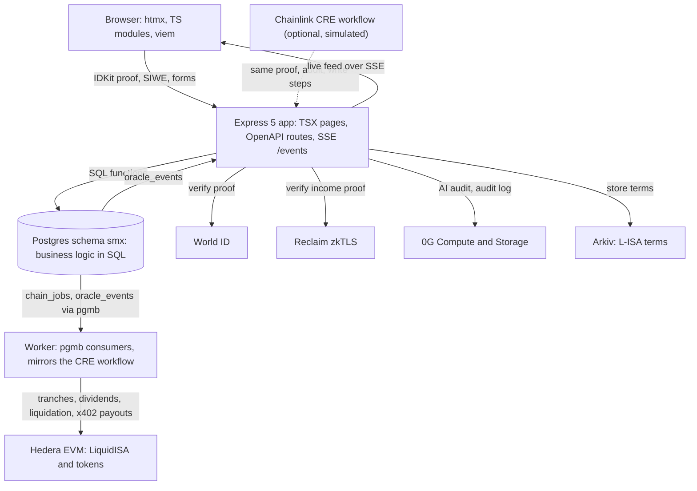

# StakeMe Exchange (SMX)

The world's first liquid stock market for human potential. Built for ETHGlobal
Mumbai.

Creators "IPO" a share of their future income through a liquid income share
agreement (L-ISA): a fixed percentage of income (default 5%) for a fixed term
(default 60 months), with no dollar cap. Investors fund the raise in USDC and
receive creator tokens such as `$RAVI`. Token holders earn dividends from
verified Web2 income and can trade the tokens.

Trust comes from proofs, not promises:

- **World ID** proves the creator is one human, and bans them after a default.
- **Reclaim zkTLS** proves real bank deposits without exposing the account.
- **An AI audit agent** (0G) checks each proof against the terms and computes
  the dividend. Chainlink CRE orchestrates the steps.
- **Escrow tranches** release only when proofs arrive. If proofs stop, the
  creator enters a grace period, then default: refund, slash, blacklist.

The whole demo runs on a laptop with no keys (simulated chain mode).

## Architecture



Every mutation writes final state to Postgres and returns immediately. The
worker sends onchain calls from the `chain_jobs` outbox. With no
`CHAIN_RPC_URL`, jobs end as `SIMULATED`.

## Sponsors

| Sponsor | Role in SMX | Guide |
| --- | --- | --- |
| World ID | Unique-human check at IPO. Nullifier stored and blacklisted on default. | [world-id.md](docs/integrations/world-id.md) |
| Reclaim Protocol | zkTLS proof of a bank deposit (`/mock-bank` shows $5,000). | [reclaim.md](docs/integrations/reclaim.md) |
| Hedera | EVM testnet for `LiquidISA` and tokens. x402 payments for dividends. | [hedera.md](docs/integrations/hedera.md) |
| 0G | AI audit via Compute. Audit logs on Storage. | [zero-g.md](docs/integrations/zero-g.md) |
| Chainlink CRE | Proof, audit, onchain workflow. | [chainlink-cre.md](docs/integrations/chainlink-cre.md) |
| Arkiv | Public record of the L-ISA terms. | [arkiv.md](docs/integrations/arkiv.md), [schema](arkiv/schema.md), [friction log](arkiv/friction.md) |
| Arc | USDC-gas chain option. Gasless via a relayer. | [arc.md](docs/integrations/arc.md) |

## Quick start

Requires Node 24 and Docker.

```bash
cp .development.env .env
docker compose -f dev/docker-compose.yaml up -d
npm install
npm run dev
```

Open <http://localhost:4020>.

Postgres listens on host port 5442. Stop it with `npm run db:down`. To run
against real testnets, fill in the keys listed in
[docs/integrations](docs/integrations/README.md) and set `CHAIN_RPC_URL`.

Common commands:

```bash
npm test          # SQL business functions and contract math
npm run check     # type checks
npm run gen       # regenerate PGTyped and OpenAPI client code
npm run migrate   # apply database migrations
```

## Repo layout

```text
packages/
  app/         @stakeme/app        Backend and server-rendered UI (openapi.yaml, sql/, migrations/)
  client/      @stakeme/client     Typed SDK generated from the OpenAPI spec
  contracts/   @stakeme/contracts  Hardhat 3 + viem: LiquidISA, share token, tests, deploys
arkiv/         schema.md, friction.md (Arkiv prize files)
cre/           Optional Chainlink CRE workflow (not created yet)
dev/           Local Postgres via Docker Compose
docs/          Spec, engineering guide, pitch, contracts, integration guides
scripts/       Repo scripts
CONTEXT.md     Hand-off notes: decisions, status, known issues
```

## Docs

- [CONTEXT.md](CONTEXT.md): status, decisions, known issues
- [Docs index](docs/README.md)
- [Product spec](docs/product-spec.md)
- [Engineering guide](docs/engineering-guide.md)
- [Pitch and demo playbook](docs/pitch.md)
- [Contracts](docs/contracts.md)
- [Integration guides](docs/integrations/README.md)

## License

Hackathon project. No license has been chosen yet.
