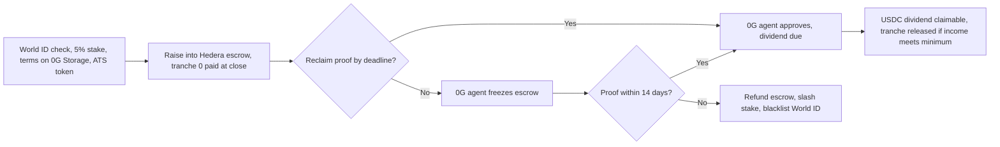
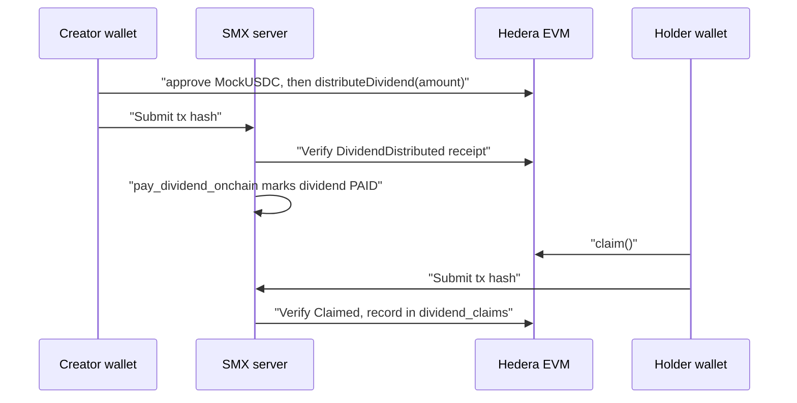
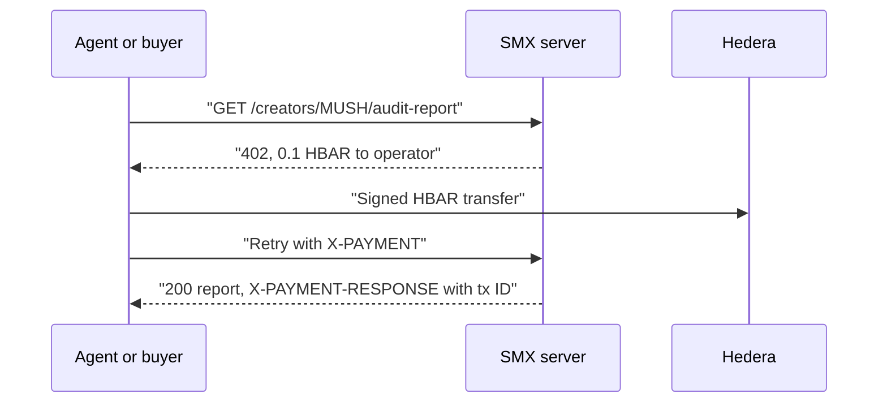
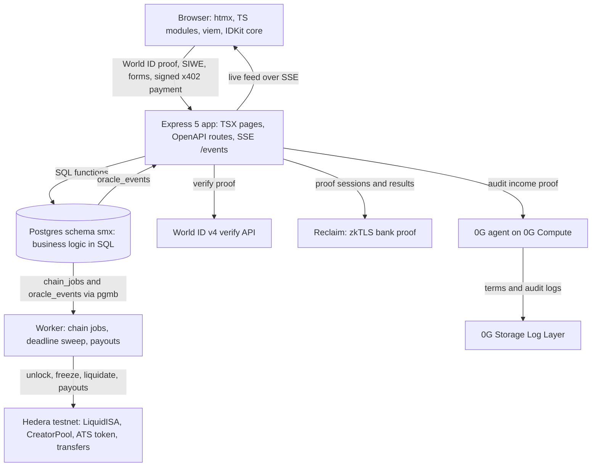

# StakeMe Exchange (SMX)

**Raise human potential. Stake your future.**

SMX is a liquid stock market for human potential. A creator sells a share of
future income, 5% for 5 years by default, to investors who fund the raise in
USDC and receive tradable creator tokens such as `$MUSH`. The creator proves
income with a bank proof, an AI auditor checks that it is genuine and in
period, and holders earn USDC dividends. If the creator stops proving income,
the escrow freezes and investors get refunds.

Live app: <https://stakeme.magnificlabs.org>. It runs on Hedera testnet, World
ID staging and 0G testnet, with a mock bank and MockUSDC.

## How it works

1. **Launch.** The creator verifies as one human with World ID, stakes at
   least 5% of the target raise in USDC, and sets the terms: income share,
   social links, proof cadence and a tranche preset. The terms go to 0G Storage
   and an equity token is minted through Hedera ATS (current `$MUSH` token
   `0xFDC2...4517`).
2. **Fund.** Investors sign `approve` and `LiquidISA.invest` in their own
   wallet. The money sits in a Hedera escrow. The creator picks 2 to 5
   tranches, or "No tranches", which releases everything when the raise closes.
   With tranches, the first one (20% in the default preset) releases at close
   and the rest stay locked.
3. **Prove income.** The creator proves a bank deposit with a Reclaim zkTLS
   proof, without sharing bank credentials. The demo bank is a mock with six
   income scenarios, chosen at login.
4. **Audit.** The auditor agent on 0G Private Computer checks that the proof
   is genuine and in the reporting period. It does not judge size. Any genuine
   in-period proof is approved and creates a dividend of income times share
   ($800 at 5% is $40; $0 means no dividend). The next tranche releases only if
   income meets the creator's minimum (default $1,000); a low month stays
   approved with the tranche locked, with no freeze. Invalid or duplicate
   proofs and out-of-period dates are rejected.
5. **Pay and trade.** For onchain creators, the creator signs a MockUSDC
   `approve` and `LiquidISA.distributeDividend` in their wallet. The server
   verifies the `DividendDistributed` receipt. Holders claim with `claim()` from
   Portfolio, and payouts follow onchain token ownership (the pool is
   excluded). From raise close, holders trade the token in a `CreatorPool` AMM.
6. **Default.** A missed proof deadline or an unpaid dividend freezes the
   escrow. If no approved proof arrives within 14 days, SMX refunds the
   escrow to current token holders, slashes the stake to them, and blacklists
   the creator's World ID. If the creator keeps up, the stake returns at the
   end of the term.



Earlier income-sharing projects used social scores, self-reported numbers or
platform-pulled revenue, and a defaulter could start over with a new wallet.
SMX proves income from a bank session and blacklists the World ID on the
escrow factory, so the same human cannot raise again from any wallet. We found
no earlier project that combines all of these, though our search was not
exhaustive.

## What is real and what is simulated

| Area | Status |
| --- | --- |
| Hedera contracts, invest, trading | Real on testnet (chain 296), verified on Sourcify. Users sign `approve`, `invest` and swaps in their wallet. Production: `$MUSH`, `$RAVI` and `$RAHUL` are onchain; the other 5 seeded creators are DB-only. |
| Dividends | Real USDC for onchain creators: the creator signs `distributeDividend`, holders sign `claim()`. A legacy HBAR multi-transfer rail remains only for DB-only or simulated creators (testnet rate 0.0001 HBAR per USDC). |
| HBAR | Gas, the 0.1 HBAR x402 audit-report fee, and the legacy rail. |
| Hedera ATS equity token | Live ATS tokens mint for new IPOs when `ATS_MODE=live`. Current `$MUSH` token: `0xFDC25E581320050B4013c9054B5Ac44546A04517`, linked to the escrow with `setAtsToken`. |
| World ID | Real v4 proof on a staging app, verified with the Simulator. |
| 0G audit | Real, on 0G Private Computer. If the call fails, the proof stays pending. |
| 0G Storage | Real on Galileo. Uploads run in the background; the ref is `local:<sha256>` until done. |
| Reclaim | The zkTLS proof is real. The end-to-end in-app callback test is pending. |
| Bank | Mock (six income scenarios). |
| USDC | Mock (`MockUSDC`), with a faucet of 1,000 per click and a 50,000 cap. |
| Pool liquidity | Protocol-provided at raise close. |
| Wallets | WalletConnect QR pairing is verified. A full phone-wallet signature is not. |

With no keys, the app runs in simulated chain mode: chain calls end as
`SIMULATED` and `DEMO_MODE=1` accepts fixture proofs.

## Try it

Open <https://stakeme.magnificlabs.org>, or run it locally. You need Node 24.

```bash
nvm use
npm install
cp .development.env .env
npm run seed:demo   # 8 creators, including MUSH, RAVI, and RAHUL
npm run dev         # http://localhost:4020
npm run check       # typecheck and XSS scan
npm test
```

The dev server uses embedded PGlite, so run `seed:demo` before `dev`, not
alongside it. For real Postgres, run `npm run db:up` (host port 5442) and
`npm run db:down` to stop it. `npm run gen` needs `db:up`.

To demo the sad path, liquidate the overdue creator. This needs `DEMO_MODE=1`
and `SMX_ADMIN_KEY` on the server; otherwise it returns `403`.

```bash
curl -X POST localhost:4020/api/trigger-default \
	-H 'Content-Type: application/json' \
	-H "X-Admin-Key: $SMX_ADMIN_KEY" -d '{"ticker":"RAHUL"}'
```

## Payment flows

Dividends and the paywalled audit report use different rails.



- **Dividends (USDC).** Payouts follow onchain token ownership, so tokens moved
  outside SMX still earn. The oracle no longer pays them.
- **x402 audit report (HBAR).** `GET /creators/{ticker}/audit-report` returns
  `402` with a price of 0.1 HBAR. An agent or API buyer signs a Hedera transfer
  to the operator, retries with `X-PAYMENT`, and reads the Hedera transaction ID
  from `X-PAYMENT-RESPONSE`. See [x402-agent.md](docs/x402-agent.md).
- **Legacy HBAR rail.** One multi-transfer pays all holders. Only DB-only or
  simulated creators use it. On mainnet it fails closed without an explicit rate
  or `HEDERA_DIVIDEND_TOKEN_ID`.



## Known gaps

- The contract does not check the dividend amount against `shareBps`, and
  anyone can call `distributeDividend`.
- Trading outside SMX cannot be frozen.
- The oracle key still signs lifecycle calls.
- MockUSDC, the mock bank, protocol-seeded pool liquidity and World ID staging
  with the Simulator are not production.
- Platform revenue today is x402 fees only. Listing, dividend and swap fees are
  proposed, not built.

## Learn more

- [Product spec](docs/product-spec.md): what SMX does, data model, routes
- [User flows](docs/user-flows.md): diagrams of the creator and investor journeys, income proof, default and dividend payment
- [Pitch and demo playbook](docs/pitch.md)
- [Engineering guide](docs/engineering-guide.md), [backend](docs/backend.md), [contracts](docs/contracts.md)
- [Integration guides](docs/integrations/README.md): Hedera, World ID, 0G, Reclaim
- [Docs index](docs/README.md), [prize checklist](docs/prize-checklist.md)
- [CONTEXT.md](CONTEXT.md): current status and what is left

## Reference

### Sponsor integrations

| Sponsor | What SMX uses | Guide |
| --- | --- | --- |
| Hedera | `LiquidISA` escrow, `CreatorPool` AMM and factory on Hedera EVM testnet (chain 296). Equity token minted through the public ATS testnet Factory (`ATS_MODE=live`). USDC dividends and claims. Safe-stop escrow freeze. HBAR for gas and x402 fees. | [hedera.md](docs/integrations/hedera.md), [contracts.md](docs/contracts.md) |
| World ID | v4 proof of human at IPO. Server signs the request (`POST /api/rp-signature`) and verifies the proof. Nullifier stored in Postgres and on the factory. | [world-id.md](docs/integrations/world-id.md) |
| 0G | Auditor agent on 0G Private Computer (Router); request ID, model and provider shown per proof. Without it, no proof is approved. Rules engine only behind `ZG_ALLOW_RULES_FALLBACK=1`. Terms and every audit log go to 0G Storage through a background outbox. Triggers the safe-stop freeze. | [zero-g.md](docs/integrations/zero-g.md) |

Reclaim Protocol supplies the zkTLS bank proof that the 0G agent audits. The
demo proves a deposit on a mock bank (`/mock-bank`, six income scenarios) with a provider
built in the Reclaim developer tools. See [reclaim.md](docs/integrations/reclaim.md).

Most integrations have a demo fallback, so the app runs end to end with no keys:
chain calls end as `SIMULATED`, and `DEMO_MODE=1` accepts fixture proofs.

Chainlink CRE, Arkiv, and Arc were dropped from scope. Their notes are no
longer in this repo.


### Live evidence

Links checked on 2026-11-07.

| Area | Evidence |
| --- | --- |
| App and code | Live app: [stakeme.magnificlabs.org](https://stakeme.magnificlabs.org). Repo: [predatorx7/stakeme-ex](https://github.com/predatorx7/stakeme-ex). |
| Hedera contracts | Verified on Sourcify (exact match): LiquidISAFactory [`0xc6b7af9392538bc596caed4a5758b9d92f650e59`](https://hashscan.io/testnet/contract/0xc6b7af9392538bc596caed4a5758b9d92f650e59), MockUSDC [`0x40027d9375311fa44b95ef881a92374b1dbf8ec4`](https://hashscan.io/testnet/contract/0x40027d9375311fa44b95ef881a92374b1dbf8ec4), LiquidISA implementation [`0x3f61050ad9fb221992742f10b34237b06a97e361`](https://hashscan.io/testnet/contract/0x3f61050ad9fb221992742f10b34237b06a97e361), CreatorShareToken implementation [`0x81521abe9ddc7dc792b4c6f4262a48bc744426ff`](https://hashscan.io/testnet/contract/0x81521abe9ddc7dc792b4c6f4262a48bc744426ff), CreatorPool implementation [`0xe310d76b357be72439e78fff84a82fe486fba84b`](https://hashscan.io/testnet/contract/0xe310d76b357be72439e78fff84a82fe486fba84b). Details in [contracts.md](docs/contracts.md#verification). |
| Hedera ATS | Live ATS tokens, minted through the public ATS testnet Factory for each new IPO when `ATS_MODE=live`. Current `$MUSH`: [`0xFDC25E581320050B4013c9054B5Ac44546A04517`](https://hashscan.io/testnet/contract/0xFDC25E581320050B4013c9054B5Ac44546A04517), linked to the MUSH escrow with `setAtsToken` (tx `0xd0a23a99...cb6e974`). The first live mint, [`0xe3abC950d9daf866653931a314FF3F19E5276AFb`](https://hashscan.io/testnet/contract/0xe3abC950d9daf866653931a314FF3F19E5276AFb) (0.0.11345067), also exists. `deployEquity` tx [`0x02f86bdb...c063df8`](https://hashscan.io/testnet/transaction/0x02f86bdb93777d03b4868e09d0f67789c4bf892c84e0f4f939803d909c063df8), `mint` tx [`0x734d4aa3...cd1c77fdf`](https://hashscan.io/testnet/transaction/0x734d4aa32ce0efce009b9c705ccbad57005fd7243f864eabf19ea50cd1c77fdf). Details in [hedera.md](docs/integrations/hedera.md#live-result-on-testnet). |
| Hedera dividend (legacy HBAR rail) | Earlier live holder dividend, one HBAR multi-transfer: [`0.0.11340822@1793996054.174485762`](https://hashscan.io/testnet/transaction/0.0.11340822@1793996054.174485762). Dividends for onchain creators are now USDC claims, shown in the contract links above. |
| Hedera x402 | `GET /creators/{ticker}/audit-report` answers 402 until paid in HBAR. Settled payments: [`0.0.9185802@1793985016.835902874`](https://hashscan.io/testnet/transaction/0.0.9185802@1793985016.835902874) (first), [`0.0.9185802@1793992761.545261642`](https://hashscan.io/testnet/transaction/0.0.9185802@1793992761.545261642), [`0.0.9185802@1793992766.013363358`](https://hashscan.io/testnet/transaction/0.0.9185802@1793992766.013363358), [`0.0.9185802@1793992768.127890663`](https://hashscan.io/testnet/transaction/0.0.9185802@1793992768.127890663). Run log in [x402-agent.md](docs/x402-agent.md). |
| World ID | App `app_0b5a20d804cb26e5008896d976fc4193` (staging, World ID Simulator). Server verifies with the v4 verify route. Walkthrough: [world-id-debrief.md](docs/world-id-debrief.md). |
| 0G | Private Computer request ID `3a1c2f3b-6177-4ab8-aa52-c1b5ff80dc8c`, model `0gm-1.0-35b-a3b`. 0G Storage root [`0xaf42ce4081e282b15c052880ad6ab351a3a2d4d2b8bc63d15dff91929b9bb394`](https://indexer-storage-testnet-turbo.0g.ai/file/info/0xaf42ce4081e282b15c052880ad6ab351a3a2d4d2b8bc63d15dff91929b9bb394) (finalized). |
| Reclaim | Provider ID `3fefebae-05cb-4d6b-b319-f3f639a31201`, v0.1.2, run against the production mock bank. |
| Simulated or mock | MockUSDC stands in for Circle USDC. The bank is a mock (the zkTLS proof is real). Pool liquidity is protocol-provided. World ID runs on staging with the Simulator. |

### Architecture



The app follows the [Reclaim Builder](https://github.com/reclaimprotocol/builder)
architecture: one `openapi.yaml` drives routes and the typed client, business
rules live in SQL functions, and pages are server-rendered TSX with htmx and
[`@reclaimprotocol/design`](https://github.com/reclaimprotocol/reclaim-design).
Each mutation commits its final state to Postgres and returns at once
(optimistic UI). The worker sends the onchain calls from a `chain_jobs` outbox
and confirms them over SSE.

[docs/reuse.md](docs/reuse.md) lists what the app reuses from Reclaim Builder and other libraries, and what is new.

Sponsors plug in through small adapters, so the app logic never imports an SDK
directly:

| Interface | Default implementation | Fallback |
| --- | --- | --- |
| `IStorageProvider` | `ZeroGravityStorage` (0G Storage) | Local content hash |
| `IOracle` | `ZeroGravityAgent` (fetches and verifies Reclaim proofs, audits on 0G Compute) | Rules engine with fixture proofs |
| `IPaymentRail` (in `PaymentService`) | Hedera rail (x402 fees, legacy HBAR dividends) | Simulated receipts |

### Connect real testnets

Copy the values you have into `.env`. Anything you leave unset falls back to
demo mode.

| Sponsor | Variables |
| --- | --- |
| Hedera | `CHAIN_RPC_URL` (Hashio), `ORACLE_PRIVATE_KEY`, `FACTORY_ADDRESS`, `USDC_ADDRESS`, `HEDERA_OPERATOR_ID`, `HEDERA_OPERATOR_KEY`, `HEDERA_DIVIDEND_TOKEN_ID` (optional HTS token for the legacy rail; HBAR otherwise) |
| Hedera ATS | `ATS_MODE=live` (signs with the operator key). `ATS_FACTORY_ADDRESS` and `ATS_RESOLVER_ADDRESS` default to the public testnet deployment. |
| World ID | `WORLD_APP_ID`, `WORLD_RP_ID`, `WORLD_RP_SIGNING_KEY`, `WORLD_ACTION`, `WORLD_ENV` (`staging` for the Simulator) |
| 0G | `ZG_PRIVATE_KEY`, `ZG_RPC_URL`, `ZG_INDEXER_URL`, `STORAGE_PROVIDER` (`0g` or `local`), `ZG_STORAGE_MIN_BALANCE`; for Compute (opt-in) also `ZG_COMPUTE_ENABLED`, `ZG_PROVIDER_ADDRESS`, `ZG_LEDGER_DEPOSIT` |
| Reclaim | `RECLAIM_ORG_SECRET`, `RECLAIM_PROVIDER_ID` |
| WalletConnect | `WALLETCONNECT_PROJECT_ID` (public; from [dashboard.walletconnect.com](https://dashboard.walletconnect.com), allow your origin) |

The guides in [docs/integrations](docs/integrations/README.md) list every
variable and how to get it. Deploy the contracts with
`npm run deploy:hedera -w packages/contracts`. It deploys the implementations
and the clone factory, and writes the addresses to
`packages/contracts/deployments/hedera-testnet.json`.

### Commands

| Command | Does |
| --- | --- |
| `npm run dev` | Dev server with Vite and PGlite on port 4020 |
| `npm run seed:demo` | Seed the demo creators |
| `npm test` | SQL business logic, integration helpers, contract tests |
| `npm run check` | Type checks and the XSS scan |
| `npm run lint:fix` | ESLint from the root |
| `npm run gen` | Regenerate PGTyped queries and the OpenAPI client |
| `npm run gen:check` | Fail when generated files are stale |
| `npm run migrate:plan` | Generate a migration from `sql/ddl.sql` |

### Repo layout

```text
packages/
  app/         @stakeme/app        Backend and UI: openapi.yaml, sql/, migrations/, src/services (adapters)
  client/      @stakeme/client     Typed SDK generated from openapi.yaml
  contracts/   @stakeme/contracts  Hardhat 3 + viem: LiquidISA, factory, tests, Ignition deploys
dev/           Local Postgres with Docker Compose (host port 5442)
docs/          Spec, guides, and integration docs
scripts/       Repo scripts
CONTEXT.md     Hand-off notes: status, decisions, known issues
```

## AI use

The developer built SMX alone with Claude Code, an AI coding agent that the developer directed. Agents wrote most of the code, tests, and docs. The developer set the product direction and scope, and reviewed the results. The full disclosure is in [docs/ai-usage.md](docs/ai-usage.md) and the prompt records are in [docs/prompts/README.md](docs/prompts/README.md). The agents followed [docs/engineering-guide.md](docs/engineering-guide.md) and [docs/product-spec.md](docs/product-spec.md).

## Team

Solo builder: Mushaheed Syed ([@_predatorx7](https://x.com/_predatorx7) on X,
[@mushaheedx](https://t.me/mushaheedx) on Telegram,
[predatorx7](https://github.com/predatorx7) on GitHub).

## Status

Hackathon build in progress. [CONTEXT.md](CONTEXT.md) lists what works,
what's simulated, and what's left.

## License

MIT. See [LICENSE](LICENSE).
