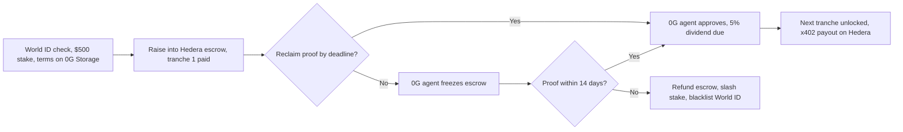
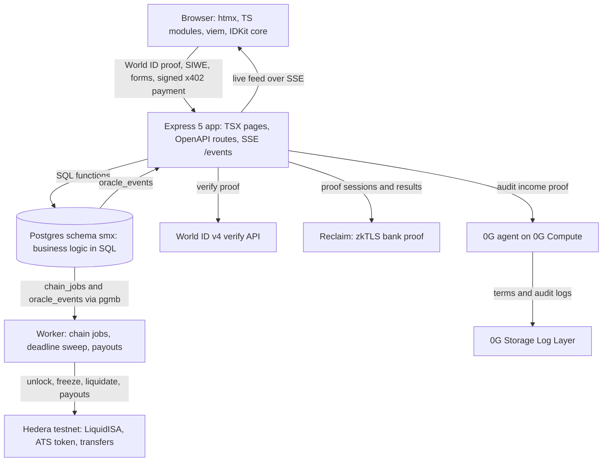

# StakeMe Exchange (SMX)

A liquid stock market for human potential. Built for ETHGlobal Mumbai on
**Hedera**, **World ID**, and **0G**.

Creators IPO a share of their future income through a liquid income share
agreement (L-ISA): a fixed percentage of income (default 5%) for a fixed term
(default 5 years), with no dollar cap. Investors fund the raise in USDC and get
creator tokens such as `$MUSH`. Holders earn dividends from verified Web2
income, and can trade the tokens on creator news.

## How it works

1. **Prove you're one human.** The creator verifies with World ID v4. SMX
   stores the nullifier, so one person can't IPO twice, and a defaulter is
   banned for good.
2. **IPO on Hedera.** The creator stakes $500 USDC as collateral. SMX deploys a
   `LiquidISA` escrow on Hedera and mints the creator's equity token on the
   Hedera Asset Tokenization Studio (ATS) contracts. The L-ISA terms go to
   0G Storage.
3. **Raise into escrow.** Investors fund the raise. The creator gets tranche 1
   (20%); the rest stays locked in escrow.
4. **Prove income.** The creator proves a bank deposit with a Reclaim zkTLS
   proof, without sharing bank credentials.
5. **AI audit on 0G.** The auditor agent runs on 0G Compute. It checks the proof
   against the terms, approves or denies it, and logs the decision to 0G
   Storage. Approval releases the next tranche and creates a 5% dividend.
6. **Pay holders with x402.** SMX returns x402 payment requirements, one per
   holder. The creator signs one Hedera multi-transfer that pays every holder
   their share, and the server settles it on Hedera.
7. **Safe-stop and liquidation.** If a proof deadline passes, the 0G agent
   freezes the Hedera escrow. After a 14-day grace period, SMX liquidates:
   escrow refunded, stake slashed to holders, World ID nullifier blacklisted.



## Sponsors

| Sponsor | What SMX uses | Guide |
| --- | --- | --- |
| Hedera | `LiquidISA` escrow and factory on Hedera EVM testnet (chain 296). Creator equity token on the Asset Tokenization Studio (ATS) contracts. x402 dividend payouts with native Hedera transfers. Safe-stop escrow freeze. | [hedera.md](docs/integrations/hedera.md), [contracts.md](docs/contracts.md) |
| World ID | v4 proof of human at IPO. The server signs the RP request (`POST /api/rp-signature`) and verifies with the v4 verify API. Nullifier stored in Postgres and on the factory contract. | [world-id.md](docs/integrations/world-id.md) |
| 0G | Auditor agent on 0G Compute. L-ISA terms and every approve or deny log on the 0G Storage Log Layer. Triggers the safe-stop freeze. | [zero-g.md](docs/integrations/zero-g.md) |

Reclaim Protocol supplies the zkTLS bank proof that the 0G agent audits. The
demo proves a $5,000 deposit on a mock bank (`/mock-bank`) with a provider
built in the Reclaim developer tools. See [reclaim.md](docs/integrations/reclaim.md).

Every integration has a demo fallback, so the app runs end to end with no keys:
chain calls end as `SIMULATED`, and `DEMO_MODE=1` accepts fixture proofs.

## Architecture



The app follows the [Reclaim Builder](https://github.com/reclaimprotocol/builder)
architecture: one `openapi.yaml` drives routes and the typed client, business
rules live in SQL functions, and pages are server-rendered TSX with htmx and
[`@reclaimprotocol/design`](https://github.com/reclaimprotocol/reclaim-design).
Each mutation commits its final state to Postgres and returns at once
(optimistic UI). The worker sends the onchain calls from a `chain_jobs` outbox
and confirms them over SSE.

Sponsors plug in through small adapters, so the app logic never imports an SDK
directly:

| Interface | Default implementation | Fallback |
| --- | --- | --- |
| `IStorageProvider` | `ZeroGravityStorage` (0G Storage) | Local content hash |
| `IOracle` | `ZeroGravityAgent` (fetches and verifies Reclaim proofs, audits on 0G Compute) | Rules engine with fixture proofs |
| `IPaymentRail` (in `PaymentService`) | Hedera rail (native transfers, x402) | Simulated receipts |

## Quick start

You need Node 24. Docker is optional.

```bash
nvm use
npm install
cp .development.env .env
npm run seed:demo   # creators MUSH, RAVI, and RAHUL
npm run dev
```

Open <http://localhost:4020>. The dev server uses an embedded PGlite database
in `pg_dev_data/`, so run `seed:demo` before `dev`, not alongside it.

To demo the sad path, liquidate the overdue creator:

```bash
curl -X POST localhost:4020/api/trigger-default \
	-H 'Content-Type: application/json' -d '{"ticker":"RAHUL"}'
```

To use real Postgres (with `pg_cron`), run `npm run db:up` (host port 5442) and
stop it with `npm run db:down`.

### Connect real testnets

Copy the values you have into `.env`. Anything you leave unset falls back to
demo mode.

| Sponsor | Variables |
| --- | --- |
| Hedera | `CHAIN_RPC_URL` (Hashio), `ORACLE_PRIVATE_KEY`, `FACTORY_ADDRESS`, `USDC_ADDRESS`, `HEDERA_OPERATOR_ID`, `HEDERA_OPERATOR_KEY`, `HEDERA_DIVIDEND_TOKEN_ID` (optional HTS token; HBAR otherwise) |
| Hedera ATS | `ATS_ENABLED=1`, `ATS_FACTORY_ADDRESS`, `ATS_RESOLVER_ADDRESS` (you deploy the ATS factory and resolver yourself) |
| World ID | `WORLD_APP_ID`, `WORLD_RP_ID`, `WORLD_RP_SIGNING_KEY`, `WORLD_ACTION`, `WORLD_ENV` (`staging` for the Simulator) |
| 0G | `ZG_PRIVATE_KEY`, `ZG_RPC_URL`, `ZG_INDEXER_URL`, `ZG_PROVIDER_ADDRESS`, `ZG_LEDGER_DEPOSIT` |
| Reclaim | `RECLAIM_ORG_SECRET`, `RECLAIM_PROVIDER_ID` |
| WalletConnect | `WALLETCONNECT_PROJECT_ID` (public; from [dashboard.walletconnect.com](https://dashboard.walletconnect.com), allow your origin) |

The guides in [docs/integrations](docs/integrations/README.md) list every
variable and how to get it. Deploy the contracts with
`npm run deploy:hedera -w packages/contracts`.

## Commands

| Command | Does |
| --- | --- |
| `npm run dev` | Dev server with Vite and PGlite on port 4020 |
| `npm run seed:demo` | Seed the demo creators |
| `npm test` | SQL business logic, integration helpers, and contract tests |
| `npm run check` | Type checks and the XSS scan |
| `npm run lint:fix` | ESLint from the root |
| `npm run gen` | Regenerate PGTyped queries and the OpenAPI client |
| `npm run migrate:plan` | Generate a migration from `sql/ddl.sql` |

## Repo layout

```text
packages/
  app/         @stakeme/app        Backend and UI: openapi.yaml, sql/, migrations/, src/services (adapters)
  client/      @stakeme/client     Typed SDK generated from openapi.yaml
  contracts/   @stakeme/contracts  Hardhat 3 + viem: LiquidISA, factory, tests, Ignition deploys
dev/           Local Postgres with Docker Compose (host port 5442)
docs/          Spec, guides, and integration docs
scripts/       Repo scripts
CONTEXT.md     Hand-off notes: status, decisions, known issues
```

## Docs

- [Docs index](docs/README.md)
- [Product spec](docs/product-spec.md)
- [Backend](docs/backend.md) and [contracts](docs/contracts.md)
- [Pitch and demo playbook](docs/pitch.md)
- [CONTEXT.md](CONTEXT.md): current status and what's left

## Status

Hackathon build in progress. See [CONTEXT.md](CONTEXT.md) for what works
today, what's simulated, and what's left.
