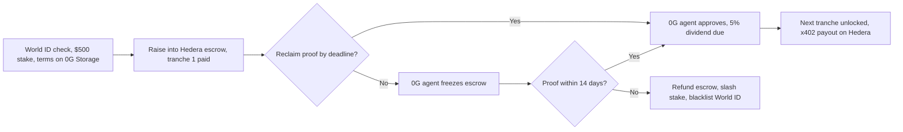
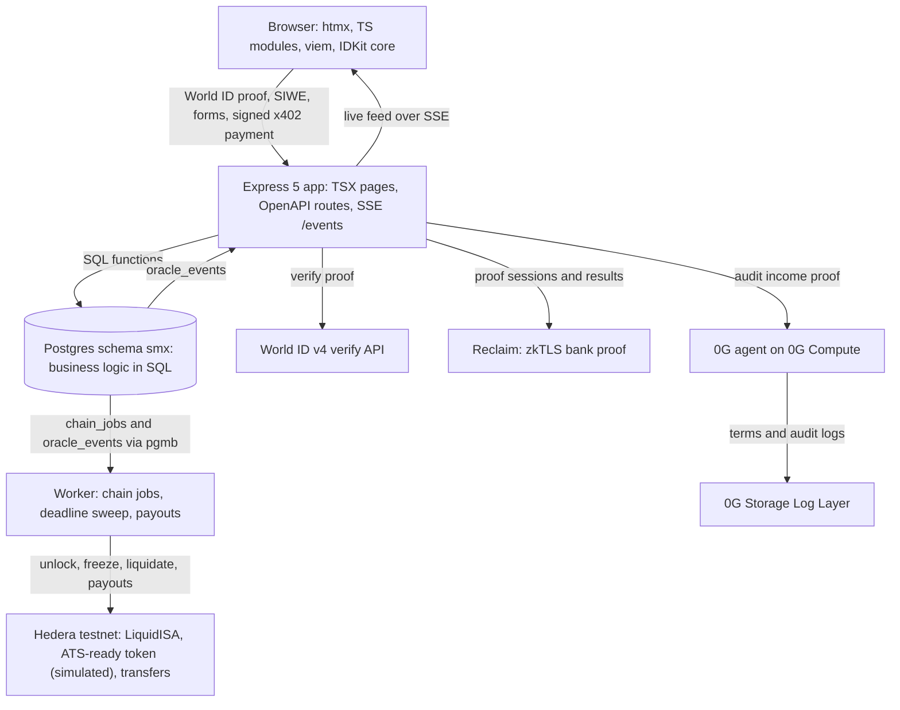

# StakeMe Exchange (SMX)

A liquid stock market for human potential. Built for ETHGlobal Mumbai on
**Hedera**, **World ID**, and **0G**.

Creators IPO a share of their future income through a liquid income share
agreement (L-ISA): a fixed percentage of income (default 5%) for a fixed term
(default 5 years), with no dollar cap. Investors fund the raise in USDC and get
creator tokens such as `$MUSH`. Holders earn dividends from verified Web2
income, and can trade the tokens on creator news.

## How it works

1. **Connect a wallet and prove you're one human.** You connect with
   WalletConnect (1inch Wallet featured), or generate or import a key. The
   creator then verifies with World ID v4: the server signs the request and
   checks the proof (`/api/world-id/check`). SMX stores the nullifier, so one person can't IPO twice, and a defaulter is
   banned for good.
2. **IPO on Hedera.** The creator stakes $500 USDC as collateral. SMX deploys a
   `LiquidISA` escrow on Hedera. The creator's equity token is ATS-ready
   (Hedera Asset Tokenization Studio integration built; minting runs in
   simulated mode on testnet). The L-ISA terms go to
   0G Storage.
3. **Raise into escrow.** Investors fund the raise. The creator gets tranche 1
   (20%); the rest stays locked in escrow.
4. **Prove income.** The creator proves a bank deposit with a Reclaim zkTLS
   proof, without sharing bank credentials.
5. **AI audit on 0G.** The auditor agent checks the proof against the terms and
   approves or denies it. It runs on 0G Private Computer (the 0G Router) and shows the model, request ID
   and TEE status on each proof. Each decision is logged to 0G Storage
   in the background. Approval releases the next tranche and creates a 5%
   dividend.
6. **Pay holders with x402.** SMX returns x402 payment requirements, one per
   holder. The creator signs one Hedera multi-transfer that pays every holder
   their share, and the server settles it on Hedera.
7. **Safe-stop and liquidation.** If a proof deadline passes, the 0G agent
   freezes the Hedera escrow. After a 14-day grace period, SMX liquidates:
   escrow refunded, stake slashed to holders, World ID nullifier blacklisted.



## How SMX differs

Earlier projects that touched income sharing used social scores, self-reported numbers or platform-pulled API revenue, and a defaulter could start over with a new wallet. SMX proves income from a bank session with Reclaim zkTLS, lets an AI auditor on 0G freeze the Hedera escrow, and releases investor money in tranches. A default blacklists the World ID on the escrow factory, so the same human cannot raise again from any wallet. The closest precedent for the ban is "not so secret agent" (ETHGlobal London, 2024), which blocked a banned oracle node's World ID. We found no earlier project that combines all of these, though our search was not exhaustive.

## Sponsors

| Sponsor | What SMX uses | Guide |
| --- | --- | --- |
| Hedera | `LiquidISA` escrow and factory on Hedera EVM testnet (chain 296). Creator equity token is ATS-ready (Asset Tokenization Studio integration built; minting runs in simulated mode on testnet). x402 dividend payouts with native Hedera transfers. Safe-stop escrow freeze. | [hedera.md](docs/integrations/hedera.md), [contracts.md](docs/contracts.md) |
| World ID | v4 proof of human at IPO. The server signs the RP request (`POST /api/rp-signature`) and verifies with the v4 verify API. Nullifier stored in Postgres and on the factory contract. | [world-id.md](docs/integrations/world-id.md) |
| 0G | Auditor agent on 0G Private Computer (Router): every income proof is audited there, with the request ID, model, provider and TEE status logged and shown. Without 0G Private Computer, no AI auditor signs off on the income proof, so no tranche is released and no dividend is created. The rules engine runs only behind `ZG_ALLOW_RULES_FALLBACK=1` (offline dev). L-ISA terms and every approve or deny log on 0G Storage, uploaded in the background by an outbox worker. Triggers the safe-stop freeze. | [zero-g.md](docs/integrations/zero-g.md) |

Reclaim Protocol supplies the zkTLS bank proof that the 0G agent audits. The
demo proves a $5,000 deposit on a mock bank (`/mock-bank`) with a provider
built in the Reclaim developer tools. See [reclaim.md](docs/integrations/reclaim.md).

Every integration has a demo fallback, so the app runs end to end with no keys:
chain calls end as `SIMULATED`, and `DEMO_MODE=1` accepts fixture proofs.

Chainlink CRE, Arkiv, and Arc were dropped from scope. Their notes are in
[docs/deprecated](docs/deprecated/README.md).

## Live evidence

Every link below was checked on 2026-11-07.

| Area | Evidence |
| --- | --- |
| App and code | Live app: [stakeme.magnificlabs.org](https://stakeme.magnificlabs.org). Repo: [predatorx7/stakeme-ex](https://github.com/predatorx7/stakeme-ex). |
| Hedera contracts | Four contracts verified on Sourcify (exact match, read by HashScan): MockUSDC [`0x1352D7F21514d6c68f8B901E7cC2AE3f1A78618f`](https://hashscan.io/testnet/contract/0x1352D7F21514d6c68f8B901E7cC2AE3f1A78618f), LiquidISA implementation [`0xb2a511d967202950e3b259c7420de1a7729a2f15`](https://hashscan.io/testnet/contract/0xb2a511d967202950e3b259c7420de1a7729a2f15), CreatorShareToken implementation [`0x8e483e26b05ee86f414a4f502457ee8fa3f05071`](https://hashscan.io/testnet/contract/0x8e483e26b05ee86f414a4f502457ee8fa3f05071), LiquidISAFactory [`0xbbc4d97315cd6e3f809d39ec4d0b2638894bc07e`](https://hashscan.io/testnet/contract/0xbbc4d97315cd6e3f809d39ec4d0b2638894bc07e). Details in [contracts.md](docs/contracts.md#verification). |
| Hedera x402 | `GET /creators/{ticker}/audit-report` answers 402 until paid in HBAR. Settled testnet payments: [`0.0.9185802@1793985016.835902874`](https://hashscan.io/testnet/transaction/0.0.9185802@1793985016.835902874) (first), [`0.0.9185802@1793992761.545261642`](https://hashscan.io/testnet/transaction/0.0.9185802@1793992761.545261642), [`0.0.9185802@1793992766.013363358`](https://hashscan.io/testnet/transaction/0.0.9185802@1793992766.013363358), [`0.0.9185802@1793992768.127890663`](https://hashscan.io/testnet/transaction/0.0.9185802@1793992768.127890663). Run log in [x402-agent.md](docs/x402-agent.md). |
| World ID | App `app_0b5a20d804cb26e5008896d976fc4193` (staging, verified with the World ID Simulator). The server verifies each proof with the v4 route `POST https://developer.world.org/api/v4/verify/{rp_id}`. Walkthrough: [world-id-debrief.md](docs/world-id-debrief.md). |
| 0G | Private Computer request ID `3a1c2f3b-6177-4ab8-aa52-c1b5ff80dc8c`, model `0gm-1.0-35b-a3b`. 0G Storage root [`0xaf42ce4081e282b15c052880ad6ab351a3a2d4d2b8bc63d15dff91929b9bb394`](https://indexer-storage-testnet-turbo.0g.ai/file/info/0xaf42ce4081e282b15c052880ad6ab351a3a2d4d2b8bc63d15dff91929b9bb394) (finalized). Without 0G Private Computer, no AI auditor signs off on the income proof, so no tranche is released and no dividend is created. |
| Reclaim | Provider ID `3fefebae-05cb-4d6b-b319-f3f639a31201`, v0.1.2, run against the production mock bank. |
| Simulated | ATS equity token minting is simulated. Trading runs on a simulated pool with virtual liquidity. The bank is a mock showing a fixed $5,000 deposit. World ID runs on staging. |

## What is live and what is simulated

| Area | Status |
| --- | --- |
| Hedera testnet (chain 296) | Live. `LiquidISAFactory` (EIP-1167 clones) and `MockUSDC` are deployed; addresses are in `packages/contracts/deployments/hedera-testnet.json`. A redeploy replaces the factory address, so read it from that file. |
| World ID v4 | Live on a staging app. Verified end to end with the World ID Simulator. |
| 0G Storage | Live on the Galileo testnet. Uploads take about 30 seconds, so a worker runs them in the background. The ref starts as `local:<sha256>` and becomes the 0G root hash. |
| 0G Private Computer | Live through the 0G Router (`ZG_ROUTER_API_KEY`, prepaid credit). If the call fails the proof stays PENDING with "0G audit unavailable, retry". 0G Compute via the SDK broker stays off by default (`ZG_COMPUTE_ENABLED`; needs a 3 0G ledger deposit). |
| Reclaim | The provider is live, but the mock bank runs behind a temporary tunnel and an end-to-end callback test is pending. |
| Wallets | WalletConnect QR pairing is verified in Chrome. A full signature from a phone wallet is not. |
| Hedera ATS equity token | ATS-ready: integration built; minting runs in simulated mode on testnet. The code is written but never ran against a live ATS deployment. |
| x402 dividend payout | Simulated unless you set the Hedera operator keys. The live settlement is unrun. |
| Mock bank | A stand-in for a real bank. It shows a hardcoded $5,000 deposit. |
| Trading | The AMM is simulated in SQL. Its liquidity is virtual and not backed by investor funds. |

## Architecture



The app follows the [Reclaim Builder](https://github.com/reclaimprotocol/builder)
architecture: one `openapi.yaml` drives routes and the typed client, business
rules live in SQL functions, and pages are server-rendered TSX with htmx and
[`@reclaimprotocol/design`](https://github.com/reclaimprotocol/reclaim-design).
Each mutation commits its final state to Postgres and returns at once
(optimistic UI). The worker sends the onchain calls from a `chain_jobs` outbox
and confirms them over SSE.

What is reused from Reclaim Builder and other libraries, and what is new, is listed in [docs/reuse.md](docs/reuse.md).

Sponsors plug in through small adapters, so the app logic never imports an SDK
directly:

| Interface | Default implementation | Fallback |
| --- | --- | --- |
| `IStorageProvider` | `ZeroGravityStorage` (0G Storage) | Local content hash |
| `IOracle` | `ZeroGravityAgent` (fetches and verifies Reclaim proofs, audits on 0G Compute) | Rules engine with fixture proofs |
| `IPaymentRail` (in `PaymentService`) | Hedera rail (native transfers, x402) | Simulated receipts |

## Quick start

You need Node 24. Docker is optional.

```bash
nvm use
npm install
cp .development.env .env
npm run seed:demo   # creators MUSH, RAVI, and RAHUL
npm run dev
```

Open <http://localhost:4020>. The dev server uses an embedded PGlite database
in `pg_dev_data/`, so run `seed:demo` before `dev`, not alongside it.

To demo the sad path, liquidate the overdue creator:

```bash
curl -X POST localhost:4020/api/trigger-default \
	-H 'Content-Type: application/json' \
	-H "X-Admin-Key: $SMX_ADMIN_KEY" -d '{"ticker":"RAHUL"}'
```

Requires `DEMO_MODE=1` and `SMX_ADMIN_KEY` set on the server; otherwise it returns `403`.

To use real Postgres (with `pg_cron`), run `npm run db:up` (host port 5442) and
stop it with `npm run db:down`.

### Connect real testnets

Copy the values you have into `.env`. Anything you leave unset falls back to
demo mode.

| Sponsor | Variables |
| --- | --- |
| Hedera | `CHAIN_RPC_URL` (Hashio), `ORACLE_PRIVATE_KEY`, `FACTORY_ADDRESS`, `USDC_ADDRESS`, `HEDERA_OPERATOR_ID`, `HEDERA_OPERATOR_KEY`, `HEDERA_DIVIDEND_TOKEN_ID` (optional HTS token; HBAR otherwise) |
| Hedera ATS | `ATS_ENABLED=1`, `ATS_FACTORY_ADDRESS`, `ATS_RESOLVER_ADDRESS` (you deploy the ATS factory and resolver yourself) |
| World ID | `WORLD_APP_ID`, `WORLD_RP_ID`, `WORLD_RP_SIGNING_KEY`, `WORLD_ACTION`, `WORLD_ENV` (`staging` for the Simulator) |
| 0G | `ZG_PRIVATE_KEY`, `ZG_RPC_URL`, `ZG_INDEXER_URL`, `STORAGE_PROVIDER` (`0g` or `local`), `ZG_STORAGE_MIN_BALANCE`; for Compute (opt-in) also `ZG_COMPUTE_ENABLED`, `ZG_PROVIDER_ADDRESS`, `ZG_LEDGER_DEPOSIT` |
| Reclaim | `RECLAIM_ORG_SECRET`, `RECLAIM_PROVIDER_ID` |
| WalletConnect | `WALLETCONNECT_PROJECT_ID` (public; from [dashboard.walletconnect.com](https://dashboard.walletconnect.com), allow your origin) |

The guides in [docs/integrations](docs/integrations/README.md) list every
variable and how to get it. Deploy the contracts with
`npm run deploy:hedera -w packages/contracts`. It deploys the implementations
and the clone factory, and writes the addresses to
`packages/contracts/deployments/hedera-testnet.json`.

## Commands

| Command | Does |
| --- | --- |
| `npm run dev` | Dev server with Vite and PGlite on port 4020 |
| `npm run seed:demo` | Seed the demo creators |
| `npm test` | SQL business logic, integration helpers, and contract tests |
| `npm run check` | Type checks and the XSS scan |
| `npm run lint:fix` | ESLint from the root |
| `npm run gen` | Regenerate PGTyped queries and the OpenAPI client |
| `npm run migrate:plan` | Generate a migration from `sql/ddl.sql` |

## Repo layout

```text
packages/
  app/         @stakeme/app        Backend and UI: openapi.yaml, sql/, migrations/, src/services (adapters)
  client/      @stakeme/client     Typed SDK generated from openapi.yaml
  contracts/   @stakeme/contracts  Hardhat 3 + viem: LiquidISA, factory, tests, Ignition deploys
dev/           Local Postgres with Docker Compose (host port 5442)
docs/          Spec, guides, and integration docs
scripts/       Repo scripts
CONTEXT.md     Hand-off notes: status, decisions, known issues
```

## Docs

- [Docs index](docs/README.md)
- [Product spec](docs/product-spec.md)
- [Backend](docs/backend.md) and [contracts](docs/contracts.md)
- [Pitch and demo playbook](docs/pitch.md)
- [CONTEXT.md](CONTEXT.md): current status and what's left

## AI use

The developer built SMX alone with Claude Code, an AI coding agent that the developer directed. Agents wrote most of the code, tests, and docs; the developer set the product direction and scope, and reviewed the results. For the full disclosure, see [docs/ai-usage.md](docs/ai-usage.md). For the prompt records, see [docs/prompts/README.md](docs/prompts/README.md). The specs the agents followed are [docs/engineering-guide.md](docs/engineering-guide.md) and [docs/product-spec.md](docs/product-spec.md).

## Team

Solo builder: Mushaheed Syed ([@_predatorx7](https://x.com/_predatorx7) on X,
[@mushaheedx](https://t.me/mushaheedx) on Telegram,
[predatorx7](https://github.com/predatorx7) on GitHub).

## Status

Hackathon build in progress. See [CONTEXT.md](CONTEXT.md) for what works
today, what's simulated, and what's left.

## License

MIT. See [LICENSE](LICENSE).
