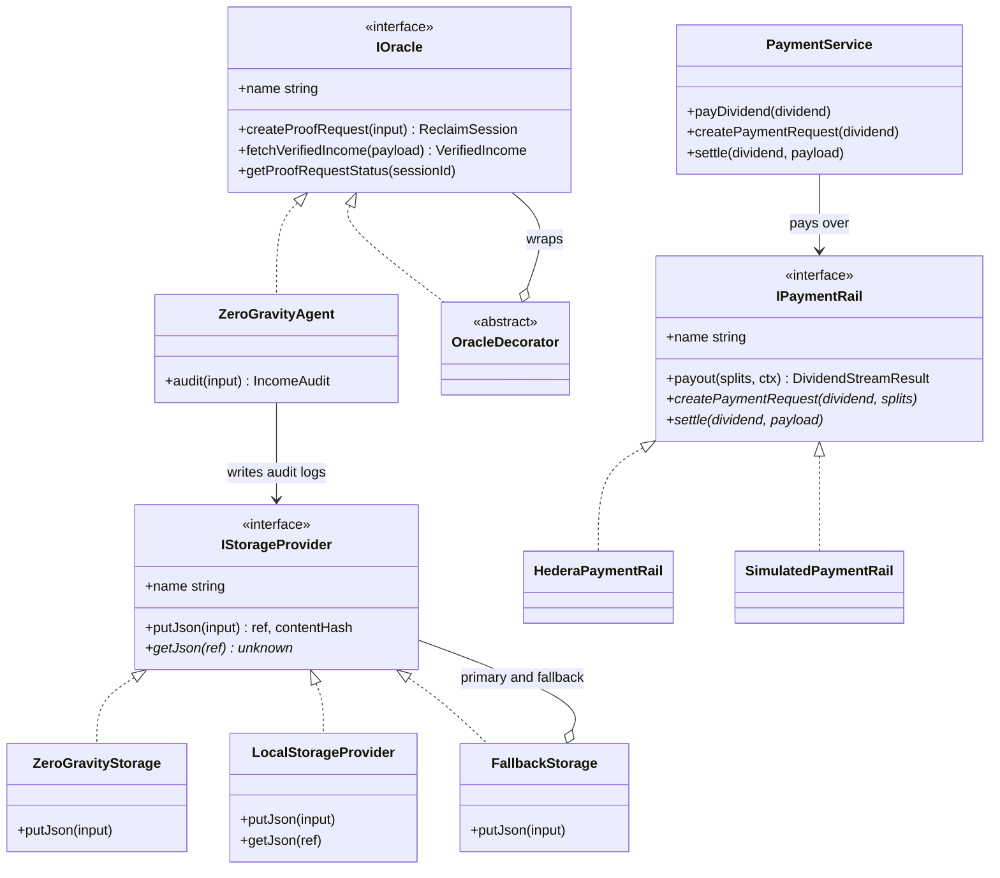
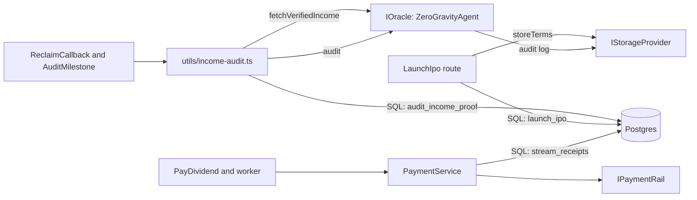
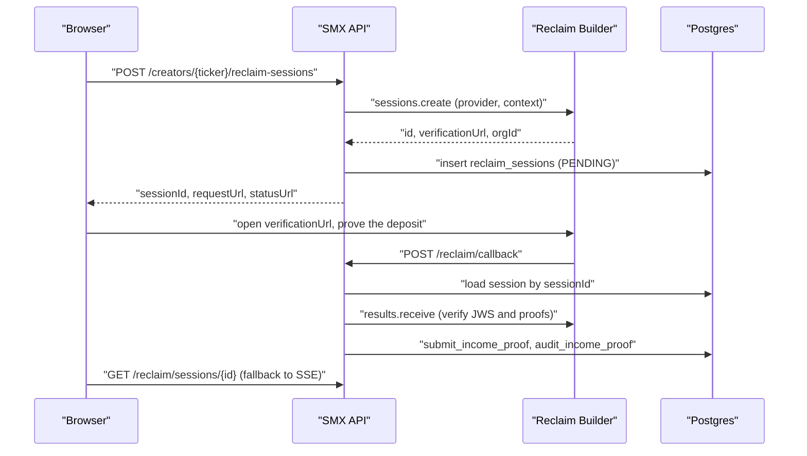

# Adapter architecture

Routes and workers depend on three small interfaces. Sponsor SDKs live behind
them in `packages/app/src/services/`. A new backend (another storage network,
oracle, or payment rail) is one class plus one line in a factory; no route,
worker, or SQL changes.

`*` marks optional members.

## Defaults and switches

| Interface | Factory | Default | Switch |
| --- | --- | --- | --- |
| `IStorageProvider` | `createStorageProvider()` in `services/storage/index.ts` | `ZeroGravityStorage` wrapped in `FallbackStorage` | `STORAGE_PROVIDER=0g\|local`. Without `ZG_PRIVATE_KEY` the factory returns `LocalStorageProvider` (`local:<sha256>` refs). |
| `IOracle` | `createOracle()` in `services/oracle/index.ts` | `ZeroGravityAgent` | Wrap it in an `OracleDecorator` subclass in the factory. |
| `IPaymentRail` | `createPaymentService(pg)` in `services/payment/index.ts` | `HederaPaymentRail` (simulated without keys) | Return another rail from `createPaymentRail()`. |

## Where each piece is used

- `LaunchIpo` writes the L-ISA legal terms (share bps, term, raise, stake,
  tranches, hashed nullifier) with `storeTerms(createStorageProvider(), ...)`.
  The ref lands in `creators.terms_ref`.
- The income pipeline asks the oracle for `VerifiedIncome`, then
  `ZeroGravityAgent.audit()` runs the model on 0G Compute and writes the
  approve or deny log. The ref lands in `income_proofs.audit_log_ref`. SQL
  decides the outcome.
- `PaymentService` never computes amounts. Splits come from SQL
  (`dividend_splits_json`, `pro_rata_split`) and are checked to add up. It
  records the receipts through SQL.

## Add a new implementation

1. Implement the interface in `services/<area>/`.
2. Return it from the factory (and add an env switch if it should be
   selectable).
3. Keep SDK imports inside the class so nothing else depends on them.

## Reclaim flow

Environment: `RECLAIM_ORG_SECRET`, `RECLAIM_PROVIDER_ID`, and optionally
`RECLAIM_ORG_ETH_PRIVATE_KEY` (only when the org encrypts results). A
`ResultVerificationError` with `retryable` set returns `503` so Reclaim
retries; every other outcome returns `200`.
