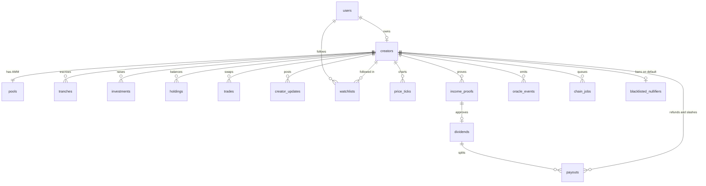
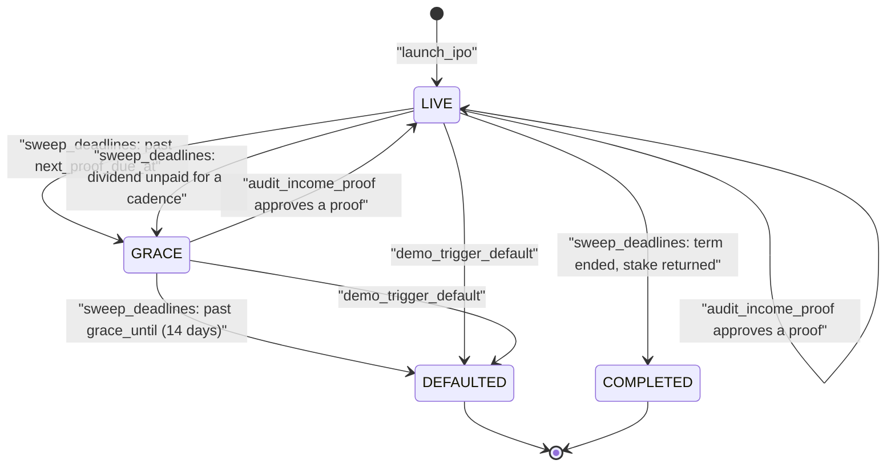
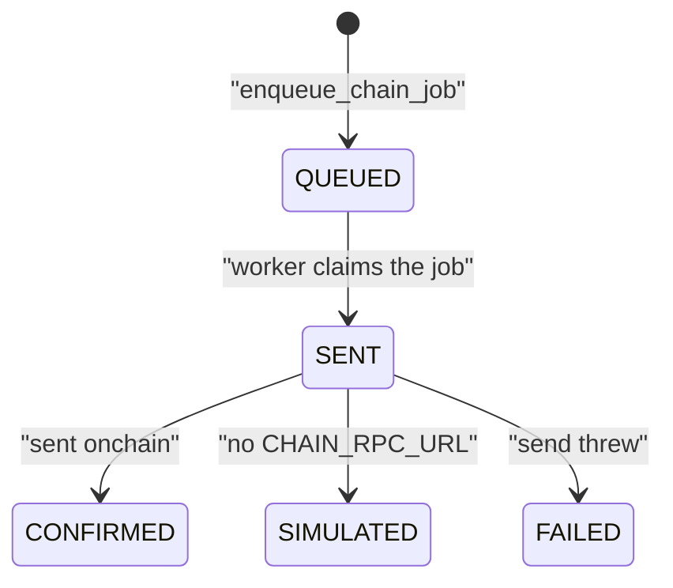
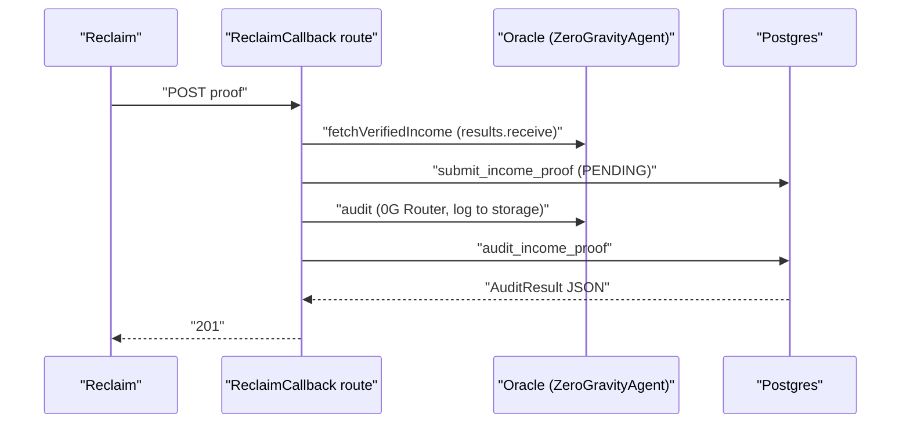

# Backend

This guide describes the SMX backend domain: the data model, the state machine,
the SQL functions that hold the business rules, the routes, the worker, and the
demo seed. The spec is [`product-spec.md`](product-spec.md); code style is in
[`engineering-guide.md`](engineering-guide.md).

## Design

All business rules live in Postgres functions in
`packages/app/sql/ddl.sql`. A route verifies external proofs (World ID,
Reclaim), calls one SQL statement, and returns the JSON the SQL built. Every
mutation commits its final state at once and queues the onchain call in
`chain_jobs`. A worker sends the call later, and the UI learns about it over
SSE. This is the optimistic UI described in the spec.

## Data model

| Table | Purpose |
| --- | --- |
| `creators` | One L-ISA per user. Holds terms, status, deadlines, proof cadence, social links, `pool_address`, `raise_closed_at`, and the World ID nullifier (unique). |
| `tranches` | Escrow schedule (default 20/40/40 of the target; presets of 1 to 5; `single` is one tranche of 10000 bps, so the full raise releases at close). Tranche 0 releases at raise close, and the amounts resize to the amount raised. |
| `investments`, `holdings` | Primary purchases and derived token balances. Supply = holdings + pool tokens. |
| `pools`, `trades`, `price_ticks` | Constant-product pool reserves, its fills (unique per `tx_hash`), and the chart history. With an onchain `CreatorPool`, the chain is the truth and SQL indexes the `Swap` events; otherwise the SQL AMM moves the reserves. |
| `creator_updates` | Creator posts to holders, at most 5 per day. |
| `watchlists` | Creators a user follows. |
| `income_proofs`, `dividends` | Reclaim proofs per period, and the 5% dividend each approval creates. |
| `payouts` | Per-holder money movements: `DIVIDEND`, `REFUND`, `SLASH`. Onchain dividends write none, because holders claim USDC from the ISA. |
| `dividend_claims` | One row per verified `Claimed` transaction (creator, wallet, unique `tx_hash`, USDC amount). |
| `oracle_events` | The live feed. Insert triggers publish each row to pgmb. |
| `chain_jobs` | Outbox of onchain calls. |
| `blacklisted_nullifiers` | World IDs banned after a default. |
| `storage_uploads` | Outbox of 0G Storage uploads (`QUEUED`, `UPLOADED`, `FAILED`, `SKIPPED`). |

Money is `money_amount` (6 decimals), tokens are `token_amount` (18 decimals),
and the API sends both as decimal strings.

## State machine

`DRAFT` exists in the enum for future use; `launch_ipo` creates creators
directly as `LIVE`. Trading and investing are rejected once a creator is
`DEFAULTED`. After the term ends (`COMPLETED`), the token is sell only.

A chain job moves through its own states:

## SQL functions

| Function | What it does |
| --- | --- |
| `launch_ipo(...)` | Asserts the nullifier is free, one IPO per user, ticker unique, and the stake is at least 5% of the target raise (`400` otherwise). Takes social links, a tranche preset (1 to 5 entries summing to 10000 bps; `single` is "No tranches") and a proof cadence. Creates the creator, locked tranches, the pool row (price 1.0), the IPO event, and `createISA` and `initializeIPO` jobs. |
| `record_investment(creator, wallet, usdc)` | SQL path (simulated chain mode or no pool). Mints tokens 1:1, caps at the remaining raise, updates holdings, emits `INVESTED`, queues `invest`. A fill calls `finish_raise`. |
| `finish_raise(creator)`, `close_raise(creator, user)` | Close the raise (full, or early by the owner): resize tranches to the amount raised, release tranche 0, start the term clock and the first proof deadline. `close_raise` queues `closeRaise`. |
| `amm_swap(creator, wallet, side, amount_in, min_out)` | SQL AMM for creators without an onchain pool. Constant product with a 0.3% fee that stays in the pool. Rejects slippage, oversells, non-trading creators, and buys after the term ends. Emits `TRADE`. |
| `ingest_onchain_swap(...)`, `ingest_onchain_invest(...)` | Record a user-signed pool swap or `invest` from the verified receipt's event amounts (base units). Idempotent on `tx_hash`. Queue no chain job, because the user already sent the transaction. `ingest_onchain_invest` also stores the pool reserves from the `Seeded` event when the raise closes. |
| `post_creator_update(...)` | Owner-only post, limited to 5 per day. Emits `CREATOR_UPDATE`. |
| `submit_income_proof(...)` | Stores a verified Reclaim proof as `PENDING`. Rejects a replayed proof id. |
| `audit_income_proof(proof, amount, audit)` | Rules engine. Approves when the period is not yet approved and the auditor did not veto (any amount, including $0). Approval creates the dividend (none for $0), releases the next tranche only when the amount meets `min_income` (otherwise it stays locked and `PROOF_VERIFIED` carries a note) (a single-tranche creator has none left to release), moves the deadline by one cadence (30 days monthly, 90 quarterly), clears grace, and emits events and jobs. Otherwise it records `REJECTED`: an invalid or not-genuine proof, a duplicate period, or a deposit outside the reporting period (the route's pre-check denies that one before any 0G call). A low month, such as $800, is approved with a $40 dividend at 5% and no freeze. |
| `pay_dividend(dividend, tx_hash, user)` | Legacy HBAR rail for DB-only creators. Marks paid, splits pro rata by holdings into `payouts`, emits `DIVIDEND_PAID`, queues `distributeDividend`. |
| `pay_dividend_onchain(dividend, tx_hash, holders, user)` | Onchain creators. Runs `pay_dividend` checks, refuses a `tx_hash` that already paid another dividend (`409`), settles the queued oracle `distributeDividend` job with the creator's hash so the oracle doesn't pay twice, drops the HBAR `payouts`, and sets `stream_receipts` to `ONCHAIN` so the stream worker skips it. |
| `ingest_dividend_claim(creator, wallet, tx_hash, amount)` | Records a verified `Claimed` event (base units). Idempotent on `tx_hash`; the same hash for another wallet or creator returns `409`. |
| `sweep_deadlines(now)` | The transitions in the state machine. A missed proof deadline, or a dividend unpaid for a full cadence, freezes the escrow and starts grace. A creator past the term end becomes `COMPLETED` and the stake returns (`STAKE_RETURNED`, `reclaimStake`). Uses `FOR UPDATE SKIP LOCKED`, so overlapping sweeps are safe. |
| `liquidate_creator(creator)` | Refunds locked escrow pro rata to the current holders (by holdings), slashes the stake pro rata to the same holders, blacklists the nullifier, emits `DEFAULTED`, queues `executeLiquidation`. |
| `enqueue_storage_upload(...)`, `claim_storage_upload(id)`, `complete_storage_upload(...)` | Queue a document for 0G Storage (deduplicated on content hash), lease one for the worker, and settle it: swap the root hash into the ref and emit `STORAGE_CONFIRMED`. |
| `complete_chain_job(...)` | Settles a job and copies the result onto the creator, tranche, dividend, or investment. |
| `emit_oracle_event(...)` | Inserts the event and one price tick. Every event and tick pair comes from here. |
| `pro_rata_split(...)` | Splits an amount so the parts sum exactly. The rounding remainder goes to the largest position. |
| `oracle_events_since(since, creator, limit)` | SSE replay: the newest `limit` events after the `seq` cursor, oldest first. |
| `*_json(...)`, `exchange_json`, `creator_page_json`, `creator_hub_json` | Build the API documents. They match the `openapi.yaml` schemas. `exchange_json` also returns `totals` (`totalRaised`, `activeCreators`, `dividendsPaid`, `holders`), computed across all creators. |

Errors use `assert_that` with an HTTP status in the SQLSTATE (`H0409`). The
JSON builders are `VOLATILE` on purpose: a `STABLE` function would not see rows
written earlier in the same statement.

## Routes

| Operation | Method and path | Auth | Notes |
| --- | --- | --- | --- |
| `GetExchange` | `GET /` | public | `totals`, trending creators, and events. |
| `GetCreator` | `GET /creators/{ticker}` | public | Instrument view document, including `market` (quote, depth, stats, fundamentals, position, corporate actions). See [`instrument-view.md`](instrument-view.md). |
| `GetCreatorCandles`, `GetCreatorChartFragment` | `GET /creators/{ticker}/candles`, `/chart` | public | Candles and the chart region. |
| `GetCreatorChain` | `GET /creators/{ticker}/chain` | public | How the browser trades this creator: `live` with the ISA, token and pool addresses and the public RPC, or the SQL path. |
| `ListCreatorHolders`, `ListCreatorProofs`, `ListCreatorTrades`, `ListCreatorDividends`, `ListCreatorUpdates`, `ListCreators`, `ListActivity` | `GET` list endpoints | public | Keyset-paged lists. |
| `CreateCreatorUpdate` | `POST /creators/{ticker}/updates` | session, owner | `post_creator_update`; 5 per day. |
| `GetPortfolio` | `GET /portfolio` | session | Wallet funds, holdings with P&L, transactions, dividends received (`wallet_portfolio_json`, `wallet_transactions_json`). |
| `RequestTestUsdc` | `POST /portfolio/faucet` | session | Mints 1,000 MockUSDC through `MockUSDC.faucet`. One request per wallet per minute; live chain mode only. |
| `GetWatchlist`, `PutWatchlistItem`, `DeleteWatchlistItem` | `GET /watchlist`, `PUT`, `DELETE /watchlist/{ticker}` | session | The viewer's watchlist. |
| `GetCreatorAuditReport` | `GET /creators/{ticker}/audit-report` | public, x402 | Answers `402` until paid in HBAR. |
| `GetZeroGBalance` | `GET /api/zero-g/balance` | public | The 0G Router credit that pays for audits, read with the server-side management key (cached about 30 seconds). |
| `GetCreatorHub` | `GET /hub` | session | The viewer's dashboard. |
| `GetLaunch` | `GET /launch` | session | Form state and World ID config. |
| `CreateRpSignature` | `POST /api/rp-signature` | session | Signs the World ID 4.0 request on the server (signal = session wallet). |
| `CheckWorldId` | `POST /api/world-id/check` | session | Verifies a World ID proof and rejects a used (409) or blacklisted (403) nullifier, so the launch form stops a Sybil before submit. Read-only: it never blacklists. The demo "Simulate Sybil" fixture maps to MUSH's nullifier, so it always returns 409. |
| `LaunchIpo` | `POST /creators` | session | Verifies World ID, builds the terms document and hash, calls `launch_ipo` (the 0G upload is queued, not awaited). The launch form's terms calculator (`utils/terms-suggest.ts`, pure and shared with tests) only suggests a share, term, tranche preset and stake from income and goal. It respects the 5% minimum stake, and the creator can edit every value. |
| `Invest` | `POST /creators/{ticker}/investments` | session | With an onchain pool, takes the `txHash` of the user-signed `invest`, verifies the receipt (`verifyUserTx`, `decodeInvestReceipt`), then `ingest_onchain_invest`. Otherwise `record_investment`. |
| `CloseRaise` | `POST /creators/{ticker}/close-raise` | session, owner | `close_raise`. |
| `Trade` | `POST /creators/{ticker}/trades` | session | With an onchain pool, takes the `txHash` of the user-signed swap, verifies the receipt (`decodeSwapReceipt`), then `ingest_onchain_swap`. Otherwise `amm_swap`. |
| `CreateReclaimSession` | `POST /creators/{ticker}/reclaim-sessions` | session, owner | `sessions.create`; stores the session row. |
| `GetReclaimSessionStatus` | `GET /reclaim/sessions/{sessionId}` | session, owner | Polling fallback for SSE; asks Reclaim while pending. |
| `ReclaimCallback` | `POST /reclaim/callback` | public, result verified | `results.receive`, then the `AuditMilestone` pipeline. `503` only when a retry can succeed. |
| `AuditMilestone` | `POST /api/audit-milestone` | public, proof verified | Verify, audit, apply. A demo fixture (`demo: true`) needs `DEMO_MODE=1`, the signed-in creator owner, and at most 3 per creator per hour (`DEMO_PROOFS_PER_HOUR`). A pre-check denies a deposit dated outside the reporting period before any 0G call. |
| `TriggerDefault` | `POST /api/trigger-default` | public, `DEMO_MODE=1` and `X-Admin-Key` = `SMX_ADMIN_KEY` | `403` otherwise. |
| `CreateDividendPaymentRequest` | `POST /dividends/{dividendId}/payment-request` | session, owner | HBAR rail for DB-only creators: x402 payment requirements from `PaymentService`. Splits come from SQL. HBAR amounts use `DIVIDEND_HBAR_PER_USDC`. |
| `PayDividend` | `POST /dividends/{dividendId}/payment` | session, owner | Onchain creators send `txHash` of their own `distributeDividend` call. The server verifies the receipt (sender is the viewer's wallet, target is the ISA, `DividendDistributed` amount equals the dividend due) and calls `pay_dividend_onchain`. DB-only creators use the legacy path: optional `paymentPayload` is settled live on Hedera first, then `pay_dividend`. In production there is no simulated fallback. |
| `CreateDividendClaim` | `POST /portfolio/claims` | session | The holder signed `LiquidISA.claim()`. The server verifies the receipt (`Claimed` for the viewer's wallet) and calls `ingest_dividend_claim`. Idempotent by `txHash`. |
| `StreamEvents` | `GET /events` | public | SSE with `Last-Event-ID` replay. |
| `GetMockBankLogin`, `MockBankLogin` | `GET`, `POST /mock-bank/login` | public | Fake bank login with an income scenario picker; sets the `smx_bank_session` cookie. |
| `GetMockBank` | `GET /mock-bank` | cookie | Statement page; redirects to login without the cookie. |
| `GetMockBankTransactions` | `GET /mock-bank/api/transactions` | cookie | The auth-bound request Reclaim proves (`401` without the cookie). |

Mutations return `201` and the resource to JSON callers, and `204` with
`HX-Trigger` (and `HX-Redirect` for `LaunchIpo`) to htmx callers.

### Event stream

`GET /events` sends three SSE event names. `oracle-event` carries the HTML
fragment rendered by `components/events/OracleEventItem.tsx` (for htmx
`sse-swap`), `oracle-event-json` carries the JSON, and `chain-job` announces a
settled onchain call. Pass `?ticker=` to filter.

Both oracle messages carry `id:` set to the event's `seq`, a
`BIGINT GENERATED ALWAYS AS IDENTITY` column on `oracle_events`. `chain-job`
messages carry no `id`, so they never move the browser's cursor. On connect,
the `Last-Event-ID` header (or `?since=`, which wins) replays missed oracle
events before live ones. The SQL function `oracle_events_since(since, creator,
limit)` returns the newest 50 after the cursor, oldest first; if more were
missed, the oldest are dropped, so reload the page for a full refresh. The
route registers the live subscription first and skips live events at or below
the last replayed `seq`, so nothing is sent twice. A `Last-Event-ID` that isn't
a number is ignored.

## Worker

`worker/register.ts` starts four things. Every sponsor call goes through the
adapters in `src/services/` (see [architecture-adapters.md](architecture-adapters.md)):

- **Chain jobs** (`worker/chain-jobs.ts`). Woken by the pgmb topic
  `smx.chain_jobs.insert`, with a drain at boot and a 15-second poll as a safety
  net. Each job is claimed (`QUEUED` to `SENT`), sent with `sendChainJob`, and
  settled by `complete_chain_job`. A failure marks the job `FAILED`; the worker
  never retries a sent job, to avoid sending a transaction twice. The one
  exception is a relay error that never reached the chain, including
  `FAIL_INVALID` (Hedera mirror-node lag right after a deployment), which
  `RequeueFailedChainJobs` puts back in the queue.
- **0G Storage uploads** (`worker/storage-uploads.ts`). Each upload takes about
  30 seconds, so no request waits for it. `launch_ipo` and `audit_income_proof`
  commit with `terms_ref` or `audit_log_ref` set to `local:<sha256>` and queue
  the document in `storage_uploads` (`enqueue_storage_upload`). The creator and
  proof JSON then carry `termsStorage` or `auditLogStorage` = `PENDING`. The
  worker (woken by `smx.storage_uploads.insert`, plus the 15-second poll)
  claims one row at a time (`claim_storage_upload`), uploads it, and calls
  `complete_storage_upload`, which swaps the 0G root hash into the ref and emits
  `STORAGE_CONFIRMED` (payload `kind`, `ref`, `contentHash`, `url` to
  storagescan) so the page reloads over SSE. Rules:
  - A content hash that is already `UPLOADED` is never uploaded again; the new
    row is completed from the stored ref.
  - No `ZG_PRIVATE_KEY`, `STORAGE_PROVIDER=local`, or a balance below
    `ZG_STORAGE_MIN_BALANCE` marks the row `SKIPPED`. The local ref stays and
    nothing is an error.
  - A failure retries with backoff (30 seconds, then 2 minutes), 3 attempts in
    all, then `FAILED`. The local ref still proves the document.
  - Chain jobs never wait for storage; `createISA` carries the local `termsRef`.
- **Dividend payout** (`worker/dividends.ts`). A pgmb handler on
  `smx.oracle_events.insert` runs `PaymentService.payDividend` for each
  `DIVIDEND_PAID` event and stores the receipts on the dividend. This is the
  legacy HBAR rail for DB-only creators. It skips onchain dividends (the
  creator paid USDC; holders claim) and dividends the creator already settled
  through the x402 loop. With live Hedera
  keys it pays from the operator's own HBAR only when
  `HEDERA_OPERATOR_PAYOUT=1`. It retries with backoff.
- **Deadline sweep** (`worker/sweep.ts`). One in-process timer calls
  `sweep_deadlines()` every `SWEEP_INTERVAL_S` seconds (default 60, `0` disables
  it). The timer serves PGlite, which has no `pg_cron`, and real Postgres alike.

## Demo seed

`npm run seed:demo` creates eight creators through the SQL functions. Each
one closes its raise through `close_raise`, so tranche 0 is released and the
pool is open.

| Ticker | State |
| --- | --- |
| `MUSH` | Mushaheed, software developer. Live, four investors, 14 trades spread over 7 days, one approved proof, one paid dividend. |
| `RAVI` | Medical student. Live with two investors and no proofs, for the live happy path. |
| `RAHUL` | Live and overdue, ready for `POST /api/trigger-default`. |
| `PRIYA`, `KART`, `ANANYA`, `ROHAN`, `TIFFIN` | Filler creators with four to six holders each; `KART` and `ROHAN` have one approved proof. |

The script uses the PGlite dev database by default and `--pg` for Docker
Postgres. PGlite allows one process, so seed before `npm run dev`, or stop the
server first. The script is idempotent, and `npm run dev -- --clear` resets the
database. The deadline sweep may move `RAHUL` to `GRACE` within a minute; the
trigger works from either state.

## Tests

`packages/app/tests/domain.test.ts` runs against a PGlite snapshot and covers
the dividend math, tranche release and duplicate periods, AMM invariants and
guards, liquidation payouts and the blacklist, and the deadline sweep.
`tests/onchain.test.ts` covers the onchain swap and invest ingest (idempotency,
replayed hashes, receipt decoding).

## Safe-stop fallback

`sweep_deadlines` moves a creator from `LIVE` to `GRACE` and calls
`freeze_escrow`: it emits `ESCROW_FROZEN` and queues a `freezeEscrow` chain job.
A late proof approved inside `GRACE` emits `ESCROW_UNFROZEN` and queues
`unfreezeEscrow` (before the next tranche unlock). Liquidation still follows
when the grace period ends.

## Reclaim sessions

`reclaim_sessions` has one row per verification session: `status`
(`PENDING`, `SUCCESS`, `REJECTED`, `ERROR`, `CANCELLED`, `EXPIRED`),
`failure_reason`, `org_id` and `proof_id`. `finish_reclaim_session` moves a
pending session exactly once. `income_proofs.reclaim_session_id` links the
proof back. The callback looks the session up by the envelope's `sessionId`
and verifies the signed result against the stored session id and org id, not
against the body.
