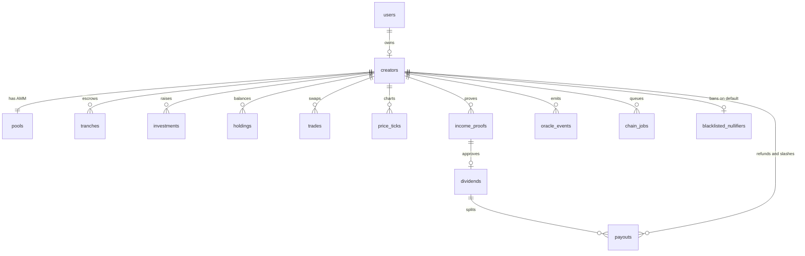
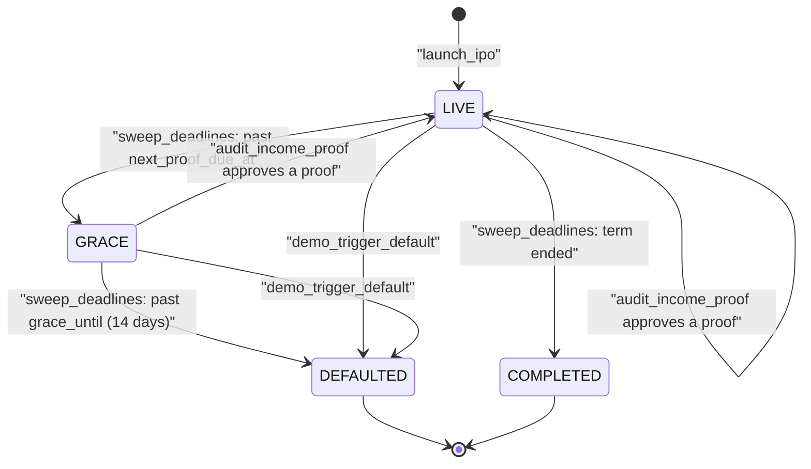
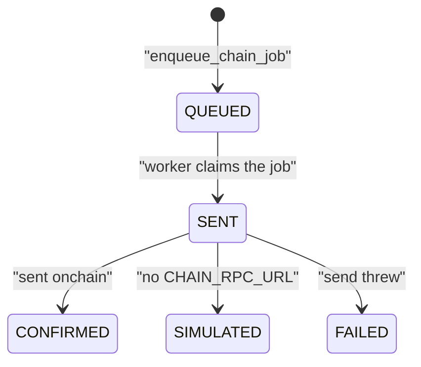

# Backend

This guide describes the SMX backend domain: the data model, the state machine,
the SQL functions that hold the business rules, the routes, the worker, and the
demo seed. The spec is [`product-spec.md`](product-spec.md); code style is in
[`engineering-guide.md`](engineering-guide.md).

## Design in one paragraph

All business rules live in Postgres functions in
`packages/app/sql/ddl.sql`. A route verifies external proofs (World ID,
Reclaim), calls one SQL statement, and returns the JSON the SQL built. Every
mutation commits its final state at once and queues the onchain call in
`chain_jobs`. A worker sends the call later, and the UI learns about it over
SSE. This is the optimistic UI described in the spec.

## Data model

| Table | Purpose |
| --- | --- |
| `creators` | One L-ISA per user. Holds terms, status, deadlines, and the World ID nullifier (unique). |
| `tranches` | Escrow schedule (default 20/40/40 of the target). Tranche 0 releases at IPO. |
| `investments`, `holdings` | Primary purchases and derived token balances. |
| `pools`, `trades`, `price_ticks` | Simulated constant-product AMM, its fills, and the chart history. |
| `income_proofs`, `dividends` | Reclaim proofs per period, and the 5% dividend each approval creates. |
| `payouts` | Per-holder money movements: `DIVIDEND`, `REFUND`, `SLASH`. |
| `oracle_events` | The live feed. Insert triggers publish each row to pgmb. |
| `chain_jobs` | Outbox of onchain calls. |
| `blacklisted_nullifiers` | World IDs banned after a default. |
| `storage_uploads` | Outbox of 0G Storage uploads (`QUEUED`, `UPLOADED`, `FAILED`, `SKIPPED`). |

Money is `money_amount` (6 decimals), tokens are `token_amount` (18 decimals),
and the API sends both as decimal strings.

## State machine

`DRAFT` exists in the enum for future use; `launch_ipo` creates creators
directly as `LIVE`. Trading and investing are rejected once a creator is
`DEFAULTED`.

A chain job moves through its own states:

## SQL functions

| Function | What it does |
| --- | --- |
| `launch_ipo(...)` | Asserts the nullifier is free, one IPO per user, ticker unique. Creates the creator, tranches, pool (virtual liquidity, price 1.0), IPO event, and `createISA` and `initializeIPO` jobs. |
| `record_investment(creator, wallet, usdc)` | Mints tokens 1:1, caps at the remaining raise, updates holdings, emits `INVESTED`, queues `invest`. |
| `amm_swap(creator, wallet, side, amount_in, min_out)` | Constant product with a 0.3% fee that stays in the pool. Rejects slippage, oversells, and non-trading creators. Emits `TRADE`. |
| `submit_income_proof(...)` | Stores a verified Reclaim proof as `PENDING`. Rejects a replayed proof id. |
| `audit_income_proof(proof, amount, audit)` | Rules engine. Approves when the amount meets `min_income`, the period is not yet approved, and the auditor did not veto. Approval creates the dividend, releases the next tranche, moves the deadline 30 days, clears grace, and emits events and jobs. Otherwise it records `REJECTED`. |
| `pay_dividend(dividend, tx_hash, user)` | Marks paid, splits pro rata by holdings into `payouts`, emits `DIVIDEND_PAID`, queues `distributeDividend`. |
| `sweep_deadlines(now)` | The transitions in the state machine. Uses `FOR UPDATE SKIP LOCKED`, so overlapping sweeps are safe. |
| `liquidate_creator(creator)` | Refunds locked escrow pro rata to investors, slashes the stake pro rata to holders, blacklists the nullifier, emits `DEFAULTED`, queues `executeLiquidation`. |
| `enqueue_storage_upload(...)`, `claim_storage_upload(id)`, `complete_storage_upload(...)` | Queue a document for 0G Storage (deduplicated on content hash), lease one for the worker, and settle it: swap the root hash into the ref and emit `STORAGE_CONFIRMED`. |
| `complete_chain_job(...)` | Settles a job and copies the result onto the creator, tranche, dividend, or investment. |
| `emit_oracle_event(...)` | Inserts the event and one price tick. Every event and tick pair comes from here. |
| `pro_rata_split(...)` | Splits an amount so the parts sum exactly. The rounding remainder goes to the largest position. |
| `*_json(...)`, `exchange_json`, `creator_page_json`, `creator_hub_json` | Build the API documents. They match the `openapi.yaml` schemas. |

Errors use `assert_that` with an HTTP status in the SQLSTATE (`H0409`). The
JSON builders are `VOLATILE` on purpose: a `STABLE` function would not see rows
written earlier in the same statement.

## Routes

| Operation | Method and path | Auth | Notes |
| --- | --- | --- | --- |
| `GetExchange` | `GET /` | public | Trending creators and events. |
| `GetCreator` | `GET /creators/{ticker}` | public | Token page document. |
| `GetCreatorHub` | `GET /hub` | session | The viewer's dashboard. |
| `GetLaunch` | `GET /launch` | session | Form state and World ID config. |
| `CreateRpSignature` | `POST /api/rp-signature` | session | Signs the World ID 4.0 request on the server (signal = session wallet). |
| `CheckWorldId` | `POST /api/world-id/check` | session | Verifies a World ID proof and rejects a used (409) or blacklisted (403) nullifier, so the launch form stops a Sybil before submit. Read-only: it never blacklists. The demo "Simulate Sybil" fixture maps to MUSH's nullifier, so it always returns 409. |
| `LaunchIpo` | `POST /creators` | session | Verifies World ID, builds the terms document and hash, calls `launch_ipo` (the 0G upload is queued, not awaited). |
| `Invest` | `POST /creators/{ticker}/investments` | session | `record_investment`. |
| `Trade` | `POST /creators/{ticker}/trades` | session | `amm_swap`. |
| `CreateReclaimSession` | `POST /creators/{ticker}/reclaim-sessions` | session, owner | `sessions.create`; stores the session row. |
| `GetReclaimSessionStatus` | `GET /reclaim/sessions/{sessionId}` | session, owner | Polling fallback for SSE; asks Reclaim while pending. |
| `ReclaimCallback` | `POST /reclaim/callback` | public, result verified | `results.receive`, then the `AuditMilestone` pipeline. `503` only when a retry can succeed. |
| `AuditMilestone` | `POST /api/audit-milestone` | public, proof verified | Verify, audit, apply. |
| `TriggerDefault` | `POST /api/trigger-default` | public, `DEMO_MODE=1` | `403` otherwise. |
| `CreateDividendPaymentRequest` | `POST /dividends/{dividendId}/payment-request` | session, owner | x402 payment requirements from `PaymentService`. Splits come from SQL. |
| `PayDividend` | `POST /dividends/{dividendId}/payment` | session, owner | Optional `paymentPayload` is settled first, then `pay_dividend`. |
| `StreamEvents` | `GET /events` | public | SSE. |
| `GetMockBankLogin`, `MockBankLogin` | `GET`, `POST /mock-bank/login` | public | Fake bank login; sets the `smx_bank_session` cookie. |
| `GetMockBank` | `GET /mock-bank` | cookie | Statement page; redirects to login without the cookie. |
| `GetMockBankTransactions` | `GET /mock-bank/api/transactions` | cookie | The auth-bound request Reclaim proves (`401` without the cookie). |

Mutations return `201` and the resource to JSON callers, and `204` with
`HX-Trigger` (and `HX-Redirect` for `LaunchIpo`) to htmx callers.

### Event stream

`GET /events` sends three SSE event names. `oracle-event` carries the HTML
fragment rendered by `components/events/OracleEventItem.tsx` (for htmx
`sse-swap`), `oracle-event-json` carries the JSON, and `chain-job` announces a
settled onchain call. Pass `?ticker=` to filter. Replay through `Last-Event-ID`
is not supported; reload the page document instead.

## Worker

`worker/register.ts` starts four things. Every sponsor call goes through the
adapters in `src/services/` (see [architecture-adapters.md](architecture-adapters.md)):

- **Chain jobs** (`worker/chain-jobs.ts`). Woken by the pgmb topic
  `smx.chain_jobs.insert`, with a drain at boot and a 15-second poll as a safety
  net. Each job is claimed (`QUEUED` to `SENT`), sent with `sendChainJob`, and
  settled by `complete_chain_job`. A failure marks the job `FAILED`; the worker
  never retries a sent job, to avoid sending a transaction twice. The one
  exception is a relay error that never reached the chain, including
  `FAIL_INVALID` (Hedera mirror-node lag right after a deployment), which
  `RequeueFailedChainJobs` puts back in the queue.
- **0G Storage uploads** (`worker/storage-uploads.ts`). Each upload takes about
  30 seconds, so no request waits for it. `launch_ipo` and `audit_income_proof`
  commit with `terms_ref` or `audit_log_ref` set to `local:<sha256>` and queue
  the document in `storage_uploads` (`enqueue_storage_upload`). The creator and
  proof JSON then carry `termsStorage` or `auditLogStorage` = `PENDING`. The
  worker (woken by `smx.storage_uploads.insert`, plus the 15-second poll)
  claims one row at a time (`claim_storage_upload`), uploads it, and calls
  `complete_storage_upload`, which swaps the 0G root hash into the ref and emits
  `STORAGE_CONFIRMED` (payload `kind`, `ref`, `contentHash`, `url` to
  storagescan) so the page reloads over SSE. Rules:
  - A content hash that is already `UPLOADED` is never uploaded again; the new
    row is completed from the stored ref.
  - No `ZG_PRIVATE_KEY`, `STORAGE_PROVIDER=local`, or a balance below
    `ZG_STORAGE_MIN_BALANCE` marks the row `SKIPPED`. The local ref stays and
    nothing is an error.
  - A failure retries with backoff (30 seconds, then 2 minutes), 3 attempts in
    all, then `FAILED`. The local ref still proves the document.
  - Chain jobs never wait for storage; `createISA` carries the local `termsRef`.
- **Dividend payout** (`worker/dividends.ts`). A pgmb handler on
  `smx.oracle_events.insert` runs `PaymentService.payDividend` for each
  `DIVIDEND_PAID` event and stores the receipts on the dividend. It skips
  dividends the creator already settled through the x402 loop. It retries with
  backoff.
- **Deadline sweep** (`worker/sweep.ts`). One in-process timer calls
  `sweep_deadlines()` every `SWEEP_INTERVAL_S` seconds (default 60, `0` disables
  it). The timer serves PGlite, which has no `pg_cron`, and real Postgres alike.

## Demo seed

`npm run seed:demo` creates three creators through the SQL functions:

| Ticker | State |
| --- | --- |
| `MUSH` | Mushaheed, software developer. Live, four investors, 14 trades spread over 7 days, one approved proof, one paid dividend. |
| `RAVI` | Medical student. Live with two investors and no proofs, for the live happy path. |
| `RAHUL` | Live and overdue, ready for `POST /api/trigger-default`. |

The script uses the PGlite dev database by default and `--pg` for Docker
Postgres. PGlite allows one process, so seed before `npm run dev`, or stop the
server first. The script is idempotent, and `npm run dev -- --clear` resets the
database. The deadline sweep may move `RAHUL` to `GRACE` within a minute; the
trigger works from either state.

## Tests

`packages/app/tests/domain.test.ts` runs against a PGlite snapshot and covers
the dividend math, tranche release and duplicate periods, AMM invariants and
guards, liquidation payouts and the blacklist, and the deadline sweep.

## Safe-stop fallback

`sweep_deadlines` moves a creator from `LIVE` to `GRACE` and calls
`freeze_escrow`: it emits `ESCROW_FROZEN` and queues a `freezeEscrow` chain job.
A late proof approved inside `GRACE` emits `ESCROW_UNFROZEN` and queues
`unfreezeEscrow` (before the next tranche unlock). Liquidation still follows
when the grace period ends.

## Reclaim sessions

`reclaim_sessions` has one row per verification session: `status`
(`PENDING`, `SUCCESS`, `REJECTED`, `ERROR`, `CANCELLED`, `EXPIRED`),
`failure_reason`, `org_id` and `proof_id`. `finish_reclaim_session` moves a
pending session exactly once. `income_proofs.reclaim_session_id` links the
proof back. The callback looks the session up by the envelope's `sessionId`
and verifies the signed result against the stored session id and org id, not
against the body.
