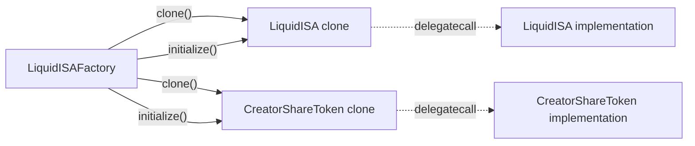

# Smart contracts

This document explains how the SMX contracts in `packages/contracts` work and
how to build, test and deploy them.

## Overview

Each creator launches one income share agreement (ISA). Investors buy share
tokens with USDC, the USDC waits in escrow, and an oracle releases it to the
creator in tranches. The creator pays dividends back to token holders. If the
creator defaults, the remaining escrow and the creator's stake go back to
investors.

| Contract | Purpose |
| --- | --- |
| `MockUSDC` | Six-decimal test token with a public `mint`. |
| `CreatorShareToken` | ERC-20 share token with built-in dividend accounting. Deployed once as an implementation; each ISA gets a clone. |
| `LiquidISA` | One clone per creator. Holds escrow, stake and dividends. |
| `LiquidISAFactory` | Clones ISAs and tokens, maps each World ID nullifier to its ISA and keeps the default blacklist. |

## Minimal proxy clones

Deploying a full `LiquidISA` (about 6.2 KB) plus a `CreatorShareToken` for every
IPO cost 3 to 5 testnet HBAR on Hedera. The factory now clones both contracts
with [EIP-1167](https://eips.ethereum.org/EIPS/eip-1167) minimal proxies
(OpenZeppelin `Clones`), so an IPO deploys two 45-byte proxies.



- Constructors became `initialize(...)` (OpenZeppelin `Initializable`). The
  implementations call `_disableInitializers()` in their constructors, so only
  clones can be initialized, once.
- Per-ISA configuration (`usdc`, `creator`, `oracle`, `totalRaise`, and so on)
  lives in storage instead of `immutable` fields. The public getters keep their
  names and types.
- `CreatorShareToken` stores `name` and `symbol` in storage and overrides
  `name()` and `symbol()`.
- The factory constructor is `(usdc, oracle, isaImplementation, tokenImplementation)`.
  `createISA` and the `ISACreated` event are unchanged.

Because a fresh factory is cheap, reseeding a demo means deploying a new
factory. This keeps the one-ISA-per-nullifier Sybil check intact; there is no
nullifier reset function.

## Lifecycle

1. The factory creates the ISA with `createISA`. The caller becomes the
   creator. An empty tranche array defaults to `[2000, 4000, 4000]` basis
   points.
2. The creator calls `initializeIPO()`, which locks the USDC stake. Investing
   fails until you do this.
3. Investors call `invest(usdcAmount)` and receive 1 share token per 1 USDC.
   Amounts above the remaining capacity are trimmed. When the raise fills, the
   contract releases tranche 0 to the creator.
4. The creator can call `closeRaise()` to end the raise early. Tranches are
   computed from the amount raised, so they resize automatically.
5. The oracle calls `unlockNextTranche()` after each verified milestone. The
   last tranche sweeps any rounding remainder.
6. Anyone calls `distributeDividend(amount)`. Holders call `claim()`.
7. After the term ends without a default, the creator calls `reclaimStake()`.
8. The oracle can call `freezeEscrow()` and `unfreezeEscrow()` at any time (see
   [Safe-stop](#safe-stop)).

## Dividend math

`CreatorShareToken` uses the ERC-2222 pattern. It stores:

- `magnifiedDividendPerShare`: increases by `amount * 2^128 / totalSupply` on
  each distribution.
- A signed correction per holder that every mint and transfer adjusts by
  `magnifiedDividendPerShare * value`.
- `withdrawnDividends` per holder.

A holder's withdrawable amount is:

```text
(magnifiedDividendPerShare * balance + correction) / 2^128 - withdrawn
```

The corrections keep earned dividends fixed when tokens move, so a transfer
between a distribution and a claim doesn't change anyone's accrued amount.
Distribution costs the same gas for one holder or one million. Division floors,
so a payout can be one base unit (0.000001 USDC) short of the exact share.

## Liquidation

Only the oracle can call `executeLiquidation()`. The contract:

1. Sets `defaulted`, which blocks investing, unlocking and distributing.
2. Adds the remaining `escrowBalance` plus the creator stake to the dividend
   accumulator, so holders claim refunds pro rata with `claim()`.
3. Calls the factory to blacklist the creator's World ID nullifier.
4. Emits `CreatorDefaulted(nullifierHash, refunded, slashed)`.

If no shares exist, the stake returns to the creator.

## Safe-stop

`freezeEscrow()` and `unfreezeEscrow()` are oracle-only. They set the `frozen`
flag and emit `EscrowFrozen(by)` and `EscrowUnfrozen(by)`. The 0G agent freezes
the escrow when a creator misses a proof deadline and unfreezes it after a late
approved proof.

While `frozen` is true:

- `unlockNextTranche()` and `reclaimStake()` revert with `EscrowFrozenError`.
- A raise that fills (or `closeRaise()`) still closes but doesn't release tranche
  0. The oracle releases it with `unlockNextTranche()` after unfreezing.
- Investing, claiming, dividends and `executeLiquidation()` keep working, so a
  freeze never traps investor money.

## Hedera ATS equity token (ATS-ready, simulated)

`setAtsToken(address)` (oracle-only, once) records the Hedera Asset
Tokenization Studio equity token for the ISA (ATS-ready; minting runs in simulated mode on testnet) and emits `AtsTokenSet`.
`CreatorShareToken` stays the source of truth for escrow and dividend math; the
ATS token is the regulated registry mirror. See
[Hedera integration](integrations/hedera.md#mint-a-creator-equity-token-with-ats-ats-ready-simulated).

## Nullifiers

`createISA` reverts with `NullifierUsed` if the nullifier already has an ISA and
with `NullifierBlacklisted` if it is blacklisted. The factory stores the
mapping in `isaOfNullifier`. The oracle can also call
`blacklist(nullifier)` on the factory directly.

## Build and test

```bash
cd packages/contracts
npm run build   # compile and export ABIs
npm test
```

## Deploy

Hedera testnet uses a viem script, not Ignition: Ignition's automatic gas limit
gets HTTP 400 from Hashio. Hedera bills at least 80% of the gas limit at about
1,240 gwei, so the script sets each limit to `estimateGas` plus 20%.

```bash
npm run deploy:hedera              # reuse the MockUSDC in USDC_ADDRESS
npm run deploy:hedera -- --new-usdc  # also deploy a fresh MockUSDC
```

The script reads `ORACLE_PRIVATE_KEY` from the root `.env` (the deployer is
the oracle) and:

1. Deploys the `LiquidISA` and `CreatorShareToken` implementations and the
   factory, waiting for each receipt.
2. Polls the Hedera mirror node
   (`https://testnet.mirrornode.hedera.com/api/v1/contracts/<address>`) until it
   returns each contract.
3. Prints the addresses and the HBAR spent.
4. Updates `FACTORY_ADDRESS` (and `USDC_ADDRESS` with `--new-usdc`) in the root
   `.env` and writes `packages/contracts/deployments/hedera-testnet.json`.

Run `npm run abis` afterward: it merges `deployments/*.json` and the Ignition
journals into `src/deployments.gen.ts`.

Other networks still use Ignition. Set the keys as Hardhat configuration
variables and never commit them:

```bash
npx hardhat vars set SEPOLIA_PRIVATE_KEY
npx hardhat vars set SEPOLIA_RPC_URL
npx hardhat vars set OG_PRIVATE_KEY
npm run deploy:sepolia
npm run deploy:0g       # 0G Galileo, chain 16602, https://evmrpc-testnet.0g.ai
```

For a local chain, run `npm run node` and `npm run deploy:local`.

### Costs on Hedera testnet

| Action | Before clones | With clones |
| --- | --- | --- |
| `createISA` | about 3 to 5 HBAR | about 0.76 HBAR |
| One-off deploy (two implementations and factory) | about 4.3 HBAR (factory only plus USDC) | about 3.7 HBAR |

### Mirror-node lag

Hashio reads go through the mirror node. For a few seconds after a deploy,
reads and `estimateGas` on the new address fail with `FAIL_INVALID`, and a
second transaction right after a receipt can fail with "nonce too low".
`packages/app/src/integrations/chain.ts` retries `FAIL_INVALID` (10 tries, 2 s
apart), retries nonce errors with a locally tracked nonce, and waits for the
mirror node to know a new ISA before `createISA` returns. It also sets every
call's gas limit to `estimateGas` plus 20%.

## Verification

All four Hedera testnet contracts are verified on Sourcify with an exact match
(runtime and creation), which HashScan reads (verified 2026-11-06):

| Contract | Address | Status |
| --- | --- | --- |
| MockUSDC | [`0x1352D7F21514d6c68f8B901E7cC2AE3f1A78618f`](https://hashscan.io/testnet/contract/0x1352D7F21514d6c68f8B901E7cC2AE3f1A78618f) | exact match |
| LiquidISA (implementation) | [`0x2c77936419a72ea377245906451bf2b38277e64c`](https://hashscan.io/testnet/contract/0x2c77936419a72ea377245906451bf2b38277e64c) | exact match |
| CreatorShareToken (implementation) | [`0xc65877c78151038b5cbf35d8a0d078510e1df0c9`](https://hashscan.io/testnet/contract/0xc65877c78151038b5cbf35d8a0d078510e1df0c9) | exact match |
| LiquidISAFactory | [`0x9698e237201c88be262523ef4917b144e857ca73`](https://hashscan.io/testnet/contract/0x9698e237201c88be262523ef4917b144e857ca73) | exact match |

Clones (for example ISA `0x041d7ecc12172a2c1bbf5cdf6daf48fd31be9d43`) are
45-byte EIP-1167 proxies. Sourcify cannot match a proxy to source, so a clone
shows no source of its own; it delegates to the verified `LiquidISA`
implementation above (and each token clone to the verified `CreatorShareToken`).

```bash
npm run verify:hedera -w packages/contracts
```

The script posts the solc standard-json input from `artifacts/build-info` (the
exact viaIR build that produced each artifact, no recompile) to Sourcify chain
296, then prints HashScan links. It needs no keys and is safe to rerun. Notes:

- HashScan's old verifier host `server-verify.hashscan.io` now 308-redirects to
  `https://sourcify.dev/server`, which lists Hedera testnet as supported. The
  Hardhat config sets `verify.sourcify.apiUrl` to that server.
- `MockUSDC` comes from the older build-info (`solc-0_8_28-4131...`); the other
  three come from the clone build (`solc-0_8_28-92e3...`). Both match the
  on-chain runtime bytecode. If you recompile with different settings or edit
  sources, the artifacts will no longer match what was deployed.

## Use from the app

```ts
import { liquidISAAbi, deployments } from "@stakeme/contracts";
```
