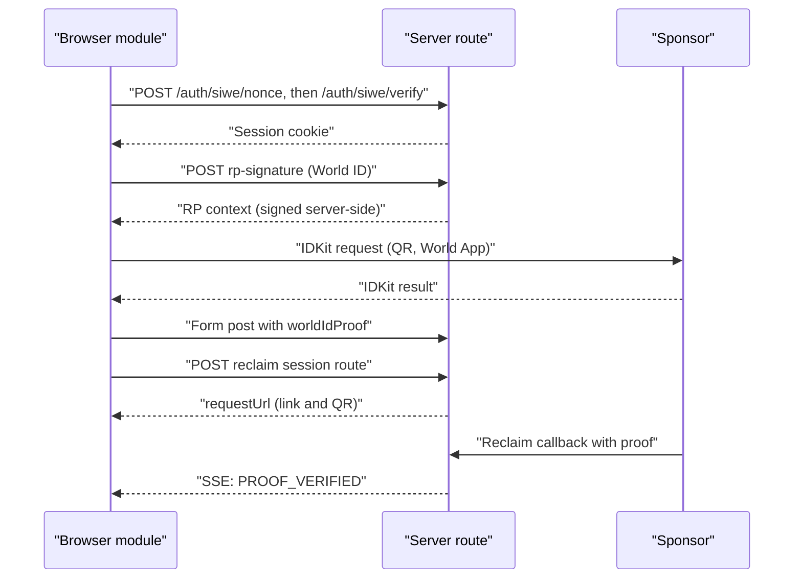
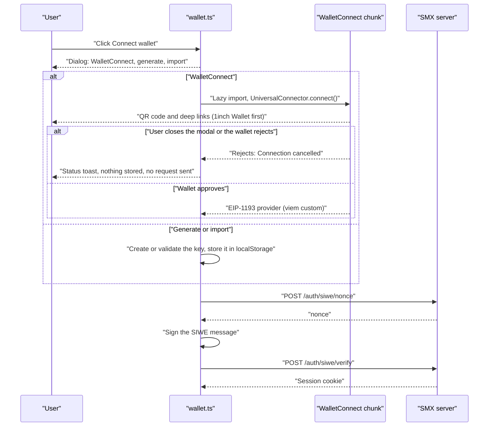
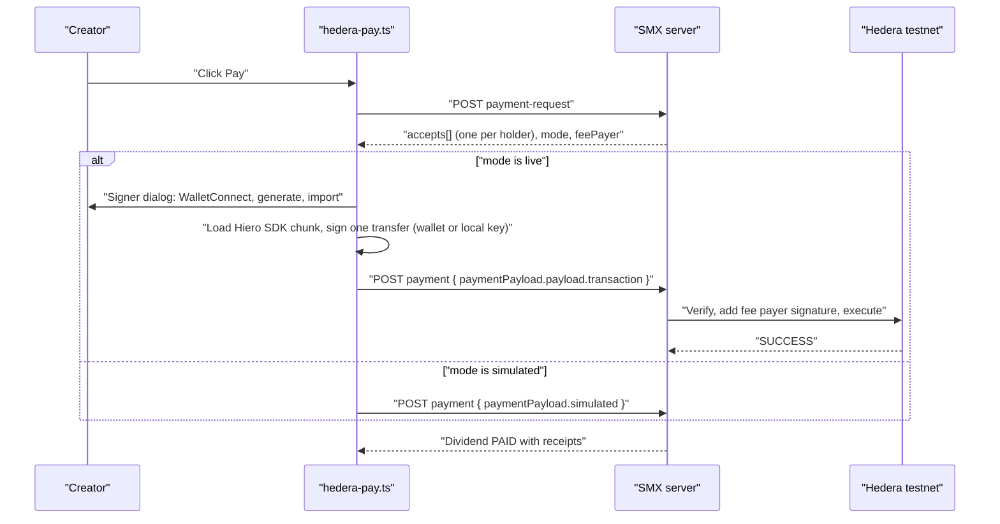

# Frontend hooks

Data-attribute contract between the server-rendered markup and the browser
modules in `packages/app/src/client/` (`wallet.ts`, `world-id.ts`,
`reclaim.ts`, `hedera-pay.ts`, `chain-trade.ts`, `order-estimate.ts`, `watchlist.ts`, `key-export.ts`). All listeners are delegated on `document`, so the markup works
for fragments that htmx swaps in later. Every hook degrades to a plain page
when JavaScript is off.

Errors surface as a design-system toast (`showToast`, tone `danger`). The
modules never poll: the server pushes progress over SSE.

## Flows



## Wallet and sign-in (`wallet.ts`)

Connecting opens `#wallet-dialog` (the `WalletConnectDialog` component, which
the header renders for anonymous visitors) with these choices, in this order:

1. **Connect with WalletConnect** (recommended): QR code and mobile deep
   links. Shown only when the page has a project id. 1inch Wallet is listed
   first.
2. **Generate a new wallet**: creates a local key kept only in this browser. If
   a key is already saved, the option reads "Use the wallet saved in this
   browser" and never overwrites it.
3. **Import a key**: reveals a form to paste a private key.
4. **Browser extension**: only when `window.ethereum` exists.

Nothing is created implicitly. Closing the dialog, closing the WalletConnect
modal or a wallet rejecting the request ends the attempt: no key is generated,
nothing is stored and no SIWE request is sent. A local key exists only after
the user picks "Generate a new wallet" or "Import a key".

| Attribute | On | Meaning |
| --- | --- | --- |
| `data-wallet-connect` | `<button>` | Click opens the connect dialog, then signs a SIWE message with the chosen wallet, posts it to Better Auth and reloads. |
| `data-wallet-option="walletconnect\|burner\|import\|injected"` | dialog buttons | The choices above. `burner` is "generate". |
| `form[data-wallet-import]` | dialog | Pasted key. A bad key shows an error toast and keeps the dialog open. |
| `data-wallet-burner` | `<button>` | Skips the dialog and signs with the local key (generating one if none is saved). Label it "Use local wallet". |
| `data-wallet-redirect="/path"` | the connect button | Optional. Go here after sign-in instead of reloading. |
| `data-siwe-domain="host"` | the connect button | Optional. Overrides the SIWE domain (default `location.host`). It must equal `siweDomain()` on the server. |
| `data-wallet-signout` | `<button>` | Ends the Better Auth session, the WalletConnect sessions (EVM and Hedera) and the stored address, then goes to `/`. The local key stays so you can use or export it again. |
| `data-wallet-address` | any element | Text is filled with the short address (`0x1234…abcd`) only when empty. The full address goes in `title`. |
| `data-wallet-kind` | any element, `hidden` | Filled with the wallet label ("1inch Wallet", "Local wallet", "Imported key", "MetaMask") and unhidden. |
| `data-key-export="evm"` | `<button>`, `hidden` | Unhidden for a local wallet. Opens the export dialog (see below). |

WalletConnect configuration comes from
`<meta name="smx-walletconnect-project-id" content="..." data-name
data-description data-url data-icon>` in the page head (`Layout.tsx`). The
server renders it only when `WALLETCONNECT_PROJECT_ID` is set. The value is
public. `data-url` comes from `CANONICAL_ORIGIN`, so the WalletConnect
dashboard must allow that origin.

Better Auth calls made: `POST /auth/siwe/nonce` (empty body),
`POST /auth/siwe/verify` with `{ message, signature }`, and
`POST /auth/sign-out`. The session is a cookie.
`window.smxWallet.connect({ kind })` returns
`{ address, chainId, sign, burner, kind, label }` for other scripts. It needs an
explicit `kind` and never falls back to a local key.



### EVM chain and SDK

The EVM chain is Hedera testnet (chain 296, `https://testnet.hashio.io/api`).
WalletConnect uses `@reown/appkit-universal-connector` (`UniversalConnector`),
the vanilla JavaScript path in the WalletConnect App SDK docs, wrapped as an
EIP-1193 provider for viem's `custom()`. It keeps its sessions under the
storage prefix `smx-evm`. 1inch Wallet's WalletConnect id is looked up with
the WalletConnect explorer API (`search=1inch`) at connect time, so the id
isn't hard-coded; if the lookup fails the wallet list just isn't reordered.

## Export a local key (`key-export.ts`)

`#key-export-dialog` (the `KeyExportDialog` component) shows a locally stored
private key after an explicit "Reveal key" click, with a warning and a Copy
button. The key is added to the DOM on reveal and removed when the dialog
closes.

| Attribute | On | Meaning |
| --- | --- | --- |
| `data-key-export="evm"` | `<button>` | Opens the dialog for the sign-in key (`localStorage` `smx.burnerKey`). |
| `data-key-export="hedera"` | `<button>` | Opens the dialog for the Hedera payment key (`smx.hedera.burner`). Closes the signer dialog first: dialogs are never stacked. |
| `[data-key-reveal]` | dialog | Shows the key. |
| `[data-key-value]` | dialog | Receives the key. The Copy button reads its text. |

## World ID (`world-id.ts`)

Render this inside the launch `<form>`. In demo mode leave `data-app-id` empty. `data-signal`, `data-rp-url` and `data-action` are optional.

```html
<form hx-post="/creators" hx-ext="json-enc">
	<input type="hidden" name="worldIdProof" />
	<button type="button" data-world-id
		data-app-id="app_xxx"
		data-signal="0xwallet"
		data-rp-url="/api/rp-signature"
		data-action="smx-launch-ipo">
		Verify with World ID
	</button>
	<div data-world-id-qr hidden></div>
	<p data-world-id-status></p>
	<div data-world-id-demo hidden>
		<button type="button" data-world-id-sim="success">Simulate success</button>
		<button type="button" data-world-id-sim="sybil">Simulate Sybil</button>
	</div>
	<button type="submit" disabled data-world-id-submit>Launch</button>
</form>
```

| Attribute | On | Meaning |
| --- | --- | --- |
| `data-world-id` | `<button type=button>` | Click starts the IDKit flow. |
| `data-app-id` | the same button | `app_...` id. Empty or missing means demo mode: the click reveals `[data-world-id-demo]`. Render `WORLD_APP_ID` here only when `isWorldIdConfigured()` is true. |
| `data-rp-url` | the same button | Route that returns `createWorldIdRequest(sessionWallet)` as JSON. Default `/api/rp-signature` (POST, no body). |
| `data-check-url` | the same button | Route that verifies the proof and rejects a used (409) or blacklisted (403) nullifier before submit is enabled. Default `/api/world-id/check`. On rejection, `[data-world-id-status]` shows the reason with `data-tone="danger"` and submit stays disabled. |
| `data-signal` | the same button | Fallback signal if the route omits `signal`. The route's `signal` wins. |
| `data-action` | the same button | Action in simulated fixtures. Default `smx-launch-ipo`. |
| `input[name=worldIdProof]` | in the form | Receives `JSON.stringify(IDKitResult)` (or the fixture). |
| `[data-world-id-submit]` | in the form | Enabled on success. Falls back to every `button[type=submit]` in the form. |
| `[data-world-id-qr]` | in the form | Optional. Gets the connect link and a QR image. |
| `[data-world-id-status]` | in the form | Optional. Text status. |
| `[data-world-id-demo]` | in the form | Optional. Container with the simulate buttons. Mark it `hidden`. |
| `[data-world-id-sim=success\|sybil]` | `<button type=button>` | Writes a fixture proof. `sybil` always yields the same nullifier, so the second creator hits the duplicate check. |

After success the form gets a bubbling `smx:world-id` event with the proof as
`detail`. The server reads `worldIdProof` and passes it unchanged, with the
session wallet as the signal, to `verifyWorldIdProof`. Demo fixtures
(`demo: true`) are accepted only when `DEMO_MODE=1`.

## Reclaim (`reclaim.ts`)

```html
<section data-reclaim>
	<button type="button"
		data-reclaim-start="/creators/RAVI/reclaim-sessions"
		data-reclaim-body='{"period":1}'>Prove income</button>
	<div data-reclaim-output hidden></div>

	<!-- DEMO_MODE only -->
	<button type="button"
		data-reclaim-demo="/api/audit-milestone"
		data-reclaim-demo-context="creator-uuid"
		data-reclaim-demo-amount="5000.00"
		data-reclaim-demo-field="proof"
		data-reclaim-body='{"ticker":"RAVI","period":1}'>Simulate deposit</button>
</section>
```

| Attribute | On | Meaning |
| --- | --- | --- |
| `data-reclaim-start="/url"` | `<button type=button>` | Click POSTs JSON to the URL (the `CreateReclaimSession` route). The JSON response must hold `requestUrl` at the top level or under `session`. |
| `data-reclaim-body='{...}'` | start or demo button | Optional extra JSON body fields. |
| `[data-reclaim-output]` | inside the closest `[data-reclaim]` (else anywhere) | Receives a QR image and a link to `requestUrl`. Without it the URL opens in a new tab. |
| `data-reclaim-demo="/url"` | `<button type=button>` | DEMO_MODE only. POSTs `{ ...body, [field]: { demo: true, amount, context, id } }` and then reloads, or follows `HX-Redirect`. |
| `data-reclaim-demo-context` | demo button | Required. The creator id echoed back as the proof context. |
| `data-reclaim-demo-amount` | demo button | USDC decimal string. Default `5000.00`. The Hub also renders a `[data-reclaim-demo-scenario]` picker that sets the amount. |
| `data-reclaim-demo-field` | demo button | Body key that holds the fixture. Default `proof`. |

The proof status uses the server's SSE stream (`PROOF_VERIFIED`): put the
htmx SSE hooks on the status fragment, not on these buttons.

The server accepts a demo fixture only from the signed-in owner of the
creator, with `DEMO_MODE=1`, and at most 3 per creator per hour.

## Onchain trade, invest and faucet (`chain-trade.ts`)

In live chain mode the user's own wallet signs every trade and investment. The
module intercepts the submit in the capture phase, before htmx sees it. It
asks `GET /creators/{ticker}/chain` whether the creator trades onchain. In
simulated mode (`mode: "simulated"`), the form goes to the server untouched
and the SQL AMM runs. In live mode, the signed-in wallet sends `approve`
(skipped when the allowance is enough) and then the swap or `invest` call, with
gas set to the estimate plus 20% and the slippage as `minOut`. The module posts
the `txHash` to the same route, and the server verifies the receipt and records
the event amounts.

| Hook | On | Meaning |
| --- | --- | --- |
| `[data-order-ticket]` | order ticket root | Its form becomes a `BUY` or `SELL` swap on the creator's `CreatorPool`. `data-ticker`, `data-usdc-reserve`, `data-token-reserve`, `data-fee-bps` and `data-halted` feed the estimate. |
| `form[action$="/investments"]` | invest form | Primary-market `LiquidISA.invest`. |
| `form[action$="/close-raise"]` | Hub form | The creator calls `closeRaise`. |
| `[data-chain-scope="TICKER"]` | host inside a form | Marks where the module paints the status and the faucet button. |
| `[data-chain-faucet]` | `<button>` | "Get 1,000 test USDC": the wallet calls `MockUSDC.faucet` (cap 50,000 per call). Shown when the USDC balance is low. |
| `[data-chain-status]` | `<output>` | Progress text. |

A wallet without HBAR for gas gets a link to the Hedera testnet faucet. The
Portfolio page has a second faucet form (`POST /portfolio/faucet`) that the
server signs, limited to one request per wallet per minute.

`order-estimate.ts` drives the order ticket: it computes the pool quote, the
price impact and the minimum received from the reserves in the data
attributes, with slippage presets (`[data-slippage-bps]`) or a custom value
(`[data-slippage-custom]`). `watchlist.ts` handles `[data-watchlist-toggle]`
(PUT or DELETE `/watchlist/{ticker}`; a 401 opens the wallet dialog) and
`[data-watchlist-open]` (refetch `GET /watchlist` into the drawer).

## Hedera dividend payment (`hedera-pay.ts`)

The creator pays a due dividend from the Hub. The module asks the server for
x402 payment requirements, signs **one** Hedera `TransferTransaction` that pays
every holder, and posts it back for settlement.

```html
<section data-hedera-pay-scope>
	<button type="button"
		data-hedera-pay="/dividends/{id}/payment-request"
		data-hedera-settle="/dividends/{id}/payment">
		Pay dividend
	</button>
	<output data-hedera-pay-status></output>
</section>
```

| Attribute | On | Meaning |
| --- | --- | --- |
| `data-hedera-pay="/url"` | `<button type=button>` | POST route that returns the x402 payment requirements (`CreateDividendPaymentRequest`). |
| `data-hedera-settle="/url"` | the same button | POST route that receives `{ paymentPayload }` (`PayDividend`). |
| `[data-hedera-pay-status]` | `<output>` | Progress text. Looked up inside the closest `[data-hedera-pay-scope]`, else anywhere on the page. |

The module dispatches a bubbling `smx:hedera-paid` event (detail: the paid
dividend) on the button and sets `aria-busy` while it runs. Show the HashScan
links from the dividend receipts, not from this module.



Signer choice (live mode only): the module opens `#hedera-signer-dialog` (the
`HederaSignerDialog` component, rendered next to the Pay button) with the same
three choices as sign-in. Nothing is created implicitly: closing the dialog or
the WalletConnect modal cancels the payment with no side effects.

| Attribute | On | Meaning |
| --- | --- | --- |
| `data-hedera-option="walletconnect\|burner\|import"` | dialog buttons | The choices. `burner` is "generate" (or "use the saved key"). |
| `form[data-hedera-import]` | dialog | Pasted ECDSA private key (raw or DER hex), validated with the Hiero SDK. |
| `data-key-export="hedera"` | dialog button | Export the saved key. |

- **WalletConnect:** the user's Hedera wallet (HashPack, Kabila and others)
  signs through `@hashgraph/hedera-wallet-connect`'s `DAppConnector` on
  `hedera:testnet`, so the payer is the connected Hedera account. 1inch Wallet
  doesn't support Hedera native, so the modal lists Hedera wallets. The server
  works out the payer from the signed transfers, so the payload shape is
  unchanged. Needs a project id; otherwise the option is hidden. Sessions use
  the default WalletConnect storage prefix; `smx.hedera.walletconnect` marks
  that a session exists so sign-out can end it.
- **Generated or imported key:** an ECDSA key in `localStorage`
  (`smx.hedera.burner`). The module looks up its account id on the mirror node
  by EVM alias (cached as `smx.hedera.account`). If the account doesn't exist,
  the status says to fund the printed address from the Hedera faucet. The server
  pays network fees (fee payer), so the account needs only the dividend amount.
- **Simulated mode:** the server has no `HEDERA_OPERATOR_*` and is not in
  production. Nothing is signed and the receipts are `sim:` hashes. In
  production the server answers `503` instead, unless `HEDERA_ALLOW_SIMULATED=1`.
  The live button reads "Pay {hbar} HBAR on Hedera" at the testnet rate
  `DIVIDEND_HBAR_PER_USDC`.

The Hiero SDK (about 1.9 MB, 310 KB gzipped) and the Hedera WalletConnect
chunk (about 1.3 MB, 195 KB gzipped) load lazily, so pages without the button
never download them. The EVM WalletConnect chunks (about 1.1 MB, 315 KB
gzipped) load only when the user picks WalletConnect.

## Notes for the UI

- Add `aria-busy` styling: the modules set `aria-busy="true"` on a button
  while its request runs.
- Don't render the Reclaim app secret or the World ID signing key anywhere.
  The browser only ever sees request URLs and RP signatures.
- The bundle loads IDKit and `qrcode` lazily (separate chunks), so pages
  without these hooks pay nothing for them.
