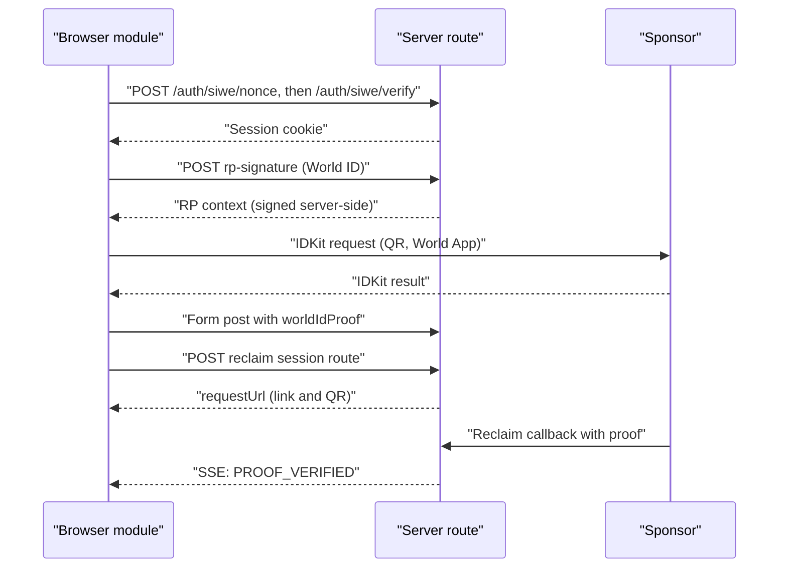
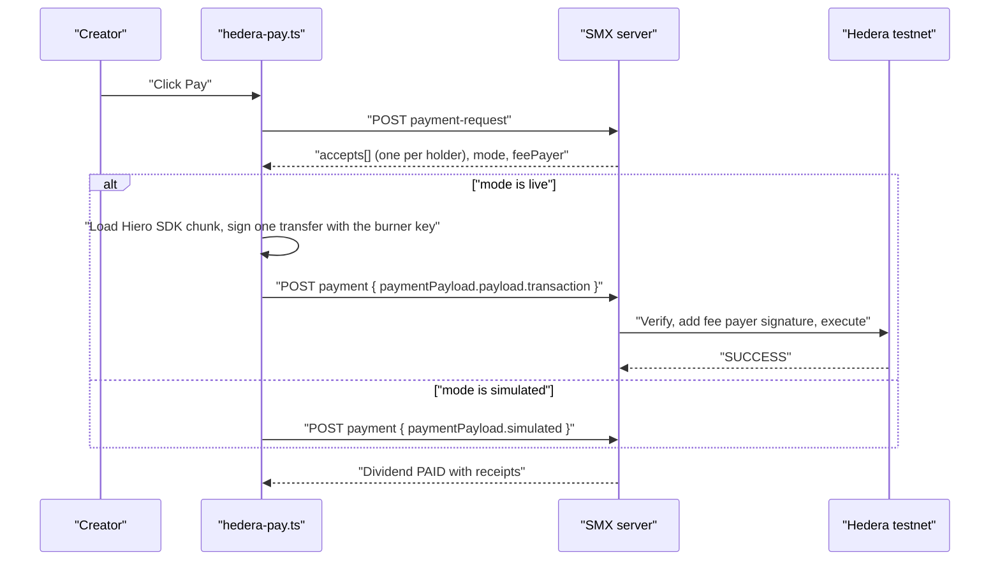

# Frontend hooks

Data-attribute contract between the server-rendered markup and the browser
modules in `packages/app/src/client/` (`wallet.ts`, `world-id.ts`,
`reclaim.ts`, `hedera-pay.ts`). All listeners are delegated on `document`, so the markup works
for fragments that htmx swaps in later. Every hook degrades to a plain page
when JavaScript is off.

Errors surface as a design-system toast (`showToast`, tone `danger`). The
modules never poll: the server pushes progress over SSE.

## Flows



## Wallet and sign-in (`wallet.ts`)

| Attribute | On | Meaning |
| --- | --- | --- |
| `data-wallet-connect` | `<button>` | Click connects `window.ethereum` (EIP-1193), signs a SIWE message, posts it to Better Auth, then reloads. Without `window.ethereum` it falls back to the demo burner wallet. |
| `data-wallet-burner` | `<button>` | Same flow, but always uses the burner wallet (a throwaway key kept in `localStorage` key `smx.burnerKey`). Label it "Use demo wallet". |
| `data-wallet-redirect="/path"` | the button | Optional. Go here after sign-in instead of reloading. |
| `data-siwe-domain="host"` | the button | Optional. Overrides the SIWE domain (default `location.host`). It must equal `siweDomain()` on the server. |
| `data-wallet-address` | any element | Text is filled with the short address (`0x1234…abcd`) only when empty. The full address goes in `title`. |

Better Auth calls made: `POST /auth/siwe/nonce` (empty body), then
`POST /auth/siwe/verify` with `{ message, signature }`. The session is a
cookie. `window.smxWallet.connect({ burner? })` returns
`{ address, chainId, sign, burner }` for other scripts.

## World ID (`world-id.ts`)

Render this inside the launch `<form>`. In demo mode leave `data-app-id` empty. `data-signal`, `data-rp-url` and `data-action` are optional.

```html
<form hx-post="/creators" hx-ext="json-enc">
	<input type="hidden" name="worldIdProof" />
	<button type="button" data-world-id
		data-app-id="app_xxx"
		data-signal="0xwallet"
		data-rp-url="/api/rp-signature"
		data-action="smx-launch-ipo">
		Verify with World ID
	</button>
	<div data-world-id-qr hidden></div>
	<p data-world-id-status></p>
	<div data-world-id-demo hidden>
		<button type="button" data-world-id-sim="success">Simulate success</button>
		<button type="button" data-world-id-sim="sybil">Simulate Sybil</button>
	</div>
	<button type="submit" disabled data-world-id-submit>Launch</button>
</form>
```

| Attribute | On | Meaning |
| --- | --- | --- |
| `data-world-id` | `<button type=button>` | Click starts the IDKit flow. |
| `data-app-id` | the same button | `app_...` id. Empty or missing means demo mode: the click reveals `[data-world-id-demo]`. Render `WORLD_APP_ID` here only when `isWorldIdConfigured()` is true. |
| `data-rp-url` | the same button | Route that returns `createWorldIdRequest(sessionWallet)` as JSON. Default `/api/rp-signature` (POST, no body). |
| `data-signal` | the same button | Fallback signal if the route omits `signal`. The route's `signal` wins. |
| `data-action` | the same button | Action in simulated fixtures. Default `smx-launch-ipo`. |
| `input[name=worldIdProof]` | in the form | Receives `JSON.stringify(IDKitResult)` (or the fixture). |
| `[data-world-id-submit]` | in the form | Enabled on success. Falls back to every `button[type=submit]` in the form. |
| `[data-world-id-qr]` | in the form | Optional. Gets the connect link and a QR image. |
| `[data-world-id-status]` | in the form | Optional. Text status. |
| `[data-world-id-demo]` | in the form | Optional. Container with the simulate buttons. Mark it `hidden`. |
| `[data-world-id-sim=success\|sybil]` | `<button type=button>` | Writes a fixture proof. `sybil` always yields the same nullifier, so the second creator hits the duplicate check. |

After success the form gets a bubbling `smx:world-id` event with the proof as
`detail`. The server reads `worldIdProof` and passes it unchanged, with the
session wallet as the signal, to `verifyWorldIdProof`. Demo fixtures
(`demo: true`) are accepted only when `DEMO_MODE=1`.

## Reclaim (`reclaim.ts`)

```html
<section data-reclaim>
	<button type="button"
		data-reclaim-start="/creators/RAVI/reclaim-sessions"
		data-reclaim-body='{"period":1}'>Prove income</button>
	<div data-reclaim-output hidden></div>

	<!-- DEMO_MODE only -->
	<button type="button"
		data-reclaim-demo="/api/audit-milestone"
		data-reclaim-demo-context="creator-uuid"
		data-reclaim-demo-amount="5000.00"
		data-reclaim-demo-field="proof"
		data-reclaim-body='{"ticker":"RAVI","period":1}'>Simulate $5,000 deposit</button>
</section>
```

| Attribute | On | Meaning |
| --- | --- | --- |
| `data-reclaim-start="/url"` | `<button type=button>` | Click POSTs JSON to the URL (the `CreateReclaimSession` route). The JSON response must hold `requestUrl` at the top level or under `session`. |
| `data-reclaim-body='{...}'` | start or demo button | Optional extra JSON body fields. |
| `[data-reclaim-output]` | inside the closest `[data-reclaim]` (else anywhere) | Receives a QR image and a link to `requestUrl`. Without it the URL opens in a new tab. |
| `data-reclaim-demo="/url"` | `<button type=button>` | DEMO_MODE only. POSTs `{ ...body, [field]: { demo: true, amount, context, id } }` and then reloads, or follows `HX-Redirect`. |
| `data-reclaim-demo-context` | demo button | Required. The creator id echoed back as the proof context. |
| `data-reclaim-demo-amount` | demo button | USDC decimal string. Default `5000.00`. |
| `data-reclaim-demo-field` | demo button | Body key that holds the fixture. Default `proof`. |

The proof status uses the server's SSE stream (`PROOF_VERIFIED`): put the
htmx SSE hooks on the status fragment, not on these buttons.

## Hedera dividend payment (`hedera-pay.ts`)

The creator pays a due dividend from the Hub. The module asks the server for
x402 payment requirements, signs **one** Hedera `TransferTransaction` that pays
every holder, and posts it back for settlement.

```html
<section data-hedera-pay-scope>
	<button type="button"
		data-hedera-pay="/dividends/{id}/payment-request"
		data-hedera-settle="/dividends/{id}/payment">
		Pay dividend
	</button>
	<output data-hedera-pay-status></output>
</section>
```

| Attribute | On | Meaning |
| --- | --- | --- |
| `data-hedera-pay="/url"` | `<button type=button>` | POST route that returns the x402 payment requirements (`CreateDividendPaymentRequest`). |
| `data-hedera-settle="/url"` | the same button | POST route that receives `{ paymentPayload }` (`PayDividend`). |
| `[data-hedera-pay-status]` | `<output>` | Progress text. Looked up inside the closest `[data-hedera-pay-scope]`, else anywhere on the page. |

The module dispatches a bubbling `smx:hedera-paid` event (detail: the paid
dividend) on the button and sets `aria-busy` while it runs. Show the HashScan
links from the dividend receipts, not from this module.



Signer behavior:

- **Live mode:** the module creates a throwaway ECDSA key in `localStorage`
  (`smx.hedera.burner`) and looks up its account id on the mirror node by EVM
  alias (cached as `smx.hedera.account`). If the account doesn't exist, the
  status says to fund the printed address from the Hedera faucet. The server
  pays network fees (fee payer), so the wallet needs only the dividend amount.
- **Simulated mode:** the server has no `HEDERA_OPERATOR_*`. Nothing is
  signed and the receipts are `sim:` hashes.
- **HashPack:** not wired. `@hashgraph/hedera-wallet-connect` 2.1.3 pins
  `@hiero-ledger/sdk` to 2.79.0 and needs a WalletConnect project id.

The Hiero SDK loads lazily in its own chunk (about 1.9 MB, 310 KB gzipped), so
pages without the button never download it.

## Notes for the UI

- Add `aria-busy` styling: the modules set `aria-busy="true"` on a button
  while its request runs.
- Don't render the Reclaim app secret or the World ID signing key anywhere.
  The browser only ever sees request URLs and RP signatures.
- The bundle loads IDKit and `qrcode` lazily (separate chunks), so pages
  without these hooks pay nothing for them.
