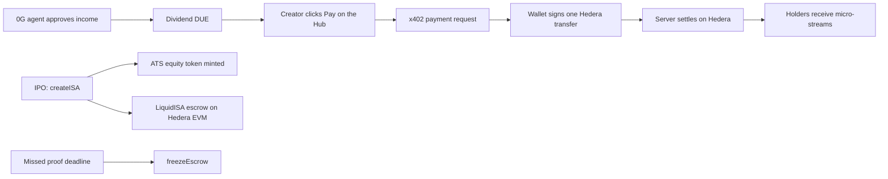
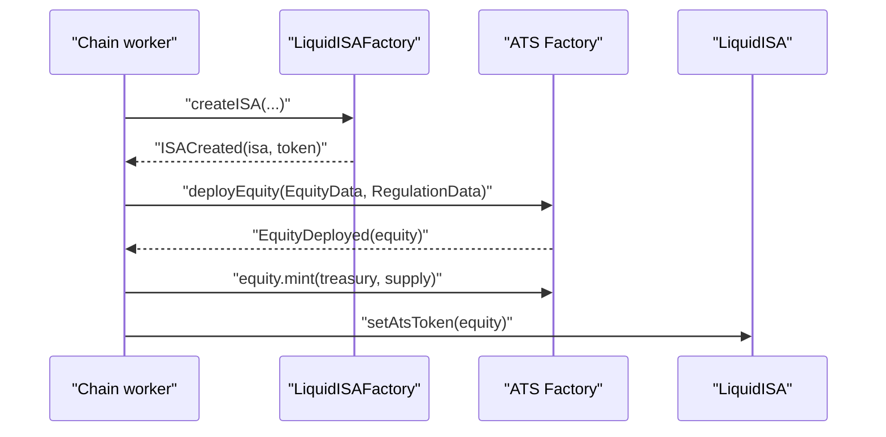
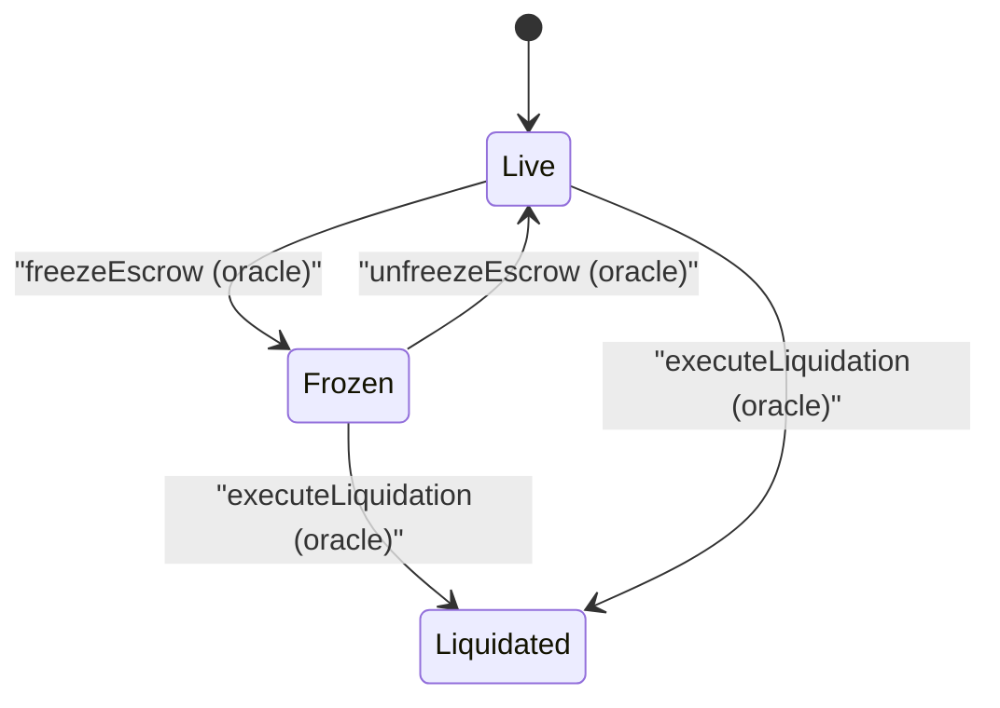
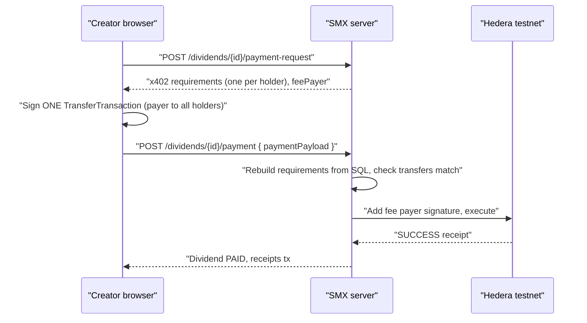

# Hedera integration

Verified against npm, the Asset Tokenization Studio (ATS) packages, and
docs.hedera.com on 2026-11-06.

**Status:** implemented with SIMULATED fallbacks. The live ATS mint and the live
x402 settlement are typechecked and unit-tested for their pure logic, but not
run against Hedera testnet in this repository (no operator key in CI).

SMX uses three Hedera features, all with native Hedera transactions:

| Feature | What it does | Code |
| --- | --- | --- |
| Hedera EVM | Hosts `LiquidISAFactory`, `LiquidISA`, `CreatorShareToken` and `MockUSDC` (chain `296`). | `packages/contracts`, `integrations/chain.ts` |
| Asset Tokenization Studio | Mints the creator's equity token (for example `$MUSH`). | `integrations/hedera-ats.ts` |
| x402 dividend loop | The creator's wallet signs one Hedera transfer that pays every holder. | `services/payment/hedera-*.ts`, `client/hedera-pay.ts` |



## Network facts

| Item | Value |
| --- | --- |
| Network | Hedera testnet |
| EVM chain id | `296` (mainnet is `295`) |
| JSON-RPC relay (Hashio) | `https://testnet.hashio.io/api` |
| Native currency | HBAR (18 decimals on the EVM side, 8 on the native side: tinybars) |
| Explorer | [HashScan](https://hashscan.io/testnet) |
| Faucet | [portal.hedera.com/faucet](https://portal.hedera.com/faucet) (EVM address or account id) |
| Mirror node | `https://testnet.mirrornode.hedera.com/api/v1` |

Hashio is for development only and can throttle. Keep a fallback relay URL in
`.env`.

### HashScan URLs

- Transaction: `https://hashscan.io/testnet/transaction/<tx-hash-or-id>`
- Account or EVM address: `https://hashscan.io/testnet/account/<id-or-0x-address>`
- Contract: `https://hashscan.io/testnet/contract/<0x-address>`
- Token: `https://hashscan.io/testnet/token/<0.0.id>`

## Environment variables

| Variable | Secret | Description |
| --- | --- | --- |
| `HEDERA_OPERATOR_ID` | No | `0.0.x` operator account. It pays network fees for dividend payments (the x402 fee payer). Legacy alias: `HEDERA_ACCOUNT_ID`. |
| `HEDERA_OPERATOR_KEY` | Yes | ECDSA key of the operator, raw `0x` hex or Hedera DER hex. Legacy alias: `HEDERA_PRIVATE_KEY`. Create an ECDSA account in the [Hedera portal](https://portal.hedera.com). |
| `HEDERA_NETWORK` | No | `testnet` (default) or `mainnet`. |
| `HEDERA_DIVIDEND_TOKEN_ID` | No | HTS token id for the dividend asset (a testnet USDC, 6 decimals). Unset means HBAR. |
| `HEDERA_RPC_URL` | No | JSON-RPC relay for ATS calls when `CHAIN_RPC_URL` is unset. Default Hashio. |
| `CHAIN_RPC_URL` | No | `https://testnet.hashio.io/api`. Unset means a simulated chain. |
| `CHAIN_ID` | No | `296`. |
| `ORACLE_PRIVATE_KEY` | Yes | ECDSA key (0x hex) of the oracle and deployer. Fund it from the faucet. |
| `FACTORY_ADDRESS` | No | Deployed `LiquidISAFactory`. |
| `ATS_ENABLED` | No | `1` turns on the live ATS mint. |
| `ATS_FACTORY_ADDRESS` | No | ATS `Factory` proxy (EVM address) on the target network. |
| `ATS_RESOLVER_ADDRESS` | No | ATS Business Logic Resolver (BLR) proxy (EVM address). |
| `ATS_CONFIG_VERSION` | No | Resolver configuration version. `0` (default) means latest. |

With no `HEDERA_OPERATOR_*` variables every path returns SIMULATED results and
logs a warning, so the demo runs with no keys.

## Mint a creator equity token with ATS

[Asset Tokenization Studio](https://github.com/hashgraph/asset-tokenization-studio)
(ATS) deploys regulated securities (ERC-1400 and ERC-3643 style) as diamond
proxies, created by an on-chain `Factory` that points at a Business Logic
Resolver.

### Decision: call the ATS Factory, not the SDK

`@hashgraph/asset-tokenization-sdk` 8.0.0 is the official client, but it can't
be driven from Node with an operator key:

- Its `Network.connect` supports WalletConnect, MetaMask, DFNS, Fireblocks and
  AWS KMS. There is no private-key signer.
- The ESM build uses extensionless imports that Node can't load, and the
  package pulls Reown and WalletConnect.

The SDK is a thin wrapper over the ATS contracts, so SMX calls the same
contracts directly: `Factory.deployEquity(...)`, then `Equity.mint(...)`, with
`viem` through the Hedera relay. The ABI subset is in `hedera-ats.ts` (copied
from `@hashgraph/asset-tokenization-contracts` 8.0.0).

### Design: ATS mirrors the cap table

`LiquidISA` keeps `CreatorShareToken` as the source of truth for escrow and
dividends. An ATS token has its own corporate-action logic and can't reuse the
ISA's O(1) dividend accounting, so SMX doesn't let `LiquidISA` use it as the
share token. Instead:

1. `createISA` on the factory deploys `LiquidISA` and `CreatorShareToken`.
2. The chain worker calls `mintCreatorEquityToken` for the same ticker. The
   supply equals the raise (1 USDC raised = 1 share, 18 decimals) and goes to
   the oracle treasury.
3. The oracle calls `LiquidISA.setAtsToken(atsToken)` once. The address is
   stored and emitted as `AtsTokenSet`, so HashScan links the two.



### Prerequisites and limits

- ATS isn't deployed for you. Deploy the BLR, Factory and facets with the
  scripts in `@hashgraph/asset-tokenization-contracts` (`scripts/README.md`),
  then set `ATS_FACTORY_ADDRESS` and `ATS_RESOLVER_ADDRESS`. The README's
  reference deployment on testnet predates v1.17 and role hashes changed in v8,
  so don't reuse its addresses.
- `deployEquity` validates an ISIN with a checksum. SMX generates a synthetic
  one (`XS` plus nine hex characters plus the ISO 6166 check digit).
- Roles use the v8 hashes: `ROLE_ISSUER` goes to the operator so it can mint.
- This path is behind `ATS_ENABLED=1` and wasn't run against a live ATS
  deployment. On any error SMX logs and falls back to a SIMULATED token, so an
  IPO never fails because of ATS.

```ts
import { mintCreatorEquityToken } from './integrations/index.ts'

const { tokenId, txId, status } = await mintCreatorEquityToken({
	ticker: 'MUSH',
	name: 'Mushroom Labs',
	supply: '100000',
	decimals: 18,
	holder: '0xTreasuryEvmAddress',
})
```

## Contracts on Hedera EVM

Deploy with Hardhat Ignition (`npm run deploy:hedera -w packages/contracts`).
Use an ECDSA key, because only ECDSA keys map to an EVM address. See
[Smart contracts](../contracts.md) for the lifecycle, the safe-stop and the
nullifier registry.

### Safe-stop: freeze the escrow

When a creator misses a proof deadline, the 0G agent calls `freezeEscrow()`
(chain job `freezeEscrow`). While frozen, `unlockNextTranche`, `reclaimStake`
and the automatic tranche release on a full raise all revert or wait.
Investors can still claim, and the oracle can still liquidate. A late approved
proof calls `unfreezeEscrow()`.



## x402 dividend loop

x402 is an HTTP payment protocol built on status `402 Payment Required`. The
server states what to pay, the client signs, and the server settles. SMX uses
x402 v2 shapes (`accepts[]` of `exact` requirements, CAIP-2 network
`hedera:testnet`) over native Hedera `TransferTransaction`s.

### Why SMX settles itself

The `exact` Hedera scheme in `@x402/hedera` 2.30.0 verifies one transfer to one
`payTo`, with the facilitator as fee payer. A dividend pays many holders, and
asking each holder to sign a separate payment would be many wallet prompts. So
SMX keeps the x402 requirement format but:

- Lists one requirement per holder in `accepts` (a micro-stream each).
- Has the creator sign **one** multi-transfer transaction.
- Verifies and submits it on the server with `@hiero-ledger/sdk`, using the
  operator as fee payer. That's the same gasless model the facilitator gives.

`@x402/core` and `@x402/hedera` are installed for the single-payee flows
(`x402.org/facilitator`, `hedera:testnet`) if you add a paywalled endpoint
later. The dividend loop doesn't call the facilitator.

### Flow



### Rules the server enforces

1. It rebuilds the requirements from the database. It never trusts amounts or
   payees from the client.
2. The signed transaction's fee payer must be `HEDERA_OPERATOR_ID`, its max fee
   must be at most 3 HBAR, and the transfers must equal the requirements
   exactly (one payer, no extra movement, total matches).
3. Rounding: the SQL split floors each holder. The builder adds the leftover
   micro units to the largest holder so the total equals the dividend.
4. Hedera rejects a repeated transaction id, which blocks replay.

### Assets and units

| Mode | Asset | Units |
| --- | --- | --- |
| HBAR (default, no token id) | `0.0.0` | 1 micro-USDC = 1 tinybar, so 1 USDC = 0.01 HBAR. Cheap for faucet funds. |
| HTS token | `HEDERA_DIVIDEND_TOKEN_ID` | 6 decimals, 1:1 with USDC. The payer must hold the token and holders must be associated (or have auto-association slots). |

Holders are addressed by EVM alias (`0.0.<40 hex>`), which creates the account
on first receipt for HBAR.

## WalletConnect

The browser signs with the user's own wallet when the page has a
`WALLETCONNECT_PROJECT_ID` (public; create it at
[dashboard.walletconnect.com](https://dashboard.walletconnect.com) and allow
your origin). WalletConnect is one of three choices, in the connect dialog and
in the Hedera signer dialog: WalletConnect, a generated key, or an imported
key. A generated or imported key can be exported (reveal and copy). Nothing is
created unless the user picks it.

| Use | Package | Notes |
| --- | --- | --- |
| EVM sign-in (SIWE) on Hedera testnet EVM (chain 296) | `@reown/appkit-universal-connector` 1.8.24 | The WalletConnect App SDK path for plain JavaScript: QR, deep links, session restore. Wrapped as an EIP-1193 provider for viem. 1inch Wallet is featured first (id found through the explorer API). |
| Native dividend payment (`hedera:testnet`) | `@hashgraph/hedera-wallet-connect` 2.1.3 (`DAppConnector`) | HashPack, Kabila and other Hedera wallets. The wallet signs the x402 `TransferTransaction` (`hedera_signTransaction`); the server adds the operator signature and submits. 1inch doesn't support Hedera native. |

Both load in their own Vite chunks, only when used. See
[Frontend hooks](../frontend-hooks.md#wallet-and-sign-in-walletts).

The sign-in and payment SDKs use different WalletConnect storage prefixes
(`smx-evm` and the default). The Hedera `DAppConnector` throws on a stored
session that has no `hedera` namespace, so they must not share sessions.

### SDK version alignment

`@hashgraph/hedera-wallet-connect` 2.1.3 (the latest stable) declares
`@hiero-ledger/sdk` `2.79.0` as an exact peer dependency, and `ethers`
`^6.13.5`. SMX uses `@hiero-ledger/sdk` 2.90.1 and `ethers` 6.13.1 (pinned by
the 0G storage SDK). The root `package.json` resolves this with npm
`overrides`:

```json
"overrides": {
  "@hiero-ledger/sdk": "^2.90.1",
  "@hashgraph/hedera-wallet-connect": { "ethers": "^6.13.1" },
  "@types/node": "$@types/node"
}
```

The browser chunk therefore uses the same Hiero SDK as the server. The wallet
package only calls stable `Transaction` APIs, and signing worked at the type
and bundle level; a live HashPack signature is not verified. The `@types/node`
override keeps one `@types/node` (24) so `tsc` resolves Node types in
`packages/app`. The app imports the package's `dist/lib/dapp` and
`dist/lib/shared` entry points directly, because the package root also pulls in
AppKit, ethers and walletkit.

### Fee payer and wallet signing

The x402 transaction's fee payer is the SMX operator, not the signing account.
A wallet that refuses to sign a transaction whose payer is another account
would fail with its own error; the user can then pay with a generated or
imported key. The server needs no change: it derives the payer from the signed
transfers (`assertTransfersMatch`) and checks the fee payer is the operator.

## Demo fallback

- `CHAIN_RPC_URL` unset: simulated chain, fake ISA, token and ATS addresses.
- `HEDERA_OPERATOR_*` unset: `payment-request` answers `mode: "simulated"`, the
  browser skips signing, and receipts are `sim:0x...`.
- `ATS_ENABLED` unset: simulated ATS token ids.

## Gotchas

- Use ECDSA keys. ED25519 accounts have no EVM address.
- EVM native value uses 18 decimals in JSON-RPC but tinybars (8) natively.
- HTS token transfers need the receiver associated with the token.
- Hedera bills the gas limit minus a capped refund, so don't over-set gas.
- Hashio can return slow or 5xx errors. Retry with backoff.
- The JS SDK is `@hiero-ledger/sdk`, not `@hashgraph/sdk`.
- In user-facing copy, say "public ledger", not "blockchain".

## Sources

- [Asset Tokenization Studio](https://github.com/hashgraph/asset-tokenization-studio)
- [`@hashgraph/asset-tokenization-sdk`](https://www.npmjs.com/package/@hashgraph/asset-tokenization-sdk)
- [`@hashgraph/asset-tokenization-contracts`](https://www.npmjs.com/package/@hashgraph/asset-tokenization-contracts)
- [Accept x402 on Hedera](https://docs.hedera.com/solutions/ai/x402/merchant-integration.md)
- [Hedera exact scheme](https://docs.hedera.com/solutions/ai/x402/exact-scheme.md)
- [JSON-RPC relay](https://docs.hedera.com/hedera/core-concepts/smart-contracts/json-rpc-relay)
