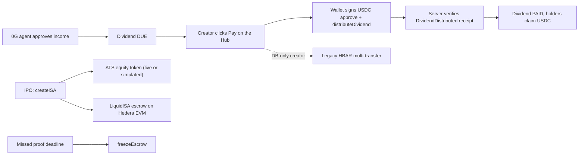
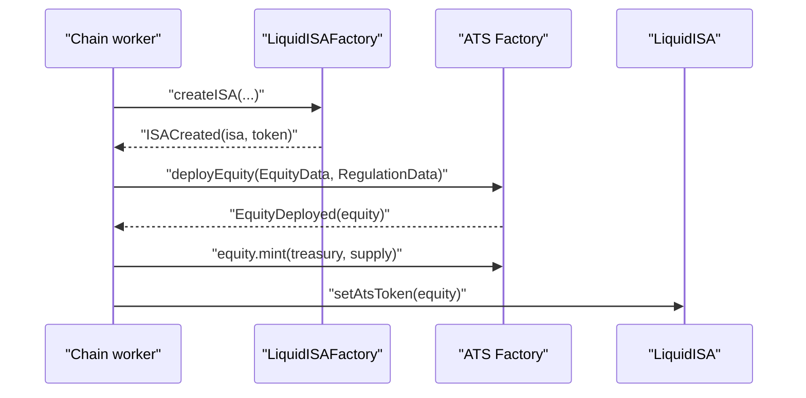

# Hedera integration

Verified against npm, the Asset Tokenization Studio (ATS) packages, and
docs.hedera.com on 2026-11-06.

**Status:** live on testnet, with SIMULATED fallbacks for runs without keys.
One real ATS equity token (`$MUSH`) was minted live; new live mints currently
revert, so they fall back to simulated (see
[Live result on testnet](#live-result-on-testnet)). The default mode stays
simulated (`ATS_MODE=simulated`). Dividends for onchain creators are USDC
through the ISA (see [Dividend payout](#dividend-payout)). HBAR pays only gas,
the 0.1 HBAR x402 audit-report fee (see [x402 research agent](../x402-agent.md))
and a legacy multi-transfer rail for DB-only or simulated creators.

SMX uses these Hedera features:

| Feature | What it does | Code |
| --- | --- | --- |
| Hedera EVM | Hosts `LiquidISAFactory`, `LiquidISA`, `CreatorShareToken`, `CreatorPool` and `MockUSDC` (chain `296`). | `packages/contracts`, `integrations/chain.ts` |
| Asset Tokenization Studio | Mints the creator's equity token (for example `$MUSH`) through the public ATS Factory on testnet when `ATS_MODE=live`; otherwise simulated. | `integrations/hedera-ats.ts` |
| Legacy HBAR dividend rail | For DB-only or simulated creators, the creator's wallet signs one Hedera transfer that pays every holder. Onchain creators pay USDC through the ISA instead. | `services/payment/hedera-*.ts`, `client/hedera-pay.ts` |
| x402 audit paywall | `GET /creators/{ticker}/audit-report` answers 402 until the caller pays 0.1 HBAR. | `routes/GetCreatorAuditReport.ts`, `services/payment/x402-paywall.ts` |

## Network facts

| Item | Value |
| --- | --- |
| Network | Hedera testnet |
| EVM chain id | `296` (mainnet is `295`) |
| JSON-RPC relay (Hashio) | `https://testnet.hashio.io/api` |
| Native currency | HBAR (18 decimals on the EVM side, 8 on the native side: tinybars) |
| Explorer | [HashScan](https://hashscan.io/testnet) |
| Faucet | [portal.hedera.com/faucet](https://portal.hedera.com/faucet) (EVM address or account id) |
| Mirror node | `https://testnet.mirrornode.hedera.com/api/v1` |

Hashio is for development only and can throttle. Keep a fallback relay URL in
`.env`.

### HashScan URLs

- Transaction: `https://hashscan.io/testnet/transaction/<tx-hash-or-id>`
- Account or EVM address: `https://hashscan.io/testnet/account/<id-or-0x-address>`
- Contract: `https://hashscan.io/testnet/contract/<0x-address>`
- Token: `https://hashscan.io/testnet/token/<0.0.id>`

## Environment variables

| Variable | Secret | Description |
| --- | --- | --- |
| `HEDERA_OPERATOR_ID` | No | `0.0.x` operator account. It is the x402 fee payer and receives the audit-report fee. Legacy alias: `HEDERA_ACCOUNT_ID`. |
| `HEDERA_OPERATOR_KEY` | Yes | ECDSA key of the operator, raw `0x` hex or Hedera DER hex. Legacy alias: `HEDERA_PRIVATE_KEY`. Create an ECDSA account in the [Hedera portal](https://portal.hedera.com). |
| `HEDERA_NETWORK` | No | `testnet` (default) or `mainnet`. |
| `HEDERA_DIVIDEND_TOKEN_ID` | No | HTS token id for the legacy rail's dividend asset (a testnet USDC, 6 decimals). Unset means HBAR. |
| `DIVIDEND_HBAR_PER_USDC` | No | Testnet conversion for the legacy HBAR rail: HBAR sent per 1 USDC due. Default `0.0001` on testnet, so a $250 dividend sends 0.025 HBAR. No default on mainnet: unset there (without a token id) turns the HBAR rail off. Up to 8 decimals. Not a market price. |
| `HEDERA_ALLOW_SIMULATED` | No | In production, `1` allows SIMULATED receipts when no operator keys are set. Outside production they are always allowed. |
| `HEDERA_OPERATOR_PAYOUT` | No | `1` lets the worker pay holders from the operator's own HBAR when the creator did not sign (the demo "Mark as paid"). Default off. |
| `HEDERA_RPC_URL` | No | JSON-RPC relay for ATS calls when `CHAIN_RPC_URL` is unset. Default Hashio. |
| `CHAIN_RPC_URL` | No | `https://testnet.hashio.io/api`. Unset means a simulated chain. |
| `CHAIN_ID` | No | `296`. |
| `ORACLE_PRIVATE_KEY` | Yes | ECDSA key (0x hex) of the oracle and deployer. Fund it from the faucet. |
| `FACTORY_ADDRESS` | No | Deployed `LiquidISAFactory`. |
| `ATS_MODE` | No | `live` or `simulated` (default). `ATS_ENABLED=1` also means live. Live signs with the operator key (`HEDERA_OPERATOR_KEY`), never `ORACLE_PRIVATE_KEY`. |
| `ATS_FACTORY_ADDRESS` | No | ATS `Factory` proxy. Default on testnet: `0xd1F118A40f3b02883D35909eF2517e7EDd78379d` (0.0.9213391). |
| `ATS_RESOLVER_ADDRESS` | No | ATS BLR proxy. Default on testnet: `0xBA2D5FC2083A0b8f164c50e65d782087fBA18E0a` (0.0.9212226). |
| `ATS_CONFIG_VERSION` | No | Resolver configuration version. Unset or `0` uses `1` (the BLR rejects `0`). |

With no `HEDERA_OPERATOR_*` variables the dev and demo paths return SIMULATED
results and log a warning, so the demo runs with no keys. In production that
fallback is off: payment requests fail with 503 unless `HEDERA_ALLOW_SIMULATED=1`.
With keys present a failed payout throws (and retries); it never turns into a
`sim:` receipt. Env is read at boot, so restart the server after adding keys:
a server started before the keys appeared keeps answering `mode: "simulated"`.

## Mint a creator equity token with ATS

[Asset Tokenization Studio](https://github.com/hashgraph/asset-tokenization-studio)
(ATS) deploys regulated securities (ERC-1400 and ERC-3643 style) as diamond
proxies, created by an on-chain `Factory` that points at a Business Logic
Resolver.

### Decision: call the ATS Factory, not the SDK

`@hashgraph/asset-tokenization-sdk` 8.0.0 is the official client, but it can't
be driven from Node with an operator key:

- Its `Network.connect` supports WalletConnect, MetaMask, DFNS, Fireblocks and
  AWS KMS. There is no private-key signer.
- The ESM build uses extensionless imports that Node can't load, and the
  package pulls Reown and WalletConnect.

The SDK is a thin wrapper over the ATS contracts, so SMX calls the same
contracts directly: `Factory.deployEquity(...)`, then `Equity.mint(...)`, with
`viem` through the Hedera relay. The ABI subset is in `hedera-ats.ts` (copied
from `@hashgraph/asset-tokenization-contracts` 8.0.0).

### Design: ATS mirrors the cap table

`LiquidISA` keeps `CreatorShareToken` as the source of truth for escrow and
dividends. An ATS token has its own corporate-action logic and can't reuse the
ISA's O(1) dividend accounting, so SMX doesn't let `LiquidISA` use it as the
share token. Instead:

1. `createISA` on the factory clones `LiquidISA`, `CreatorShareToken` and `CreatorPool`.
2. The chain worker calls `mintCreatorEquityToken` for the same ticker. The
   supply equals the raise (1 USDC raised = 1 share, 18 decimals) and goes to
   the oracle treasury.
3. The oracle calls `LiquidISA.setAtsToken(atsToken)` once. The address is
   stored and emitted as `AtsTokenSet`, so HashScan links the two.

### Live result on testnet

SMX uses the public reference deployment from
`packages/ats/contracts/deployments/hedera-testnet/newBlr-2026-06-12T11-19-42-198.json`
in the ATS repo. No deployment of your own is needed.

| Item | Value |
| --- | --- |
| Factory proxy | `0xd1F118A40f3b02883D35909eF2517e7EDd78379d` (0.0.9213391) |
| BLR proxy | `0xBA2D5FC2083A0b8f164c50e65d782087fBA18E0a` (0.0.9212226) |
| Equity config | key `0x...01`, version `1` |
| Demo token `$MUSH` | [`0xe3abC950d9daf866653931a314FF3F19E5276AFb` (0.0.11345067)](https://hashscan.io/testnet/contract/0xe3abC950d9daf866653931a314FF3F19E5276AFb) |
| `deployEquity` tx | [`0x02f86bdb...c063df8`](https://hashscan.io/testnet/transaction/0x02f86bdb93777d03b4868e09d0f67789c4bf892c84e0f4f939803d909c063df8) |
| `mint` tx | [`0x734d4aa3...cd1c77fdf`](https://hashscan.io/testnet/transaction/0x734d4aa32ce0efce009b9c705ccbad57005fd7243f864eabf19ea50cd1c77fdf) |
| Cost | about 0.23 HBAR |

This is the only real ATS token. New live mints currently revert (custom error
`0x76f138fb`) and fall back to simulated.

### Prerequisites and limits

- The public deployment predates ATS v8 (June 12, 2026 versus v8 on June 24).
  The ABI in `hedera-ats.ts` matches that deployment, not `main`: the `main`
  `deployEquity` selector reverts with `FunctionNotFound`. A fresh deployment
  from newer sources needs a different ABI.
- The Factory rejects regulation `0/0`. SMX sends `REG_D` / `506(b)` (`2/1`).
- The BLR rejects config version `0`; SMX uses version `1`.
- The testnet contracts are shared and renewable only by their owner. If they
  expire, deploy your own with `npm run deploy:hedera:testnet` in
  `packages/ats/contracts` of the ATS repo and set `ATS_FACTORY_ADDRESS` and
  `ATS_RESOLVER_ADDRESS`.
- `deployEquity` validates an ISIN with a checksum. SMX generates a synthetic
  one (`XS` plus nine hex characters plus the ISO 6166 check digit).
- Roles: the operator gets `ISSUER` under both the v7 and v8 hashes so it can
  mint. The operator signs, not `ORACLE_PRIVATE_KEY`, so nonces don't collide.
- Live mode is behind `ATS_MODE=live`. On any error SMX logs and falls back to a
  SIMULATED token (status `SIMULATED`), so an IPO never fails because of ATS.

## Dividend payout

The app computes every dividend in USDC (`MockUSDC`, not Circle USDC). There
are two rails.

### Onchain creators: USDC through the ISA

When the chain is live and the creator has an ISA address, no HBAR moves.

1. On the Hub, the creator's wallet signs `MockUSDC.approve(isa, amount)`
   (skipped when the allowance is enough), then
   `LiquidISA.distributeDividend(amount)`. The amount is the USD due in
   6-decimal USDC. Gas is the estimate plus 20%.
2. The browser posts the `txHash` to `POST /dividends/{id}/payment`. The server
   checks the receipt: it succeeded, the sender is the creator's wallet, the
   target is the ISA, and a `DividendDistributed` event from that wallet
   carries exactly the amount due. Then SQL `pay_dividend_onchain` marks the
   dividend `PAID` and stores the hash in `paid_tx_hash`. It also settles the
   queued oracle `distributeDividend` job so the oracle never pays twice, and
   it skips the HBAR stream.
3. Holders claim from Portfolio ("Dividends to claim"). The page reads
   `withdrawableOf` for each held onchain creator (cached 15 seconds). The
   holder's wallet signs `LiquidISA.claim()` and the browser posts
   `{ ticker, txHash }` to `POST /portfolio/claims`. The server checks the
   receipt and the `Claimed` event, then records the claim in
   `dividend_claims`. Recording is idempotent by `txHash`. "Dividends received"
   includes the claims.

A creator without test USDC sees "Get test USDC" and a hint when the wallet has
no HBAR for gas.

### DB-only or simulated creators, and x402: HBAR

The HBAR multi-transfer stays for the x402 paywall and for creators with no
ISA (or a simulated chain). It is one Hedera multi-transfer of HBAR to all
holders, converted at `DIVIDEND_HBAR_PER_USDC`. The testnet default is `0.0001`.
The rate is not a market price.

The rail fails closed on mainnet. There is no default rate: without an explicit
`DIVIDEND_HBAR_PER_USDC` or `HEDERA_DIVIDEND_TOKEN_ID`, it refuses with a 503.

- The creator signs the transfer from their own wallet, so the creator must hold
  enough HBAR. The operator account is the x402 fee payer.
- HBAR also pays gas and the 0.1 HBAR audit report.
- With `HEDERA_OPERATOR_PAYOUT=1`, the worker pays holders from the operator's
  HBAR when the creator did not sign. It is off by default.
- Live settlement example:
  [`0.0.11340822@1793996054.174485762`](https://hashscan.io/testnet/transaction/0.0.11340822@1793996054.174485762).
