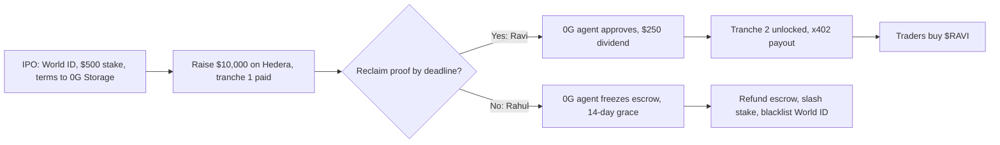

# Pitch and demo playbook

Tagline: *StakeMe Exchange (SMX): the world's first liquid stock market for
human potential.*

SMX builds on three sponsors: Hedera, World ID, and 0G. Reclaim supplies the
zkTLS bank proof that the 0G agent audits. Chainlink CRE, Arkiv, and Arc were
dropped; see [deprecated/](deprecated/README.md).

## Elevator pitch

Day traders speculate on dead corporations while banks refuse to lend to
brilliant young talent. SMX lets ambitious creators and professionals IPO their
future income with a liquid income share agreement (L-ISA). Investors fund
them today and receive cryptographically enforced dividends from real-world
income. Hold the token for yield or trade it on life events.

An L-ISA pledges a percentage of income (for example, 5%) for a fixed term
(for example, 5 years) with no dollar cap.

## User journeys

Example: $10,000 raise, $500 creator stake, 5% income share for 5 years.

### Happy path: Ravi, the honest developer

1. IPO: Ravi connects a wallet (WalletConnect, or a generated or imported
   key) and verifies with World ID v4. He stakes $500 USDC and signs the L-ISA.
   SMX uploads the terms to 0G Storage in the background.
2. Raise: investors fund $10,000; 10,000 `$RAVI` tokens are minted. Ravi gets
   tranche 1 ($2,000); $8,000 stays in escrow on Hedera.
3. Proof: in month 3 Ravi proves a $5,000 bank deposit with a Reclaim zkTLS
   proof. The demo uses the mock bank.
4. Audit: the 0G agent checks the proof against the L-ISA terms and computes a
   $250 dividend. It runs on 0G Compute when enabled and on a rules engine
   otherwise. The decision log goes to 0G Storage.
5. Payout: the agent unlocks tranche 2 ($4,000). Ravi signs one x402-style
   Hedera transfer in his own wallet that pays $250 to every `$RAVI` holder.
6. Market: traders buy `$RAVI`; price rises.

### Sad path: Rahul, the scammer

1. World ID blocks fake accounts and repeat IPOs. Rahul raises $10,000, takes
   tranche 1 ($2,000), and disappears.
2. Month 3: no Reclaim proof. The agent freezes the Hedera escrow (safe stop)
   and a 14-day grace period starts. A late approved proof unfreezes it.
3. Liquidation: $8,000 escrow refunded, $500 stake slashed to investors,
   World ID nullifier blacklisted. Referral to a debt collector is off-chain
   and narrative only.

## Three-minute stage pitch

1. **0:00–0:30 Hook.** Problem above. "Welcome to StakeMe Exchange."
2. **0:30–1:15 Self-IPO.** Connect a wallet. Launch `$MUSH` on Hedera. Verify
   with World ID. Stake $500.
3. **1:15–2:00 Stack.** Escrow; Reclaim proof of a bank deposit; the 0G agent
   audits against the L-ISA terms; unlock tranche; the creator signs the Hedera
   x402-style dividend payout.
4. **2:00–2:30 Scam protection.** Missed proof → escrow freeze → refund,
   slash, blacklist.
5. **2:30–3:00 Close.** Hold or trade `$MUSH`. Scan the QR code. 5% of any
   prize streams to holders.

## Demo setup with no spend

1. Reclaim: the `/mock-bank` page with a hardcoded $5,000 deposit; a provider
   on the Reclaim developer free plan. The provider URL is a tunnel, so
   publish a new provider version if the tunnel restarts.
2. World ID: the Simulator in the Developer Portal (staging app).
3. Hedera: testnet faucet (10 HBAR per day without sign-in). Each IPO costs
   about 0.76 HBAR with the clone factory.
4. 0G: Galileo testnet faucet; show `chainscan-galileo.0g.ai`. Storage works
   with the faucet balance. Compute is off by default.
5. Wallets: a WalletConnect project id, or the generate and import options.

With no keys at all, `npm run seed:demo` and `npm run dev` run the whole story
in simulated chain mode.

## What is real and what is simulated

Say this out loud if a judge asks.

| Claim | Status |
| --- | --- |
| Hedera factory and `MockUSDC` | Deployed on testnet (chain 296). The factory address may change on redeploy; see `packages/contracts/deployments/hedera-testnet.json`. |
| World ID v4 | Real proof from the Simulator, verified through the v4 API. |
| 0G Storage | Real uploads on Galileo, in the background. Until one finishes, the ref is `local:<sha256>`. |
| 0G Compute audit | Opt-in. It needs a 3 0G ledger deposit, so the demo audit uses the rules engine. 0G Router credits are pending. |
| Bank | The mock bank stands in for a real bank. |
| Reclaim end-to-end callback | Pending a stable host for the mock bank. |
| Dividend payout | The creator signs the transfer, but live settlement needs Hedera operator keys; otherwise it is simulated. |
| Hedera ATS equity token | Simulated. Never run against a live ATS deployment. |
| Trading | A simulated AMM with virtual liquidity. |

## Sponsor questions for booth visits

- **0G:** Which 0G Storage telemetry logs do judges want for our "safe-stop"
  fallback (escrow freeze when proofs stop)? When will 0G Router credits be
  available, and is there a faucet path to the 3 0G Compute ledger deposit?
- **Hedera:** For x402 micro-dividends to many holders, would you pay HTS
  tokens or HBAR? Do you recommend a lock-and-mint bridge to an EVM testnet
  for a Uniswap pool?
- **World ID:** Can we query contract state before the IDKit modal opens to
  block blacklisted nullifiers? (`/api/world-id/check` does this on the server
  today.)
