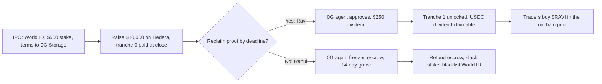

# Pitch and demo playbook

Tagline: *StakeMe Exchange (SMX): a liquid stock market for
human potential.*

SMX builds on three sponsors: Hedera, World ID, and 0G. Reclaim supplies the
zkTLS bank proof that the 0G agent audits. Other sponsors were
dropped.

## Elevator pitch

Day traders speculate on dead corporations while banks refuse to lend to
brilliant young talent. SMX lets ambitious creators and professionals IPO their
future income with a liquid income share agreement (L-ISA). Investors fund
them today and receive cryptographically enforced dividends from real-world
income. Hold the token for yield or trade it on life events.

An L-ISA pledges a percentage of income (for example, 5%) for a fixed term
(for example, 5 years) with no dollar cap.

## User journeys

Example: $10,000 raise, $500 creator stake, 5% income share for 5 years.

### Happy path: Ravi, the honest developer

1. IPO: Ravi connects a wallet (WalletConnect, or a generated or imported
   key) and verifies with World ID v4. He stakes $500 USDC (at least 5% of the raise), picks a tranche
   preset and a monthly proof cadence, and signs the L-ISA. SMX mints his
   equity token through the Hedera ATS Factory and uploads the terms to 0G
   Storage in the background.
2. Raise: investors sign `approve` and `invest` in their own wallets, funding
   $10,000; 10,000 `$RAVI` tokens are minted. When the raise closes, Ravi gets
   tranche 0 ($2,000), and $8,000 stays in escrow on Hedera.
3. Proof: in month 3 Ravi proves a $5,000 bank deposit with a Reclaim zkTLS
   proof. The demo uses the mock bank.
4. Audit: the 0G agent checks the proof against the L-ISA terms and computes a
   $250 dividend. It runs on 0G Private Computer through the 0G Router and
   judges authenticity and reporting period, not size. A genuine low month is
   still approved: an $800 deposit earns a $40 dividend, but the next tranche
   stays locked unless income reaches Ravi's minimum ($1,000 by default). A
   pre-check denies a deposit dated outside the reporting period without a 0G
   call. The decision log goes to 0G Storage.
5. Payout: the agent unlocks tranche 1 ($4,000). Ravi signs a MockUSDC
   `approve` and `distributeDividend($250)` in his own wallet. The server
   verifies the receipt and marks the dividend paid. Each `$RAVI` holder then
   clicks "Dividends to claim" on the Portfolio and signs `claim()`. Payouts
   follow onchain token ownership, so tokens moved outside SMX still earn.
6. Market: the raise close opens a constant-product pool for `$RAVI`. Traders
   sign `approve` and the swap in their wallets, and the price rises with
   demand. After the term ends, the token is sell-only and Ravi gets his stake
   back.

### Sad path: Rahul, the scammer

1. World ID blocks fake accounts and repeat IPOs. Rahul raises $10,000, takes
   tranche 0 ($2,000), and disappears.
2. Month 3: no Reclaim proof, or a dividend stays unpaid. The agent freezes
   the Hedera escrow (safe stop) and a 14-day grace period starts. A late
   approved proof unfreezes it.
3. Liquidation: $8,000 escrow refunded to the current token holders, $500
   stake slashed to them, World ID nullifier blacklisted. Referral to a debt
   collector is off-chain and narrative only.

## Three-minute stage pitch

1. **0:00–0:30 Hook.** Problem above. "Welcome to StakeMe Exchange."
2. **0:30–1:15 Self-IPO.** Connect a wallet. Launch `$MUSH` on Hedera. Verify
   with World ID. Stake $500. Show the ATS token on HashScan.
3. **1:15–2:00 Stack.** Escrow; Reclaim proof of a bank deposit; the 0G agent
   audits against the L-ISA terms; unlock tranche; the creator signs the creator
   pays the USDC dividend and holders claim it.
4. **2:00–2:30 Scam protection.** Missed proof → escrow freeze → refund,
   slash, blacklist.
5. **2:30–3:00 Close.** Hold or trade `$MUSH` in the onchain pool. Scan the QR
   code. 5% of any prize streams to holders.

## Demo setup with no spend

1. Reclaim: the `/mock-bank` page with six selectable income scenarios
   ($5,000 salary by default); a provider on the Reclaim developer free plan that
   points at the production host.
2. World ID: the Simulator in the Developer Portal (staging app).
3. Hedera: testnet faucet (10 HBAR per day without sign-in). Each IPO costs
   about 0.76 HBAR with the clone factory. Investors get MockUSDC from the
   in-app faucet (1,000 per click, from the portfolio or the order ticket).
4. 0G: Galileo testnet faucet; show `chainscan-galileo.0g.ai`. Storage works
   with the faucet balance. Compute is off by default.
5. Wallets: a WalletConnect project id, or the generate and import options.

With no keys at all, `npm run seed:demo` and `npm run dev` run the whole story
in simulated chain mode.

## What is real and what is simulated

Say this out loud if a judge asks.

| Claim | Status |
| --- | --- |
| Hedera contracts | Factory, `LiquidISA`, `CreatorShareToken`, `CreatorPool` and `MockUSDC` are deployed on testnet (chain 296) and verified on Sourcify. The factory address may change on redeploy; see `packages/contracts/deployments/hedera-testnet.json`. |
| Trading | Real. Each creator has an onchain `CreatorPool` AMM (0.3% fee). Users sign `approve` and the swap; the server verifies receipts and indexes `Swap` events. Creators without a pool (old factory or simulated chain mode) use the SQL AMM. |
| Invest | Real. Users sign `approve` and `LiquidISA.invest`; the server verifies the receipt. |
| Pool liquidity | Protocol-provided. At raise close the protocol mints 10% of the target (minimum 100 USDC) of MockUSDC plus tokens at 1 USDC. |
| USDC | Mock. `MockUSDC`, not Circle USDC. Circle testnet USDC (0.0.429274) exists, but its faucet is too small. |
| World ID v4 | Real proof from the Simulator, verified through the v4 API. |
| 0G Storage | Real uploads on Galileo, in the background. Until one finishes, the ref is `local:<sha256>`. |
| 0G audit | Runs on 0G Private Computer through the 0G Router, with a request ID shown per proof. 0G is required for approval: if the Router fails, the proof stays pending. The rules engine runs only behind `ZG_ALLOW_RULES_FALLBACK=1` and is labelled in the UI. The Router returned no TEE attestation field in live calls, so the UI shows "Private routing (TEE provider)", not "TEE verified". |
| Bank | The mock bank stands in for a real bank (six scenarios: salary $5,000 approved with a $250 dividend; low $800 approved, $40, tranche locked; big $25,000 approved, $1,250; several deposits approved; none $0 approved, no dividend; late, 40 days old, denied by the date pre-check). The zkTLS proof is real. |
| Reclaim end-to-end callback | Pending a full end-to-end run. |
| Dividend payout | Real, in MockUSDC, for onchain creators (MUSH, RAVI, RAHUL): the creator signs `distributeDividend`, holders sign `claim()`, and the server verifies both receipts. The other five creators are DB-only and use a legacy HBAR multi-transfer (testnet rate 0.0001 HBAR per USDC). |
| HBAR | Used for gas, the x402 audit-report fee (0.1 HBAR, paid to the operator), and the legacy rail above. The earlier live HBAR dividend is historical evidence of that rail. |
| Hedera ATS equity token | One real ATS token minted: `$MUSH`, through the public ATS testnet Factory. New live mints currently revert, so SMX falls back to a simulated token and the IPO still completes. |
| Platform revenue | Only x402 fees today. A listing fee, dividend fee and swap-fee share are proposed, not built. |
| Known gaps | The contract doesn't check the dividend amount against the income share, and anyone can call `distributeDividend`. Trading outside SMX can't be frozen. The oracle key still signs lifecycle calls. |

## Sponsor questions for booth visits

- **0G:** Which 0G Storage telemetry logs do judges want for our "safe-stop"
  fallback (escrow freeze when proofs stop)? When will 0G Router credits be
  available, and is there a faucet path to the 3 0G Compute ledger deposit?
- **Hedera:** For dividends to many holders, would you pay HTS
  tokens or USDC claims? Do you recommend a lock-and-mint bridge to an EVM testnet
  for a Uniswap pool?
- **World ID:** Can we query contract state before the IDKit modal opens to
  block blacklisted nullifiers? (`/api/world-id/check` does this on the server
  today.)
