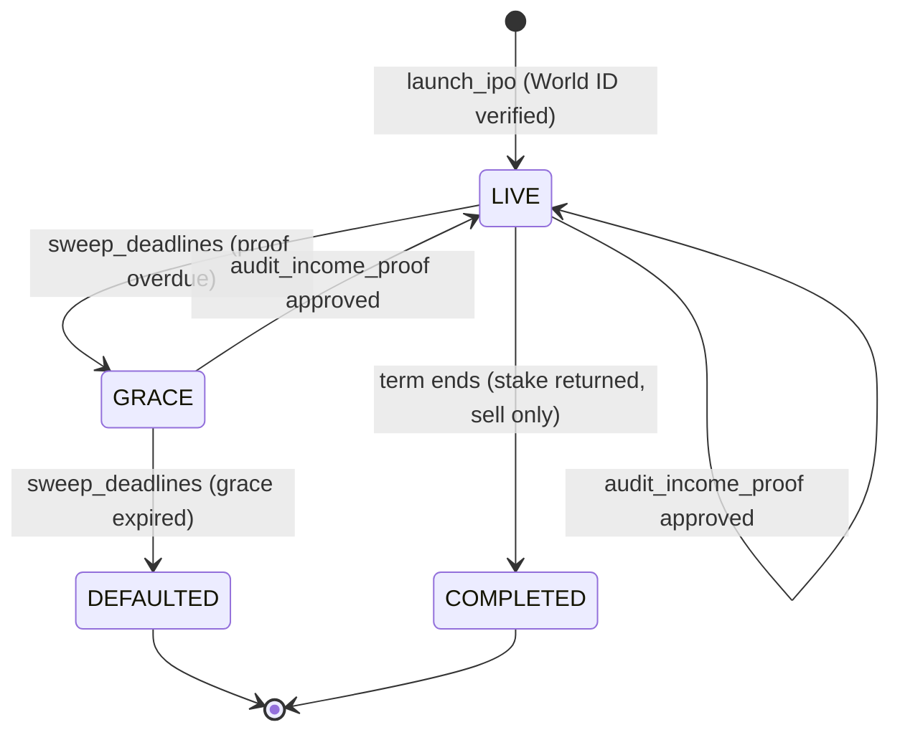
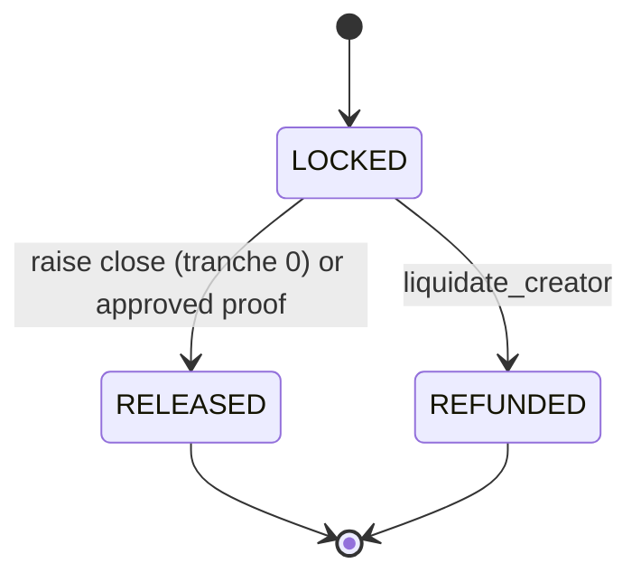
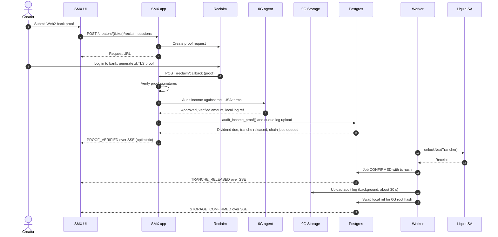
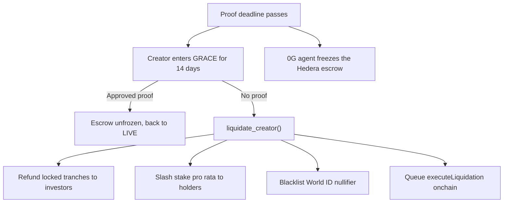

# StakeMe Exchange (SMX) product and system spec

This is the source of truth for what SMX does. For how to write the code, see
[`engineering-guide.md`](engineering-guide.md). When the two disagree about
architecture or code style, the engineering guide wins. When this spec and the
guide's placeholders differ, use the values in [Project constants](#project-constants).

## Product

SMX is a liquid stock market for human potential. A creator "IPOs" a share of
their future income through a liquid income share agreement (L-ISA): a fixed
percentage of income (default 5%, `share_bps = 500`) for a fixed term (default
60 months), with no dollar cap. Investors fund the raise in USDC and receive
creator tokens (for example, `$MUSH`). Token holders earn dividends from
verified Web2 income and can trade tokens on an exchange.

Built for ETHGlobal Mumbai (hackathon MVP). The demo runs end to end on a
laptop without paid services or testnet keys (simulated chain mode). With keys,
the same app runs against Hedera testnet, World ID staging, and 0G Galileo. See
[Implementation status](#implementation-status) for what is live and what is
simulated.

### Sponsor integrations

SMX uses exactly three sponsors: Hedera, World ID, and 0G. Reclaim Protocol is
the zkTLS proof source, not a sponsor target. Other sponsors were dropped.

| Sponsor | Role in SMX | Demo fallback |
| --- | --- | --- |
| World ID | v4 proof of unique human at IPO. The server signs the RP request (`POST /api/rp-signature`) and verifies the proof; `POST /api/world-id/check` rejects a used or blacklisted nullifier before submit. The nullifier is stored in Postgres and on the factory contract. | World ID Simulator (staging app); `DEMO_MODE=1` fixture proofs. |
| Hedera | EVM testnet (chain 296) for the `LiquidISA` clone factory, escrow, share tokens and the `CreatorPool` AMM. Live ATS equity tokens (`$MUSH`: `0xFDC2...4517`) minted for new IPOs through the public Asset Tokenization Studio (ATS) testnet Factory when `ATS_MODE=live`. USDC dividends: the creator signs `distributeDividend` in their wallet and holders `claim()`. HBAR pays gas and the x402 audit-report fee (0.1). Safe-stop escrow freeze. | Simulated chain mode (`CHAIN_RPC_URL` unset); simulated receipts, and a simulated ATS token if a live ATS call errors. The legacy HBAR dividend rail has no simulated fallback in production. |
| 0G | Auditor agent that approves or denies milestones and computes dividends. It runs on 0G Private Computer through the 0G Router; 0G Compute through the SDK broker is opt-in, and the rules engine runs only behind `ZG_ALLOW_RULES_FALLBACK=1`. L-ISA terms and every audit log go to 0G Storage through a background outbox. Triggers the safe-stop freeze. | Rules engine; `local:<sha256>` refs. |
| Reclaim Protocol | zkTLS proof of a Web2 bank deposit that the 0G agent verifies. The mock bank (`/mock-bank`) stands in for a real bank and shows the deposits of the income scenario picked at login (six scenarios: salary $5,000 by default, low $800, big $25,000, several deposits, none, late). | `DEMO_MODE=1` fixture proof. |

Wallets: sign-in uses SIWE. Users connect with WalletConnect (1inch Wallet
featured), generate a local key, or import a key. The Hedera payment signer
offers the same three choices.

## Project constants

| Placeholder | Value |
| --- | --- |
| `{{PROJECT_NAME}}` | StakeMe Exchange (SMX) |
| `{{SCOPE}}` | `@stakeme` |
| `{{SCHEMA}}` | `smx` |
| `{{PORT}}` | `4020` |
| Local Docker Postgres host port | `5442` (container 5432) to avoid conflicts |
| Repo | `github.com/predatorx7/stakeme-ex` |

Packages:

```
packages/
	app/        @stakeme/app        Backend + server-rendered exchange UI. Owns openapi.yaml, sql/, migrations/, src/services (adapters).
	client/     @stakeme/client     Typed SDK generated from app/openapi.yaml.
	contracts/  @stakeme/contracts  Hardhat 3 + viem. LiquidISA.sol, share token, factory (EIP-1167 clones), tests, deploy scripts. Exports ABIs as `.gen.ts`.
```

Architecture follows Builder (Express 5 + OpenAPI + PGTyped + Kita TSX + htmx
+ `@reclaimprotocol/design`). SMX is Express and htmx, not Next.js. It has no
React, wagmi, or recharts: browser modules use `viem`, Builder's TSX chart
components, and `@worldcoin/idkit-core` (framework-neutral) for World ID.

Sponsors plug in through three adapters in `src/services/`: `IStorageProvider`,
`IOracle`, and `IPaymentRail`. See
[`architecture-adapters.md`](architecture-adapters.md).

## Domain model (schema `smx`)

Money is `money_amount NUMERIC(18,6)` (USDC has 6 decimals). Token amounts are
`token_amount NUMERIC(38,18)`. Wallet addresses use a domain
`evm_address CITEXT CHECK (VALUE ~ '^0x[0-9a-fA-F]{40}$')`. Tx hashes use
`tx_hash TEXT CHECK (VALUE ~ '^0x[0-9a-f]{64}$')`.

| Table | Purpose |
| --- | --- |
| Better Auth tables | Users and sessions. Sign-in with Ethereum (SIWE) plugin; wallet address on the user. |
| `creators` | One L-ISA per creator: `ticker` (3–6 upper letters, unique), `display_name`, `headline`, `share_bps`, `term_months`, `target_raise`, `stake_amount`, `raised_amount`, `status creator_status`, `world_id_nullifier` (unique), `terms_ref` (0G root hash, or `local:<sha256>` until the upload finishes), `terms_hash` (sha256), `contract_address`, `token_address`, `pool_address`, `ats_token_address`, `chain_id`, `proof_cadence ('MONTHLY','QUARTERLY')`, social links (`x_url`, `github_url`, `linkedin_url`, `website_url`), `next_proof_due_at`, `grace_until`, `ipo_at`, `raise_closed_at`. |
| `tranches` | Escrow schedule per creator: `idx`, `amount`, `status tranche_status ('LOCKED','RELEASED','REFUNDED')`, `released_at`, `tx_hash`. Presets of 1 to 5 tranches (`single` = no tranches: 100% releases at raise close, no escrow milestones); default 20% / 40% / 40%. Tranche 0 releases when the raise closes, resized to the amount raised. |
| `creator_updates` | Short posts by a creator to holders (at most 5 per day). |
| `investments` | Primary-market purchases: investor `wallet`, `usdc_amount`, `token_amount`, `tx_hash`. |
| `holdings` | Derived balances per (creator, wallet). Updated by investments and trades. The pool is not a holder, so supply = holdings + pool tokens. |
| `pools` | Constant-product AMM reserves per creator (`usdc_reserve`, `token_reserve`). For an onchain pool, each indexed `Swap` event replaces the reserves; without a pool (old factory or simulated chain mode), the SQL AMM moves them. Seeded at raise close. |
| `trades` | `side trade_side ('BUY','SELL')`, amounts, price, wallet, `tx_hash` (unique per swap). |
| `watchlists` | A signed-in user's watched tickers. |
| `price_ticks` | Price history for charts (`at`, `price`). One tick per trade and per oracle event. |
| `income_proofs` | Reclaim proof per period: `period` (month index), `provider`, `reclaim_proof_id`, `verified_amount`, `status proof_status ('PENDING','APPROVED','REJECTED')`, `audit jsonb` (agent output; `engine` shows `0g-router`, `0g-compute`, `rules-engine` or `pre-check`), `audit_log_ref` (0G Storage root, or `local:<sha256>` until uploaded). |
| `dividends` | `amount_due` = `verified_amount * share_bps / 10000`, `status dividend_status ('DUE','PAID')`, `paid_tx_hash`. |
| `dividend_claims` | One row per verified `Claimed` transaction: `creator_id`, `wallet`, `tx_hash` (unique), USDC `amount`. |
| `oracle_events` | Live feed: `kind oracle_event_kind ('IPO','INVESTED','PROOF_VERIFIED','PROOF_REJECTED','TRANCHE_RELEASED','DIVIDEND_PAID','GRACE_STARTED','DEFAULTED','TRADE','ESCROW_FROZEN','ESCROW_UNFROZEN','STORAGE_CONFIRMED','CREATOR_UPDATE','STAKE_RETURNED')`, `creator_id`, `payload jsonb`. Published to pgmb for SSE. |
| `chain_jobs` | Outbox of onchain calls (`fn`, `args jsonb`, `status ('QUEUED','SENT','CONFIRMED','FAILED','SIMULATED')`, `tx_hash`). Optimistic UI reads DB state; the worker confirms later. |
| `blacklisted_nullifiers` | World ID nullifiers banned after default. |
| `reclaim_sessions` | One row per Reclaim verification session: `status`, `failure_reason`, `org_id`, `proof_id`. |
| `storage_uploads` | Outbox for 0G Storage uploads: `kind ('LISA_TERMS','AUDIT_LOG')`, `status ('QUEUED','UPLOADED','FAILED','SKIPPED')`, `attempts`, `next_attempt_at`. |

`creator_status`: `'DRAFT','LIVE','GRACE','DEFAULTED','COMPLETED'`. `launch_ipo` creates creators as `LIVE`; `DRAFT` is unused.



Tranche lifecycle:



### Business logic in SQL

Write these as SQL functions in `ddl.sql`, called from `queries.sql`:

- `smx.launch_ipo(...)`: asserts the creator stake is at least 5% of the target
  raise and the nullifier isn't blacklisted or used,
  creates the creator (social links, proof cadence), tranches (1 to 5 entries
  summing to 10000 bps), pool, first tick, `IPO` event, and `chain_jobs` rows
  for `createISA` and `initializeIPO`. All tranches start `LOCKED`. The L-ISA
  terms are committed with a `local:<sha256>` ref and queued for 0G Storage.
- `smx.record_investment(creator, wallet, usdc)`: mints tokens 1:1 at the IPO
  price (1 USDC = 1 token), caps at the remaining raise, updates holdings. A
  fill closes the raise.
- `smx.finish_raise(creator)` and `smx.close_raise(creator, user)`: close the
  raise (full, or early by the creator). They resize the tranches to the amount
  raised, release tranche 0, start the term clock and the first proof
  deadline, and open the pool.
- `smx.amm_swap(creator, wallet, side, amount_in, min_out)`: the SQL
  constant-product AMM with 0.3% fee and a slippage guard, used when a creator
  has no onchain pool. Rejects when the creator is `DEFAULTED`, and rejects
  buys once the term has ended (`COMPLETED` is sell only).
- `smx.ingest_onchain_swap(...)` and `smx.ingest_onchain_invest(...)`: with an
  onchain pool, record a user-signed swap or investment from its verified
  receipt. The chain is the truth and SQL is the index. Both are idempotent on
  the transaction hash.
- `smx.post_creator_update(...)`: the creator's owner posts an update; limited
  to 5 per day.
- `smx.audit_income_proof(proof_id, verified_amount, audit jsonb)`: applies the
  agent's verdict. The 0G Router model proposes it, and a model answer that
  breaks the rules is overridden by the rules engine. A pre-check denies a
  deposit dated outside the reporting period before any 0G call (engine
  `pre-check`). Approve when the period isn't already approved and the auditor doesn't deny
  (size never matters, so a low or $0 month is approved). On approval: create
  the dividend (none for $0), release
  the next locked tranche only when `verified_amount >= min_income` (default 1000 USDC; a lower month leaves it locked and `PROOF_VERIFIED` carries the note) (if any; a single-tranche creator has none left, so approval only creates the dividend), move `next_proof_due_at` by one cadence (30 days monthly, 90 quarterly), clear grace,
  insert `PROOF_VERIFIED` and `TRANCHE_RELEASED` events and chain jobs. A late
  approval in `GRACE` also emits `ESCROW_UNFROZEN` and queues `unfreezeEscrow`.
  The audit log is committed with a `local:<sha256>` ref and queued in
  `storage_uploads`.
- `smx.pay_dividend_onchain(dividend_id, tx_hash, holders, user)`: for an
  onchain creator, marks the dividend `PAID` from the creator's own verified
  `distributeDividend` transaction, settles the queued oracle job by that hash
  (the oracle doesn't pay it a second time), and drops per-holder HBAR payouts.
  Holders claim USDC onchain; the server records each verified `Claimed`
  receipt in `dividend_claims`.
- `smx.pay_dividend(dividend_id, tx_hash)`: the legacy HBAR rail for DB-only or
  simulated creators. Marks paid and emits `DIVIDEND_PAID` with a per-holder
  split (pro rata by holdings).
- `smx.enqueue_storage_upload`, `claim_storage_upload`,
  `complete_storage_upload`: the 0G Storage outbox. On upload, the root hash
  replaces the local ref and `STORAGE_CONFIRMED` is emitted.
- `smx.sweep_deadlines(now)`: `LIVE` creators past `next_proof_due_at`, or with
  a dividend unpaid for a full cadence, enter `GRACE` for 14 days and the
  escrow is frozen (`ESCROW_FROZEN`, chain job `freezeEscrow`); `GRACE`
  creators past `grace_until` are liquidated. `LIVE` creators past the term
  end become `COMPLETED`: the stake returns (`STAKE_RETURNED`, chain job
  `reclaimStake`) and the token is sell only.
- `smx.liquidate_creator(creator)`: refunds locked tranches pro rata to the
  current token holders (by holdings, not original investors), slashes the
  stake pro rata to the same holders, blacklists the nullifier, sets
  `DEFAULTED`, emits `DEFAULTED`, queues `executeLiquidation`.

## Smart contracts (`packages/contracts`)

- `CreatorShareToken.sol`: ERC-20 (OpenZeppelin), minted only by its
  `LiquidISA`. Hooks into dividend accounting on transfer. The pool is
  excluded from the dividend denominator.
- `CreatorPool.sol`: constant-product AMM between `MockUSDC` and one creator's
  token, cloned per ISA. The 0.3% fee stays in the pool. The ISA seeds it at
  raise close with 10% of the target (minimum 100 USDC) of protocol-minted
  `MockUSDC` plus the same value in tokens at 1 USDC. Swaps revert when
  `tradingOpen()` is false. See [`contracts.md`](contracts.md#pool).
- `LiquidISA.sol`: one per creator, cloned (EIP-1167) by
  `LiquidISAFactory.sol`, which also clones the share token and the pool, maps each World ID
  nullifier to its ISA, and keeps the blacklist. Constructors are
  `initialize(...)`. Addresses are in
  `packages/contracts/deployments/hedera-testnet.json` and change on redeploy.
  - State: `usdc`, `creator`, `oracle`, `totalRaise`, `escrowBalance`,
    `creatorStake`, `shareBps`, `termEnd`, `tranches[]`, `nextTranche`,
    `defaulted`.
  - `initializeIPO()`: creator deposits the USDC stake.
  - `invest(amount)`: the investor signs `approve` and `invest` from their own
    wallet, deposits USDC, receives tokens 1:1 and funds escrow. When the raise
    target is met (or the creator calls `closeRaise()`), the ISA seeds the pool
    and releases tranche 0.
  - `unlockNextTranche()`: only the oracle. Transfers the next tranche to the
    creator.
  - `distributeDividend(amount)`: the creator signs `approve` and this call from
    their wallet to deposit USDC. It accrues through a dividend-per-share
    accumulator (`magnifiedDividendPerShare`); holders `claim()`. O(1) gas
    regardless of holder count. Payouts follow onchain token ownership, so
    tokens moved outside SMX still earn; the pool is excluded. Known gaps: the
    contract doesn't check the amount against `shareBps`, and anyone can call
    it.
  - `freezeEscrow()` / `unfreezeEscrow()`: only the oracle. A frozen escrow
    blocks `unlockNextTranche`, `reclaimStake`, the automatic tranche 0
    release and pool trading; claims and liquidation still work.
  - `executeLiquidation()`: only the oracle. Moves remaining escrow and the
    stake into the dividend accumulator as refunds, sets `defaulted`, emits
    `CreatorDefaulted(nullifierHash)`.
  - `reclaimStake()`: returns the stake to the creator after the term ends.
  - `MockUSDC.sol` (6 decimals, public mint, capped `faucet`) for testnets.
- Networks: `hardhatMainnet` (simulated), `hederaTestnet` (chain 296, the
  target), plus `sepolia` and `ogGalileo` configs that the demo doesn't use. Keys come from Hardhat
  configuration variables, never committed.
- ABIs are exported from `packages/contracts/src/abis.gen.ts` and imported by
  the app as `@stakeme/contracts`.

## Routes (operation ids)

Pages render HTML; the same handler returns JSON by content negotiation.

| Method and path | operationId | Notes |
| --- | --- | --- |
| `GET /` | `GetExchange` | Trending creators, price, 24h change, chart, live oracle events (SSE). |
| `GET /creators/{ticker}` | `GetCreator` | Instrument view: quote, depth, stats, candles, order ticket with estimate, your position, fundamentals, corporate actions, holders, events. See [`instrument-view.md`](instrument-view.md). |
| `GET /creators`, `GET /activity` | `ListCreators`, `ListActivity` | Keyset-paged creator list and the global event feed. |
| `GET /creators/{ticker}/candles` | `GetCreatorCandles` | OHLC candles for the chart. |
| `GET /creators/{ticker}/chart`, `/chain`, `/holders`, `/proofs`, `/trades`, `/dividends` | `GetCreatorChartFragment`, `GetCreatorChain`, `ListCreatorHolders`, `ListCreatorProofs`, `ListCreatorTrades`, `ListCreatorDividends` | Chart region, onchain trading config, and paged lists. |
| `GET /creators/{ticker}/audit-report` | `GetCreatorAuditReport` | x402 audit report; answers `402` until paid in HBAR (0.1). |
| `GET /api/zero-g/balance` | `GetZeroGBalance` | 0G Router credit balance. |
| `GET /portfolio` | `GetPortfolio` | Wallet funds, holdings with P&L, transactions, dividends received. |
| `POST /portfolio/faucet` | `RequestTestUsdc` | Mints 1,000 `MockUSDC` to the viewer's wallet (50,000 cap per call, one request per minute). Live chain mode only. |
| `GET /watchlist`, `PUT`, `DELETE /watchlist/{ticker}` | `GetWatchlist`, `PutWatchlistItem`, `DeleteWatchlistItem` | The viewer's watchlist. |
| `GET`, `POST /creators/{ticker}/updates` | `ListCreatorUpdates`, `CreateCreatorUpdate` | Creator updates (owner only, 5 per day). |
| `GET /hub` | `GetCreatorHub` | Viewer's creator dashboard: escrow, Reclaim proof button, pending dividend, collateral. |
| `GET /launch` | `GetLaunch` | IPO form gated by World ID: social links, tranche preset ("No tranches", or 2 to 5; with none, everything releases at raise close and traders see that), monthly or quarterly proof cadence, the terms suggestion calculator, and a hint that the stake must be at least 5% of the target raise. |
| `POST /api/rp-signature` | `CreateRpSignature` | Signs the World ID v4 request on the server. The signal is the session wallet. |
| `POST /api/world-id/check` | `CheckWorldId` | Verifies a proof and rejects a used (409) or blacklisted (403) nullifier. Read-only. |
| `POST /creators` | `LaunchIpo` | Body includes the World ID proof; server verifies it. The 0G upload is queued, not awaited. |
| `POST /creators/{ticker}/investments` | `Invest` | Primary market. With an onchain pool, the body is the `txHash` of the user-signed `invest`; the server verifies the receipt. Otherwise, `usdcAmount` runs the SQL purchase. |
| `POST /creators/{ticker}/close-raise` | `CloseRaise` | The creator ends the raise early. |
| `POST /creators/{ticker}/trades` | `Trade` | With an onchain pool, the body is the `txHash` of the user-signed swap, verified and indexed from its `Swap` event. Otherwise, the SQL AMM (`side`, `amountIn`, `minOut`). |
| `POST /creators/{ticker}/reclaim-sessions` | `CreateReclaimSession` | Returns the Reclaim request URL and status URL. |
| `GET /reclaim/sessions/{sessionId}` | `GetReclaimSessionStatus` | Polling fallback for the proof status. |
| `POST /reclaim/callback` | `ReclaimCallback` | Reclaim posts the proof here. |
| `POST /api/audit-milestone` | `AuditMilestone` | Accepts a Reclaim proof JSON, verifies, runs the 0G audit, calls `audit_income_proof`. A demo fixture needs `DEMO_MODE=1`, the signed-in creator owner, and at most 3 per creator per hour. |
| `POST /api/trigger-default` | `TriggerDefault` | Demo only (`DEMO_MODE=1` and an `X-Admin-Key` header equal to `SMX_ADMIN_KEY`; `403` otherwise): fast-forwards the deadline and liquidates. |
| `POST /dividends/{dividendId}/payment-request` | `CreateDividendPaymentRequest` | Legacy HBAR rail: x402 payment requirements, one per holder, built from SQL. |
| `POST /dividends/{dividendId}/payment` | `PayDividend` | Onchain creator: body is the `txHash` of the creator-signed `distributeDividend`; the server verifies the `DividendDistributed` receipt. A live creator without a `txHash` gets `409`. Legacy rail: an optional `paymentPayload` is settled first. |
| `POST /portfolio/claims` | `CreateDividendClaim` | Records a holder's `claim()` after the server verifies the `Claimed` receipt. |
| `GET /events` | `StreamEvents` | SSE stream of `oracle_events` via pgmb. |
| `GET`, `POST /mock-bank/login` | `GetMockBankLogin`, `MockBankLogin` | Fake bank login (any non-empty credentials) with an income scenario picker. |
| `GET /mock-bank` | `GetMockBank` | Fake bank statement page for the chosen scenario. Needs the login cookie. |
| `GET /mock-bank/api/transactions` | `GetMockBankTransactions` | The auth-bound request the Reclaim provider proves. |
| `GET /healthz` | (built in) | |

## Income proof flow



## Liquidation flow



The freeze is the safe stop: while the escrow is frozen, the creator can't
receive tranches or reclaim the stake. Liquidation still follows if the grace
period ends without an approved proof.

## Dividend payout

When the agent approves a proof, a dividend becomes `DUE`. For an onchain
creator, USDC moves directly between wallets:

1. The creator signs `MockUSDC.approve` and `LiquidISA.distributeDividend(amount)`
   from their wallet on the Hub.
2. The browser posts the `txHash` to `PayDividend`. The server verifies the
   `DividendDistributed` receipt, and `pay_dividend_onchain` marks the dividend
   `PAID`. The oracle no longer pays these dividends.
3. Holders click "Dividends to claim" on the Portfolio and sign `claim()`. The
   server verifies the `Claimed` receipt and records it in `dividend_claims`.

Payouts follow onchain token ownership: tokens moved outside SMX still earn,
and the pool is excluded.

HBAR is now used only for gas, the x402 audit-report fee (0.1 HBAR, paid by
agents and API buyers to the operator), and a legacy HBAR multi-transfer rail
for DB-only or simulated creators (testnet rate `DIVIDEND_HBAR_PER_USDC`,
default 0.0001 HBAR per USDC). The earlier live HBAR dividend
`0.0.11340822@1793996054.174485762` is historical evidence of that rail. On
mainnet the HBAR rail fails closed without an explicit rate or
`HEDERA_DIVIDEND_TOKEN_ID`. In production the rail has no simulated fallback:
without operator keys, payment requests fail with `503` unless
`HEDERA_ALLOW_SIMULATED=1`. Outside production, it returns simulated
`sim:0x...` receipts.

## Terms calculator

The launch form has a collapsible "Suggest terms from your income" panel. It
only suggests: the creator applies the values with "Use these terms" and can
still edit every field. The formulas live in
`packages/app/src/utils/terms-suggest.ts`; the browser and the tests share them.

| Output | Rule |
| --- | --- |
| Projected income | Sum for months k = 1 to term of `income * (1 + growth)^(k/12)`. |
| Share | `ceil(goal * 1.3 / projected * 10000)` bps, clamped to 1-5000. 1.3 is the target investor multiple. |
| Stake | 10% of the goal, at most 50% of savings when given, at least 1 and at least 5% of the goal (`launch_ipo` rejects less). |
| Escrow release | Goal of 6 months of income or less: `single`. Up to 24 months: `20-40-40`. More: `20-20-20-20-20`. |
| Proof cadence | `QUARTERLY` when income varies, else `MONTHLY`. |

Warnings: `share-high` (share over 20%), `goal-unreachable` (the unclamped
share is over 50%; try a longer term or smaller goal), `below-min-income`
(income under the minimum proof amount: proofs are approved but the next tranche stays locked).

## Implementation status

SMX is a hackathon build. This table shows the state as of 2026-11-07. See
[`../CONTEXT.md`](../CONTEXT.md) for details and known issues.

| Area | Status |
| --- | --- |
| Hedera contracts | Live on testnet (chain 296) and verified on Sourcify: clone factory, `LiquidISA`, `CreatorShareToken`, `CreatorPool` and `MockUSDC`. Unit tests pass. |
| Trading | Live onchain. Each creator has a `CreatorPool` AMM; users sign `approve` and the swap, and the server verifies receipts and indexes `Swap` events into SQL. Creators without a pool (old factory or simulated chain mode) use the SQL AMM. |
| Invest | Live onchain. Users sign `approve` and `LiquidISA.invest`; the server verifies the receipt. |
| USDC | Mock. `MockUSDC` (not Circle USDC; Circle testnet USDC 0.0.429274 exists, but its faucet is too small) with an in-app faucet of 1,000 per click and a 50,000 cap. |
| Pool liquidity | Protocol-provided: the protocol mints 10% of the target (minimum 100 USDC) of `MockUSDC` plus tokens at 1 USDC at raise close. |
| Hedera ATS equity token | Live ATS tokens minted through the public ATS testnet Factory with `ATS_MODE=live`. Current `$MUSH`: `0xFDC25E581320050B4013c9054B5Ac44546A04517`; the first live mint `0xe3abC950d9daf866653931a314FF3F19E5276AFb` also exists. The default mode is simulated. `CreatorShareToken` stays the source of truth. |
| Dividend payout | USDC for onchain creators: the creator signs `distributeDividend`, holders `claim()`, the server verifies both receipts. Onchain today: MUSH, RAVI, RAHUL; the other five creators are DB-only and use the legacy HBAR rail (no simulated fallback in production). |
| World ID v4 | Live on a staging app; verified end to end with the Simulator. Production is possible; see [`world-id-debrief.md`](world-id-debrief.md). |
| 0G audit | Live on 0G Private Computer through the 0G Router. If the call fails, the proof stays pending. |
| 0G Storage | Live on Galileo. Uploads run in the background; refs start as `local:<sha256>`. |
| 0G Compute | Opt-in (`ZG_COMPUTE_ENABLED`); needs a 3 0G ledger deposit. |
| Reclaim | Provider live on the production mock bank; the end-to-end in-app callback test is pending. |
| Bank | Mock. The mock bank stands in for a real bank with six scenarios; the zkTLS proof is real. |
| Wallets | WalletConnect QR pairing verified. A full phone-wallet signature is not. |
| Platform revenue | Only x402 fees today. Fees such as a listing or dividend fee are proposed, not built. |
| Gaps | The Exchange "Dividends paid" and "Total raised" KPIs are approximate. The contract doesn't check the dividend amount against `shareBps`; `distributeDividend` is callable by anyone; trading outside SMX can't be frozen; the oracle key still signs lifecycle calls. |

## Optimistic UI

Every mutation writes final state to Postgres in one statement and returns
immediately. Onchain calls go to `chain_jobs`; the worker sends them with
`viem` and updates `tx_hash` and status. The UI shows a pending badge until an
SSE event confirms. In simulated mode (no `CHAIN_RPC_URL`), jobs end as
`SIMULATED` with a deterministic fake hash.

## Demo script

Run `npm run seed:demo`; it must reproduce the happy path
(Ravi) and the sad path (Rahul).
