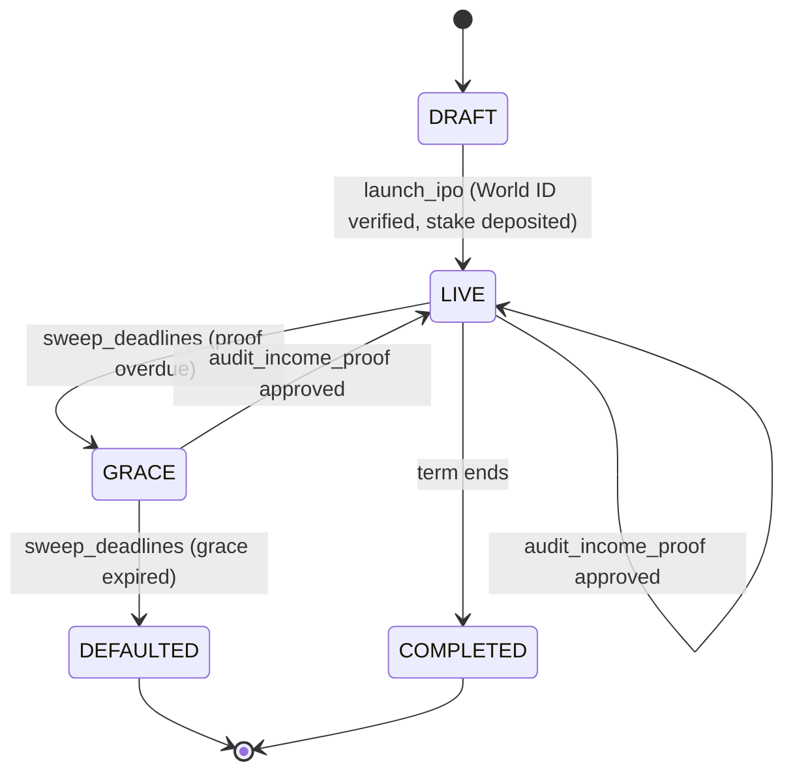
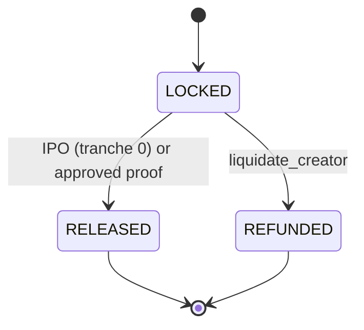
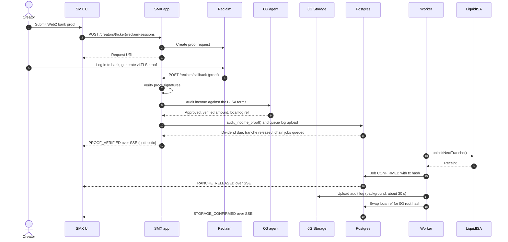
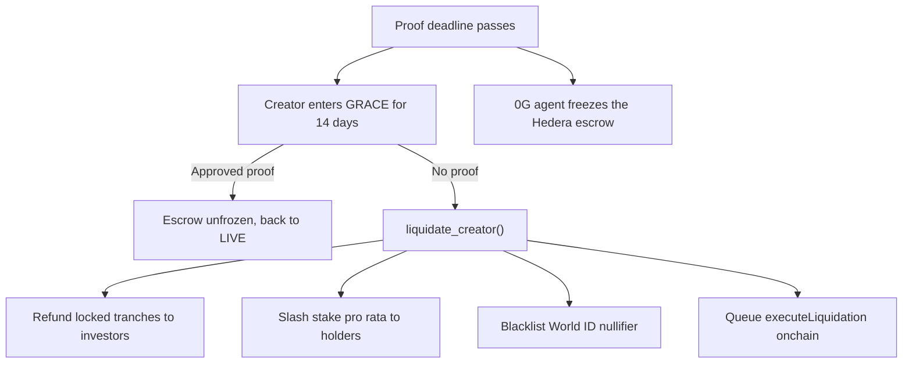

# StakeMe Exchange (SMX) product and system spec

This is the source of truth for what SMX does. For how to write the code, see
[`engineering-guide.md`](engineering-guide.md). When the two disagree about
architecture or code style, the engineering guide wins. When this spec and the
guide's placeholders differ, use the values in [Project constants](#project-constants).

## Product

SMX is a liquid stock market for human potential. A creator "IPOs" a share of
their future income through a liquid income share agreement (L-ISA): a fixed
percentage of income (default 5%, `share_bps = 500`) for a fixed term (default
60 months), with no dollar cap. Investors fund the raise in USDC and receive
creator tokens (for example, `$MUSH`). Token holders earn dividends from
verified Web2 income and can trade tokens on an exchange.

Built for ETHGlobal Mumbai (hackathon MVP). The demo runs end to end on a
laptop with no paid services and no testnet keys (simulated chain mode). With
keys, the same app runs against Hedera testnet, World ID staging, and 0G
Galileo. See [Implementation status](#implementation-status) for what is live
and what is simulated.

### Sponsor integrations

SMX uses exactly three sponsors: Hedera, World ID, and 0G. Reclaim Protocol is
the zkTLS proof source, not a sponsor target. Chainlink CRE, Arkiv, and Arc
were dropped; see [deprecated/](deprecated/README.md).

| Sponsor | Role in SMX | Demo fallback |
| --- | --- | --- |
| World ID | v4 proof of unique human at IPO. The server signs the RP request (`POST /api/rp-signature`) and verifies the proof; `POST /api/world-id/check` rejects a used or blacklisted nullifier before submit. The nullifier is stored in Postgres and on the factory contract. | World ID Simulator (staging app); `DEMO_MODE=1` fixture proofs. |
| Hedera | EVM testnet (chain 296) for the `LiquidISA` clone factory, escrow and share tokens. Creator equity token on the Asset Tokenization Studio (ATS). x402-style dividend payouts: the creator signs one Hedera multi-transfer in their wallet and the server settles it. Safe-stop escrow freeze. | Simulated chain mode (`CHAIN_RPC_URL` unset); simulated receipts. |
| 0G | Auditor agent that approves or denies milestones and computes dividends. 0G Compute is opt-in; otherwise a rules engine runs. L-ISA terms and every audit log go to 0G Storage through a background outbox. Triggers the safe-stop freeze. | Rules engine; `local:<sha256>` refs. |
| Reclaim Protocol | zkTLS proof of a Web2 bank deposit that the 0G agent verifies. The mock bank (`/mock-bank`) stands in for a real bank and shows a hardcoded $5,000 deposit. | `DEMO_MODE=1` fixture proof. |

Wallets: sign-in uses SIWE. Users connect with WalletConnect (1inch Wallet
featured), generate a local key, or import a key. The Hedera payment signer
offers the same three choices.

## Project constants

| Placeholder | Value |
| --- | --- |
| `{{PROJECT_NAME}}` | StakeMe Exchange (SMX) |
| `{{SCOPE}}` | `@stakeme` |
| `{{SCHEMA}}` | `smx` |
| `{{PORT}}` | `4020` |
| Local Docker Postgres host port | `5442` (container 5432) to avoid conflicts |
| Repo | `github.com/predatorx7/stakeme-ex` |

Packages:

```
packages/
	app/        @stakeme/app        Backend + server-rendered exchange UI. Owns openapi.yaml, sql/, migrations/, src/services (adapters).
	client/     @stakeme/client     Typed SDK generated from app/openapi.yaml.
	contracts/  @stakeme/contracts  Hardhat 3 + viem. LiquidISA.sol, share token, factory (EIP-1167 clones), tests, deploy scripts. Exports ABIs as `.gen.ts`.
```

Architecture follows Builder (Express 5 + OpenAPI + PGTyped + Kita TSX + htmx
+ `@reclaimprotocol/design`). SMX is Express and htmx, not Next.js. It has no
React, wagmi, or recharts: browser modules use `viem`, Builder's TSX chart
components, and `@worldcoin/idkit-core` (framework-neutral) for World ID.

Sponsors plug in through three adapters in `src/services/`: `IStorageProvider`,
`IOracle`, and `IPaymentRail`. See
[`architecture-adapters.md`](architecture-adapters.md).

## Domain model (schema `smx`)

Money is `money_amount NUMERIC(18,6)` (USDC has 6 decimals). Token amounts are
`token_amount NUMERIC(38,18)`. Wallet addresses use a domain
`evm_address CITEXT CHECK (VALUE ~ '^0x[0-9a-fA-F]{40}$')`. Tx hashes use
`tx_hash TEXT CHECK (VALUE ~ '^0x[0-9a-f]{64}$')`.

| Table | Purpose |
| --- | --- |
| Better Auth tables | Users and sessions. Sign-in with Ethereum (SIWE) plugin; wallet address on the user. |
| `creators` | One L-ISA per creator: `ticker` (3–6 upper letters, unique), `display_name`, `headline`, `share_bps`, `term_months`, `target_raise`, `stake_amount`, `status creator_status`, `world_id_nullifier` (unique), `terms_ref` (0G root hash, or `local:<sha256>` until the upload finishes), `terms_hash` (sha256), `contract_address`, `token_address`, `ats_token_address`, `chain_id`, `next_proof_due_at`, `grace_until`, `ipo_at`. |
| `tranches` | Escrow schedule per creator: `idx`, `amount`, `status tranche_status ('LOCKED','RELEASED','REFUNDED')`, `released_at`, `tx_hash`. Default schedule 20% / 40% / 40%. Tranche 0 releases on IPO. |
| `investments` | Primary-market purchases: investor `wallet`, `usdc_amount`, `token_amount`, `tx_hash`. |
| `holdings` | Derived balances per (creator, wallet). Updated by investments and trades. |
| `pools` | Simulated constant-product AMM per creator (`usdc_reserve`, `token_reserve`). Seeded at IPO. |
| `trades` | `side trade_side ('BUY','SELL')`, amounts, price, wallet. |
| `price_ticks` | Price history for charts (`at`, `price`). One tick per trade and per oracle event. |
| `income_proofs` | Reclaim proof per period: `period` (month index), `provider`, `reclaim_proof_id`, `verified_amount`, `status proof_status ('PENDING','APPROVED','REJECTED')`, `audit jsonb` (agent output; `engine`/`model` shows `0g-compute` or `rules-engine`), `audit_log_ref` (0G Storage root, or `local:<sha256>` until uploaded). |
| `dividends` | `amount_due` = `verified_amount * share_bps / 10000`, `status dividend_status ('DUE','PAID')`, `paid_tx_hash`. |
| `oracle_events` | Live feed: `kind oracle_event_kind ('IPO','INVESTED','PROOF_VERIFIED','PROOF_REJECTED','TRANCHE_RELEASED','DIVIDEND_PAID','GRACE_STARTED','DEFAULTED','TRADE','ESCROW_FROZEN','ESCROW_UNFROZEN','STORAGE_CONFIRMED')`, `creator_id`, `payload jsonb`. Published to pgmb for SSE. |
| `chain_jobs` | Outbox of onchain calls (`fn`, `args jsonb`, `status ('QUEUED','SENT','CONFIRMED','FAILED','SIMULATED')`, `tx_hash`). Optimistic UI reads DB state; the worker confirms later. |
| `blacklisted_nullifiers` | World ID nullifiers banned after default. |
| `reclaim_sessions` | One row per Reclaim verification session: `status`, `failure_reason`, `proof_id`. |
| `storage_uploads` | Outbox for 0G Storage uploads: `kind ('LISA_TERMS','AUDIT_LOG')`, `status ('QUEUED','UPLOADED','FAILED','SKIPPED')`, `attempts`, `next_attempt_at`. |

`creator_status`: `'DRAFT','LIVE','GRACE','DEFAULTED','COMPLETED'`.



Tranche lifecycle:



### Business logic in SQL

Write these as SQL functions in `ddl.sql`, called from `queries.sql`:

- `smx.launch_ipo(...)`: asserts the nullifier isn't blacklisted or used,
  creates the creator, tranches, pool, first tick, `IPO` event, and a
  `chain_jobs` row for `createISA` (then `initializeIPO`); releases tranche 0.
  The L-ISA terms are committed with a `local:<sha256>` ref and queued for 0G
  Storage.
- `smx.record_investment(creator, wallet, usdc)`: mints tokens 1:1 at the IPO
  price (1 USDC = 1 token), caps at `target_raise`, updates holdings.
- `smx.amm_swap(creator, wallet, side, amount_in)`: constant product with 0.3%
  fee, slippage guard `min_out`, updates pool, holdings, trades, ticks. Rejects
  when the creator is `DEFAULTED`.
- `smx.audit_income_proof(proof_id, verified_amount, audit jsonb)`: applies the
  agent's verdict. The 0G Compute model proposes it when enabled; a rules engine
  (the default) decides otherwise, and a model answer that breaks the rules is
  overridden by the rules engine. Approve when `verified_amount >= min_income` (default 1000 USDC) and
  the period isn't already approved. On approval: create the dividend, release
  the next locked tranche, move `next_proof_due_at` by 30 days, clear grace,
  insert `PROOF_VERIFIED` and `TRANCHE_RELEASED` events and chain jobs. A late
  approval in `GRACE` also emits `ESCROW_UNFROZEN` and queues `unfreezeEscrow`.
  The audit log is committed with a `local:<sha256>` ref and queued in
  `storage_uploads`.
- `smx.pay_dividend(dividend_id, tx_hash)`: marks paid and emits
  `DIVIDEND_PAID` with a per-holder split (pro rata by holdings).
- `smx.enqueue_storage_upload`, `claim_storage_upload`,
  `complete_storage_upload`: the 0G Storage outbox. On upload, the root hash
  replaces the local ref and `STORAGE_CONFIRMED` is emitted.
- `smx.sweep_deadlines(now)`: `LIVE` creators past `next_proof_due_at` enter
  `GRACE` for 14 days and the escrow is frozen (`ESCROW_FROZEN`, chain job
  `freezeEscrow`); `GRACE` creators past `grace_until` are liquidated.
- `smx.liquidate_creator(creator)`: refunds locked tranches pro rata to
  investors, slashes the stake pro rata to holders, blacklists the nullifier,
  sets `DEFAULTED`, emits `DEFAULTED`, queues `executeLiquidation`.

## Smart contracts (`packages/contracts`)

- `CreatorShareToken.sol`: ERC-20 (OpenZeppelin), minted only by its
  `LiquidISA`. Hooks into dividend accounting on transfer.
- `LiquidISA.sol`: one per creator, cloned (EIP-1167) by
  `LiquidISAFactory.sol`, which also clones the share token, maps each World ID
  nullifier to its ISA, and keeps the blacklist. Constructors are
  `initialize(...)`. Addresses are in
  `packages/contracts/deployments/hedera-testnet.json` and change on redeploy.
  - State: `usdc`, `creator`, `oracle`, `totalRaise`, `escrowBalance`,
    `creatorStake`, `shareBps`, `termEnd`, `tranches[]`, `nextTranche`,
    `defaulted`.
  - `initializeIPO()`: creator deposits the USDC stake.
  - `invest(amount)`: investor deposits USDC, receives tokens 1:1, funds
    escrow. Releases tranche 0 when the raise target is met (or on
    `closeRaise()` by the creator).
  - `unlockNextTranche()`: only the oracle. Transfers the next tranche to the
    creator.
  - `distributeDividend(amount)`: anyone (usually the creator) deposits USDC;
    accrues through a dividend-per-share accumulator (`magnifiedDividendPerShare`),
    holders `claim()`. O(1) gas regardless of holder count.
  - `freezeEscrow()` / `unfreezeEscrow()`: only the oracle. A frozen escrow
    blocks `unlockNextTranche`, `reclaimStake`, and the automatic tranche 0
    release; claims and liquidation still work.
  - `executeLiquidation()`: only the oracle. Moves remaining escrow and the
    stake into the dividend accumulator as refunds, sets `defaulted`, emits
    `CreatorDefaulted(nullifierHash)`.
  - `MockUSDC.sol` (6 decimals, public mint) for testnets.
- Networks: `hardhatMainnet` (simulated), `hederaTestnet` (chain 296, the
  target), plus `sepolia` and `ogGalileo` configs that the demo doesn't use. Keys come from Hardhat
  configuration variables, never committed.
- ABIs are exported from `packages/contracts/src/abis.gen.ts` and imported by
  the app as `@stakeme/contracts`.

## Routes (operation ids)

Pages render HTML; the same handler returns JSON by content negotiation.

| Method and path | operationId | Notes |
| --- | --- | --- |
| `GET /` | `GetExchange` | Trending creators, price, 24h change, chart, live oracle events (SSE). |
| `GET /creators/{ticker}` | `GetCreator` | Token page: chart, terms, escrow progress, buy/sell form, holders, events. |
| `GET /hub` | `GetCreatorHub` | Viewer's creator dashboard: escrow, Reclaim proof button, pending dividend, collateral. |
| `GET /launch` | `GetLaunch` | IPO form gated by World ID. |
| `POST /api/rp-signature` | `CreateRpSignature` | Signs the World ID v4 request on the server. The signal is the session wallet. |
| `POST /api/world-id/check` | `CheckWorldId` | Verifies a proof and rejects a used (409) or blacklisted (403) nullifier. Read-only. |
| `POST /creators` | `LaunchIpo` | Body includes the World ID proof; server verifies it. The 0G upload is queued, not awaited. |
| `POST /creators/{ticker}/investments` | `Invest` | Primary market. |
| `POST /creators/{ticker}/trades` | `Trade` | Simulated AMM (`side`, `amountIn`, `minOut`). |
| `POST /creators/{ticker}/reclaim-sessions` | `CreateReclaimSession` | Returns the Reclaim request URL and status URL. |
| `GET /reclaim/sessions/{sessionId}` | `GetReclaimSessionStatus` | Polling fallback for the proof status. |
| `POST /reclaim/callback` | `ReclaimCallback` | Reclaim posts the proof here. |
| `POST /api/audit-milestone` | `AuditMilestone` | Accepts a Reclaim proof JSON, verifies, runs the 0G audit, calls `audit_income_proof`. |
| `POST /api/trigger-default` | `TriggerDefault` | Demo only (`DEMO_MODE=1`): fast-forwards the deadline and liquidates. |
| `POST /dividends/{dividendId}/payment-request` | `CreateDividendPaymentRequest` | Returns x402 payment requirements, one per holder, built from SQL. |
| `POST /dividends/{dividendId}/payment` | `PayDividend` | Creator pays the dividend. An optional `paymentPayload` (the creator-signed transfer) is settled first. |
| `GET /events` | `StreamEvents` | SSE stream of `oracle_events` via pgmb. |
| `GET`, `POST /mock-bank/login` | `GetMockBankLogin`, `MockBankLogin` | Fake bank login (any non-empty credentials). |
| `GET /mock-bank` | `GetMockBank` | Fake bank statement page with a $5,000 deposit. Needs the login cookie. |
| `GET /mock-bank/api/transactions` | `GetMockBankTransactions` | The auth-bound request the Reclaim provider proves. |
| `GET /healthz` | (built in) | |

## Income proof flow



## Liquidation flow



The freeze is the safe stop: while the escrow is frozen the creator can't
receive tranches or reclaim the stake. Liquidation still follows after the
grace period.

## Dividend payout (x402 style)

When the agent approves a proof, a dividend becomes `DUE`. The creator pays it
from the Hub:

1. The browser calls `CreateDividendPaymentRequest`. The server returns one
   x402 payment requirement per holder, computed from SQL.
2. The creator signs one Hedera multi-transfer in their own wallet
   (WalletConnect with HashPack or Kabila, or a generated or imported ECDSA
   key).
3. The browser posts the signed payload to `PayDividend`. The server rebuilds
   the requirements, checks every transfer, adds the operator fee-payer
   signature, and executes the transaction on Hedera.
4. `pay_dividend` marks the dividend `PAID` and emits `DIVIDEND_PAID`.

The stock x402 `exact` facilitator verifies one payee, so SMX settles the
multi-payee transfer itself. Without Hedera operator keys the rail returns
simulated `sim:0x...` receipts.

## Implementation status

SMX is a hackathon build. This table is the honest state as of 2026-11-06. See
[`../CONTEXT.md`](../CONTEXT.md) for details and known issues.

| Area | Status |
| --- | --- |
| Hedera contracts | Live on testnet (chain 296): clone factory and `MockUSDC`. Unit tests pass. |
| World ID v4 | Live on a staging app; verified end to end with the Simulator. |
| 0G Storage | Live on Galileo. Uploads run in the background; refs start as `local:<sha256>`. |
| 0G Compute | Opt-in (`ZG_COMPUTE_ENABLED`); needs a 3 0G ledger deposit. The audit falls back to the rules engine. 0G Router (`pc.0g.ai`) credits are pending. |
| Reclaim | Provider live. The mock bank runs behind a temporary tunnel; the end-to-end callback test is pending. |
| Wallets | WalletConnect QR pairing verified. A full phone-wallet signature is not. |
| Hedera ATS equity token | Simulated. It mirrors the cap table; `CreatorShareToken` stays the source of truth. Never run against a live ATS deployment. |
| x402 dividend payout | Built and tested against the requirement validator. Live settlement is unrun without operator keys. |
| Bank | Simulated. The mock bank stands in for a real bank. |
| Trading | Simulated constant-product AMM with virtual liquidity, not backed by investor funds. |
| Gaps | The Exchange "Dividends paid" and "Total raised" KPIs are approximate. SSE has no `Last-Event-ID` replay. |

## Optimistic UI

Every mutation writes final state to Postgres in one statement and returns
immediately. Onchain calls go to `chain_jobs`; the worker sends them with
`viem` and updates `tx_hash` and status. The UI shows a pending badge until an
SSE event confirms. In simulated mode (no `CHAIN_RPC_URL`), jobs end as
`SIMULATED` with a deterministic fake hash.

## Demo script

See [`pitch.md`](pitch.md). The happy
path (Ravi) and sad path (Rahul) must be reproducible with `npm run seed:demo`.
