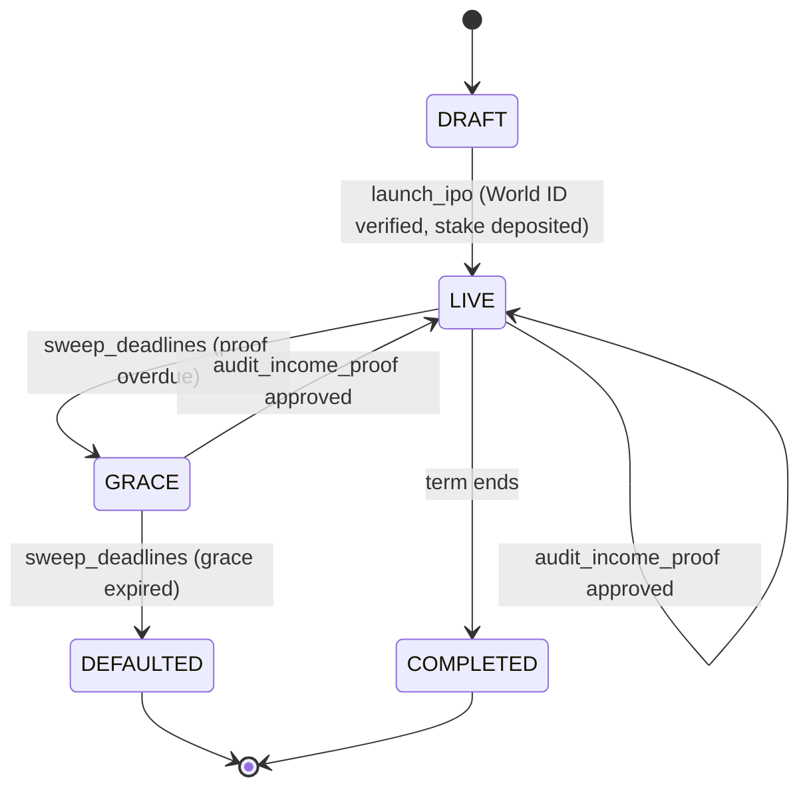
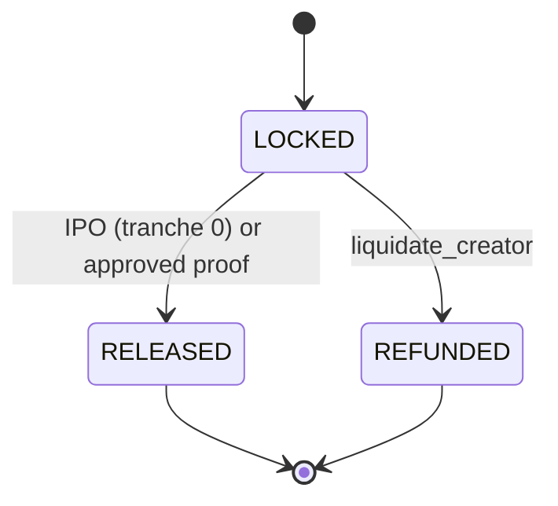
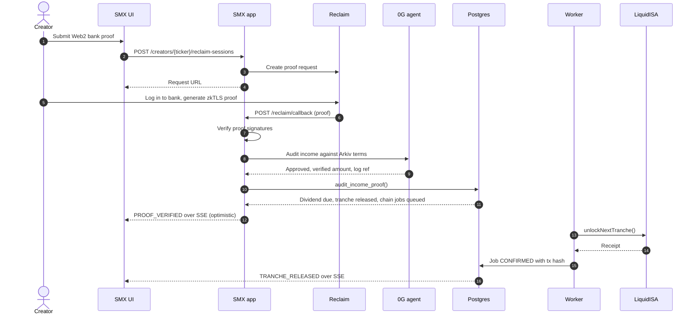
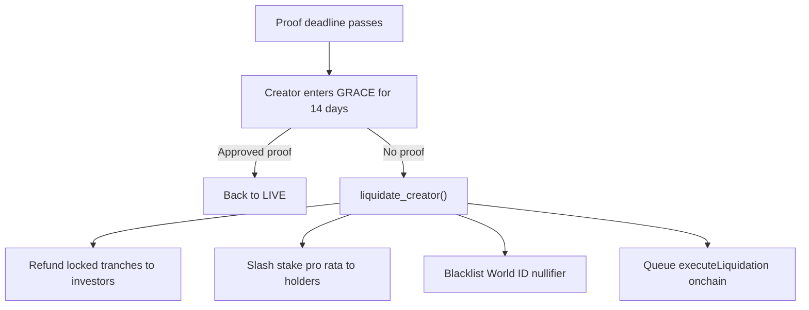

# StakeMe Exchange (SMX) product and system spec

This is the source of truth for what SMX does. For how to write the code, see
[`engineering-guide.md`](engineering-guide.md). When the two disagree about
architecture or code style, the engineering guide wins. When this spec and the
guide's placeholders differ, use the values in [Project constants](#project-constants).

## Product

SMX is a liquid stock market for human potential. A creator "IPOs" a share of
their future income through a liquid income share agreement (L-ISA): a fixed
percentage of income (default 5%, `share_bps = 500`) for a fixed term (default
60 months), with no dollar cap. Investors fund the raise in USDC and receive
creator tokens (for example, `$MUSH`). Token holders earn dividends from
verified Web2 income and can trade tokens on an exchange.

Built for ETHGlobal Mumbai (hackathon MVP). Demo must run end to end on a
laptop with no paid services and no testnet keys (simulated chain mode).

### Sponsor integrations

| Sponsor | Role in SMX | Demo fallback |
| --- | --- | --- |
| World ID | Proves the creator is a unique human. Nullifier is stored and can be blacklisted. | World ID Simulator (staging app id). |
| Reclaim Protocol | zkTLS proof of a Web2 bank deposit (`/mock-bank` page shows a hardcoded $5,000 deposit). | `@reclaimprotocol/js-sdk` with a dev app id; a signed fixture proof when `DEMO_MODE=1`. |
| Hedera | EVM chain for `LiquidISA` and creator tokens. x402-style gasless dividend streaming. | Hedera testnet JSON-RPC relay. |
| 0G | AI audit agent that approves milestones and computes dividends; audit logs stored on 0G. | Deterministic rules engine in SQL when no 0G key. |
| Chainlink CRE | Orchestrates the proof → audit → onchain call workflow. | Same workflow runs in the pgmb worker. |
| Arkiv | Immutable storage of the L-ISA terms. Requires `/arkiv/schema.md` and `/arkiv/friction.md` at repo root. | Local record with a content hash. |
| Arc | Paymaster RPC for gasless investor transactions. | Not required in simulated mode. |

## Project constants

| Placeholder | Value |
| --- | --- |
| `{{PROJECT_NAME}}` | StakeMe Exchange (SMX) |
| `{{SCOPE}}` | `@stakeme` |
| `{{SCHEMA}}` | `smx` |
| `{{PORT}}` | `4020` |
| Local Docker Postgres host port | `5442` (container 5432) to avoid conflicts |
| Repo | `github.com/predatorx7/stakeme-ex` |

Packages:

```
packages/
	app/        @stakeme/app        Backend + server-rendered exchange UI. Owns openapi.yaml, sql/, migrations/.
	client/     @stakeme/client     Typed SDK generated from app/openapi.yaml.
	contracts/  @stakeme/contracts  Hardhat 3 + viem. LiquidISA.sol, share token, tests, Ignition deploys. Exports ABIs as `.gen.ts`.
```

Architecture follows Builder (Express 5 + OpenAPI + PGTyped + Kita TSX + htmx
+ `@reclaimprotocol/design`). We don't use Next.js, React, wagmi, or recharts:
use `viem` in browser modules, Builder's TSX chart components, and
`@worldcoin/idkit-core` (framework-neutral) for World ID.

## Domain model (schema `smx`)

Money is `money_amount NUMERIC(18,6)` (USDC has 6 decimals). Token amounts are
`token_amount NUMERIC(38,18)`. Wallet addresses use a domain
`evm_address CITEXT CHECK (VALUE ~ '^0x[0-9a-fA-F]{40}$')`. Tx hashes use
`tx_hash TEXT CHECK (VALUE ~ '^0x[0-9a-f]{64}$')`.

| Table | Purpose |
| --- | --- |
| Better Auth tables | Users and sessions. Sign-in with Ethereum (SIWE) plugin; wallet address on the user. |
| `creators` | One L-ISA per creator: `ticker` (3–6 upper letters, unique), `display_name`, `headline`, `share_bps`, `term_months`, `target_raise`, `stake_amount`, `status creator_status`, `world_id_nullifier` (unique), `arkiv_entity_key`, `terms_hash`, `contract_address`, `token_address`, `chain_id`, `next_proof_due_at`, `grace_until`, `ipo_at`. |
| `tranches` | Escrow schedule per creator: `idx`, `amount`, `status tranche_status ('LOCKED','RELEASED','REFUNDED')`, `released_at`, `tx_hash`. Default schedule 20% / 40% / 40%. Tranche 0 releases on IPO. |
| `investments` | Primary-market purchases: investor `wallet`, `usdc_amount`, `token_amount`, `tx_hash`. |
| `holdings` | Derived balances per (creator, wallet). Updated by investments and trades. |
| `pools` | Simulated constant-product AMM per creator (`usdc_reserve`, `token_reserve`). Seeded at IPO. |
| `trades` | `side trade_side ('BUY','SELL')`, amounts, price, wallet. |
| `price_ticks` | Price history for charts (`at`, `price`). One tick per trade and per oracle event. |
| `income_proofs` | Reclaim proof per period: `period` (month index), `provider`, `reclaim_proof_id`, `verified_amount`, `status proof_status ('PENDING','APPROVED','REJECTED')`, `audit jsonb` (0G output), `audit_log_ref` (0G storage root). |
| `dividends` | `amount_due` = `verified_amount * share_bps / 10000`, `status dividend_status ('DUE','PAID')`, `paid_tx_hash`. |
| `oracle_events` | Live feed: `kind oracle_event_kind ('IPO','INVESTED','PROOF_VERIFIED','PROOF_REJECTED','TRANCHE_RELEASED','DIVIDEND_PAID','GRACE_STARTED','DEFAULTED','TRADE')`, `creator_id`, `payload jsonb`. Published to pgmb for SSE. |
| `chain_jobs` | Outbox of onchain calls (`fn`, `args jsonb`, `status ('QUEUED','SENT','CONFIRMED','FAILED','SIMULATED')`, `tx_hash`). Optimistic UI reads DB state; the worker confirms later. |
| `blacklisted_nullifiers` | World ID nullifiers banned after default. |

`creator_status`: `'DRAFT','LIVE','GRACE','DEFAULTED','COMPLETED'`.



Tranche lifecycle:



### Business logic in SQL

Write these as SQL functions in `ddl.sql`, called from `queries.sql`:

- `smx.launch_ipo(...)`: asserts the nullifier isn't blacklisted or used,
  creates the creator, tranches, pool, first tick, `IPO` event, and a
  `chain_jobs` row for `initializeIPO`; releases tranche 0.
- `smx.record_investment(creator, wallet, usdc)`: mints tokens 1:1 at the IPO
  price (1 USDC = 1 token), caps at `target_raise`, updates holdings.
- `smx.amm_swap(creator, wallet, side, amount_in)`: constant product with 0.3%
  fee, slippage guard `min_out`, updates pool, holdings, trades, ticks. Rejects
  when the creator is `DEFAULTED`.
- `smx.audit_income_proof(proof_id, verified_amount, audit jsonb)`: rules
  engine. Approve when `verified_amount >= min_income` (default 1000 USDC) and
  the period isn't already approved. On approval: create the dividend, release
  the next locked tranche, move `next_proof_due_at` by 30 days, clear grace,
  insert `PROOF_VERIFIED` and `TRANCHE_RELEASED` events and chain jobs.
- `smx.pay_dividend(dividend_id, tx_hash)`: marks paid and emits
  `DIVIDEND_PAID` with a per-holder split (pro rata by holdings).
- `smx.sweep_deadlines(now)`: `LIVE` creators past `next_proof_due_at` enter
  `GRACE` for 14 days; `GRACE` creators past `grace_until` are liquidated.
- `smx.liquidate_creator(creator)`: refunds locked tranches pro rata to
  investors, slashes the stake pro rata to holders, blacklists the nullifier,
  sets `DEFAULTED`, emits `DEFAULTED`, queues `executeLiquidation`.

## Smart contracts (`packages/contracts`)

- `CreatorShareToken.sol`: ERC-20 (OpenZeppelin), minted only by its
  `LiquidISA`. Hooks into dividend accounting on transfer.
- `LiquidISA.sol`: one per creator, deployed by `LiquidISAFactory.sol`.
  - State: `usdc`, `creator`, `oracle`, `totalRaise`, `escrowBalance`,
    `creatorStake`, `shareBps`, `termEnd`, `tranches[]`, `nextTranche`,
    `defaulted`.
  - `initializeIPO()`: creator deposits the USDC stake.
  - `invest(amount)`: investor deposits USDC, receives tokens 1:1, funds
    escrow. Releases tranche 0 when the raise target is met (or on
    `closeRaise()` by the creator).
  - `unlockNextTranche()`: only the oracle. Transfers the next tranche to the
    creator.
  - `distributeDividend(amount)`: anyone (usually the creator) deposits USDC;
    accrues through a dividend-per-share accumulator (`magnifiedDividendPerShare`),
    holders `claim()`. O(1) gas regardless of holder count.
  - `executeLiquidation()`: only the oracle. Moves remaining escrow and the
    stake into the dividend accumulator as refunds, sets `defaulted`, emits
    `CreatorDefaulted(nullifierHash)`.
  - `MockUSDC.sol` (6 decimals, public mint) for testnets.
- Networks: `hardhatMainnet` (simulated), `hederaTestnet` (chain 296),
  `sepolia`, `ogGalileo` (0G Galileo testnet). Keys come from Hardhat
  configuration variables, never committed.
- ABIs are exported from `packages/contracts/src/abis.gen.ts` and imported by
  the app as `@stakeme/contracts`.

## Routes (operation ids)

Pages render HTML; the same handler returns JSON by content negotiation.

| Method and path | operationId | Notes |
| --- | --- | --- |
| `GET /` | `GetExchange` | Trending creators, price, 24h change, chart, live oracle events (SSE). |
| `GET /creators/{ticker}` | `GetCreator` | Token page: chart, terms, escrow progress, buy/sell form, holders, events. |
| `GET /hub` | `GetCreatorHub` | Viewer's creator dashboard: escrow, Reclaim proof button, pending dividend, collateral. |
| `GET /launch` | `GetLaunch` | IPO form gated by World ID. |
| `POST /creators` | `LaunchIpo` | Body includes the World ID proof; server verifies it. |
| `POST /creators/{ticker}/investments` | `Invest` | Primary market. |
| `POST /creators/{ticker}/trades` | `Trade` | Simulated AMM (`side`, `amountIn`, `minOut`). |
| `POST /creators/{ticker}/reclaim-sessions` | `CreateReclaimSession` | Returns the Reclaim request URL and status URL. |
| `POST /reclaim/callback` | `ReclaimCallback` | Reclaim posts the proof here. |
| `POST /api/audit-milestone` | `AuditMilestone` | Accepts a Reclaim proof JSON, verifies, runs the 0G audit, calls `audit_income_proof`. |
| `POST /api/trigger-default` | `TriggerDefault` | Demo only (`DEMO_MODE=1`): fast-forwards the deadline and liquidates. |
| `POST /dividends/{dividendId}/payment` | `PayDividend` | Creator pays the dividend. |
| `GET /events` | `StreamEvents` | SSE stream of `oracle_events` via pgmb. |
| `GET /mock-bank` | `GetMockBank` | Fake bank page with a $5,000 deposit for the Reclaim provider. |
| `GET /healthz` | (built in) | |

## Income proof flow



## Liquidation flow



## Optimistic UI

Every mutation writes final state to Postgres in one statement and returns
immediately. Onchain calls go to `chain_jobs`; the worker sends them with
`viem` and updates `tx_hash` and status. The UI shows a pending badge until an
SSE event confirms. In simulated mode (no `CHAIN_RPC_URL`), jobs end as
`SIMULATED` with a deterministic fake hash.

## Demo script

See the pitch section of the playbook in [`pitch.md`](pitch.md). The happy
path (Ravi) and sad path (Rahul) must be reproducible with `npm run seed:demo`.
