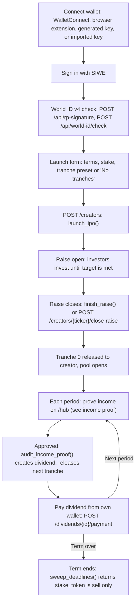
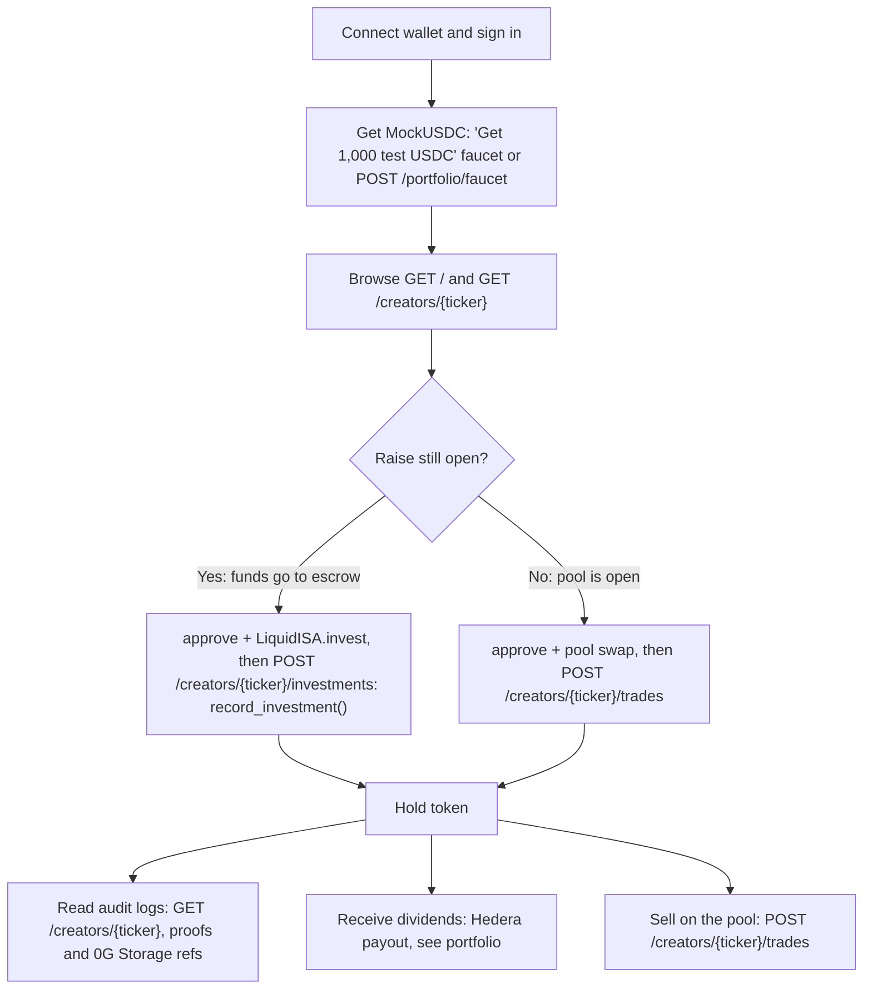
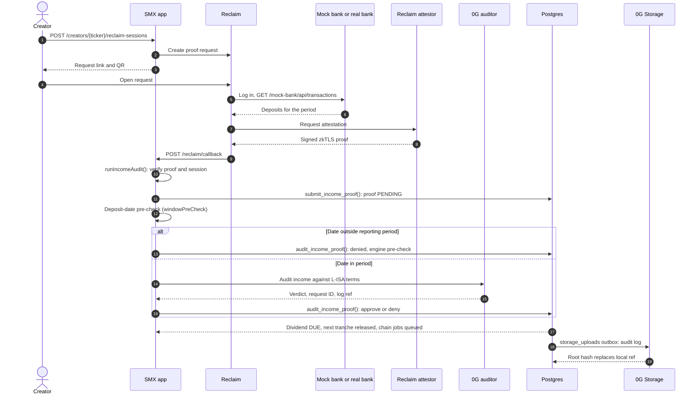
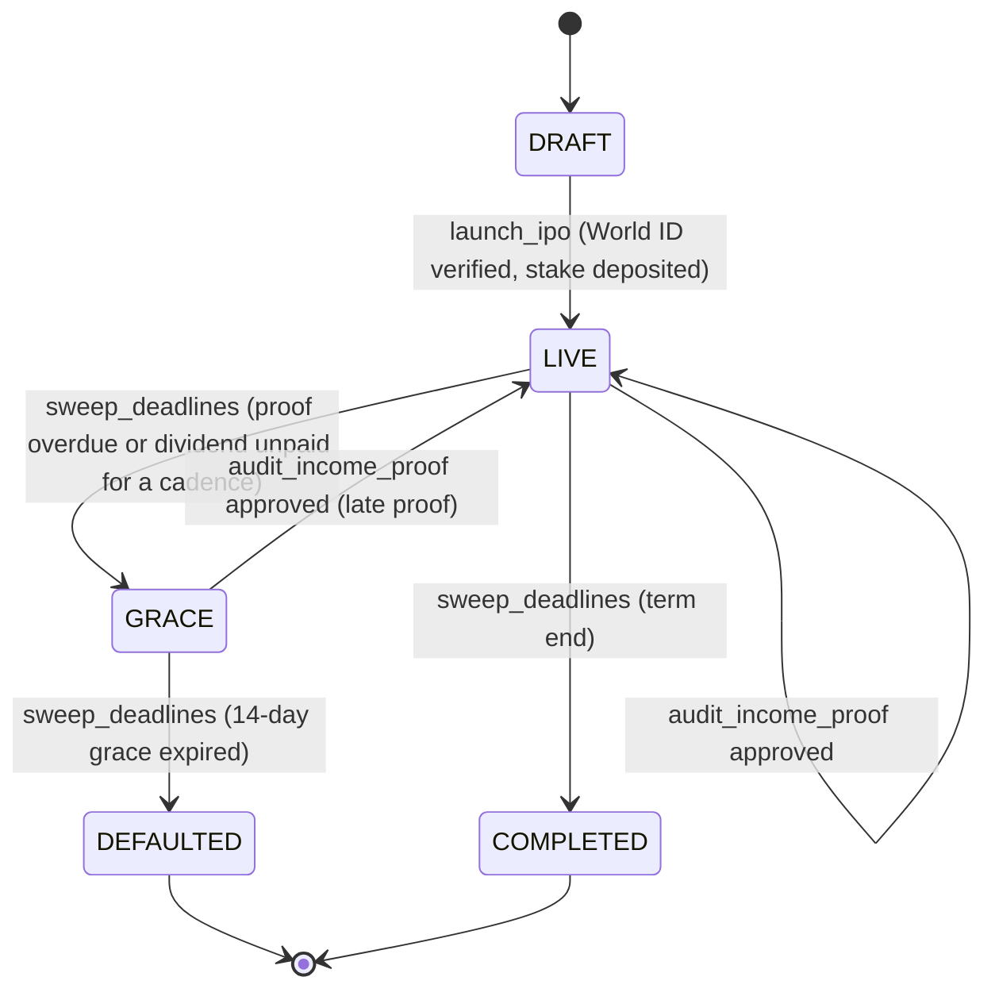
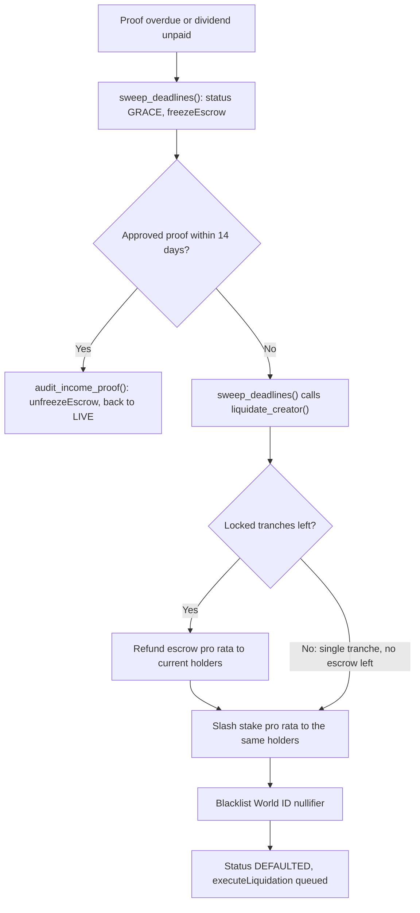
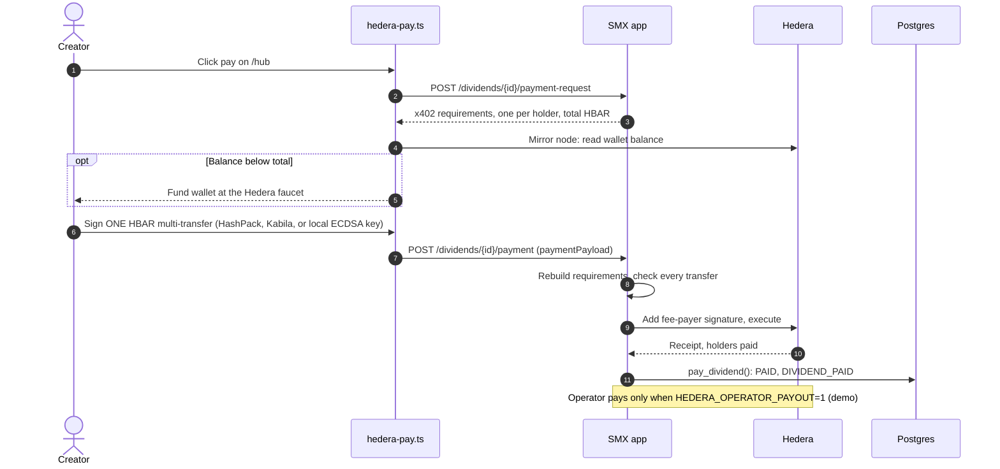

# User flows

This page shows how creators and investors move through StakeMe Exchange
(SMX), and how the money, proofs, and states change along the way. Route and
SQL function names label the edges so you can find each step in the code. For
the full spec, see [product-spec.md](product-spec.md).

Actors in every diagram:

- **Creator**: the person who IPOs a share of their income.
- **Investor**: a wallet that funds the raise or trades the token.
- **SMX app**: the Express server and its worker.
- **0G auditor**: the agent on 0G Private Computer, through the 0G Router.

## Creator journey

A creator connects a wallet, proves they're a unique human, launches the IPO,
and then proves income each period. Each approved proof creates a dividend and
unlocks the next tranche.

Notes:

- The browser module `wallet.ts` offers WalletConnect, an injected extension
  (only when `window.ethereum` exists), a generated local key, or an imported
  key.
- `POST /api/world-id/check` rejects a used nullifier (409) or a blacklisted
  one (403) before `POST /creators` verifies the proof again on the server.
- `launch_ipo()` creates the tranches, all `LOCKED`, and queues the 0G Storage
  upload of the terms. It also queues the `createISA` and `initializeIPO`
  chain jobs.
- With the **No tranches** preset (`single`), 100% of the raise releases at
  close and no escrow milestones remain, so approved proofs only create
  dividends.

## Investor journey

An investor needs MockUSDC, then either invests in the primary raise (escrow)
or buys on the pool once the raise closes. Both paths are signed in the
investor's own wallet.

Notes:

- With an onchain pool, `Invest` and `Trade` take the `txHash` of the
  user-signed transaction. The server verifies the receipt and indexes it
  (`ingest_onchain_invest()`, `ingest_onchain_swap()`).
- Without a pool (simulated chain mode), the same routes run the SQL purchase
  and `amm_swap()`.
- After a default, `amm_swap()` rejects trades. After the term ends, the token
  is sell only.

## Income proof sequence

The creator proves a bank deposit with a Reclaim zkTLS proof. SMX verifies it,
the 0G auditor decides, and SQL applies the verdict. If 0G can't answer, the
proof stays `PENDING`.

Notes:

- `ReclaimCallback` and `AuditMilestone` share `runIncomeAudit()`. The session,
  org, and creator come from the `reclaim_sessions` row, never from the body.
- A callback answers `201` when audited, `202` when 0G was unavailable (proof
  stays `PENDING`), and `200` for duplicates and rejected deliveries.
- The app uses the pre-check result before any 0G call, so the log says 0G
  didn't decide it.
- The rules engine runs only with `ZG_ALLOW_RULES_FALLBACK=1`, and the UI
  labels it. A model answer that breaks the rules is overridden in SQL.
- The mock bank offers six income scenarios. A real bank works the same way
  through its own Reclaim provider.
- In `DEMO_MODE=1`, the Hub can post a fixture proof to `POST /api/audit-milestone`
  instead.

## Creator state machine

`creators.status` is `DRAFT`, `LIVE`, `GRACE`, `DEFAULTED`, or `COMPLETED`.
The worker runs `sweep_deadlines()` on a timer, and approved proofs move the
state back.

Notes:

- Entering `GRACE` freezes the escrow (`freezeEscrow`, `ESCROW_FROZEN`). A late
  approved proof unfreezes it (`unfreezeEscrow`, `ESCROW_UNFROZEN`).
- Entering `COMPLETED` returns the stake (`reclaimStake`, `STAKE_RETURNED`).
  The token becomes sell only.

## Default and recovery path

A missed proof starts a 14-day grace period with a frozen escrow. A late
approved proof recovers the creator. Otherwise `liquidate_creator()` pays
holders and bans the creator's World ID.

Notes:

- Holders are the current token holders (by `holdings`), not the original
  investors.
- A single-tranche creator has no escrow after the raise closes, so holders
  recover only the stake.
- While the escrow is frozen, tranche unlocks, `reclaimStake`, and pool
  trading stop. Claims and liquidation still work.

## Dividend payment

After an approved proof, the dividend is `DUE`. The creator funds their own
Hedera wallet, signs one multi-transfer, and SMX settles it. The operator pays
only in demo mode.

Notes:

- HBAR amounts use the testnet rate `DIVIDEND_HBAR_PER_USDC`, 0.0001 HBAR per
  USDC by default.
- The worker (`streamPaidDividend`) handles `DIVIDEND_PAID` events. With live
  Hedera keys, it spends the operator's HBAR only when
  `HEDERA_OPERATOR_PAYOUT=1`, and it skips dividends the creator already
  settled.
- Without a signed payload, `PayDividend` only marks the dividend paid, and the
  worker's operator payout covers holders in demo mode.
