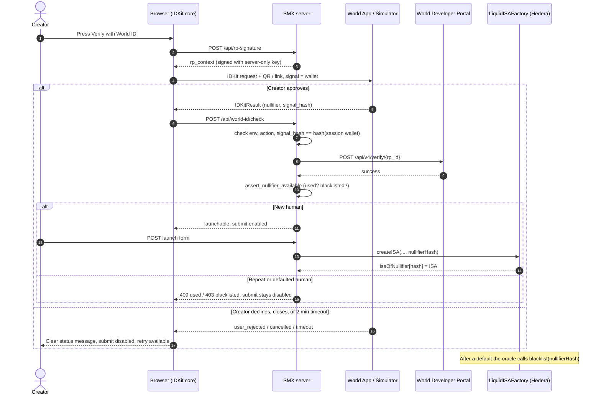

# World ID integration debrief and trust moment

Prize track: World, [Best Use of IDKit](https://ethglobal.com/events/mumbai/prizes/world).
The page asks teams to "Clearly explain the specific product event requiring trust",
justify "why the chosen credential is the minimum sufficient assurance",
"Demonstrate a successful verification and one meaningful alternative path, such as
cancellation, unavailable credential, rejection", and "Include a short integration
debrief/feedback" (time to first success, friction, missing capabilities or docs, the
single improvement with the greatest impact). Page re-read 2026-11-06.

## The trust moment

**Event:** a creator presses "Launch IPO" on `/launch`. SMX is a stake-backed income
securities exchange: investors buy a share of one creator's future income. Before the
creator can raise money, investors need to know one thing about that person: **this is
one human who has not already launched, and has not already defaulted.**

World ID changes what an investor can trust at exactly this point:

- **One creator, one IPO.** The proof yields a nullifier scoped to the action
  `smx-launch-ipo`. The same human always produces the same nullifier, so a second
  launch under a second wallet is rejected (HTTP 409, or `NullifierUsed` onchain).
- **Defaulters cannot come back.** When a creator defaults, the oracle blacklists the
  nullifier (`blacklisted[nullifierHash]` on `LiquidISAFactory`). A new wallet, new
  email and new SIWE session still map to the same human, so the relaunch is
  refused (HTTP 403, or `NullifierBlacklisted` onchain). Without this, default is
  free: the creator walks away from investors and restarts under a new address.

**Why proof of human is the minimum sufficient assurance.** SMX needs uniqueness of a
person, not identity, age, nationality or document data. Proof of human (the Orb
credential, requested with the `proofOfHuman` preset) is the weakest credential that
gives a per-person, action-scoped, unlinkable nullifier. A device or phone credential is
cheaper to farm, so it would not stop a Sybil relaunch. A document or passport
credential would collect more than SMX needs and adds no uniqueness SMX lacks. We use
one credential and no more.

## What we built

- Creator row stores the nullifier (`creators.world_id_nullifier`, unique); a
  `blacklisted_nullifiers` table is written on default.
- The browser flow is `packages/app/src/client/world-id.ts`; server code is
  `packages/app/src/integrations/world-id.ts`, `routes/CreateRpSignature.ts` and
  `routes/CheckWorldId.ts`. `LaunchIpo` repeats the checks, so skipping the pre-check
  gains nothing.
- The same nullifier is also stored onchain in the factory
  (`isaOfNullifier`, `blacklisted`), so the rule holds even if the SMX database is
  ignored.

## How IDKit v4 is used

- Package: `@worldcoin/idkit-core` 4.6.0, loaded by dynamic `import()` on click so it
  stays out of the main bundle. The React package `@worldcoin/idkit` is not used
  because SMX is server-rendered HTML with small client modules.
- `IDKit.request({ app_id, action, rp_context, allow_legacy_proofs: true, environment })`
  then `.preset(proofOfHuman({ signal }))`. The signal is the lowercase session wallet.
- We render `request.connectorURI` as a link and QR code ourselves, then
  `request.pollUntilCompletion({ timeout: 120_000, signal })`. The call returns a
  discriminated union and never throws.
- The result is posted unchanged to the server. We do not remap fields.

## Server RP signing

`POST /api/rp-signature` calls `signRequest` from `@worldcoin/idkit-core/signing` with
the Developer Portal signing key (`WORLD_RP_SIGNING_KEY`) and the action, and returns
`{ rp_id, nonce, created_at, expires_at, signature }`. The key never reaches the
browser. The signal comes from the authenticated SIWE session, never the request body.
A fresh signature is fetched for every attempt, which is also what makes retry safe.

## The v4 verify call

`POST https://developer.world.org/api/v4/verify/{rp_id}` with the IDKit result as the
body. Before it, the server checks `environment` and `action` match config and that
`responses[0].signal_hash` equals `hashSignal(session wallet)`, so a proof cannot be
replayed for another wallet. Success requires HTTP 200 and `success: true`.

## Nullifier storage, registry, Sybil and blacklist

The Portal verifies proofs but does not track duplicates; that is our job. The
nullifier is parsed with BigInt (v4 gives decimal, v3 legacy gives hex) and stored as
`NUMERIC`. `smx.assert_nullifier_available` raises 403 (blacklisted) or 409 (used)
before any 0G Storage write or chain call. Onchain, `LiquidISAFactory.createISA`
reverts with `NullifierBlacklisted` or `NullifierUsed`; `blacklist` and
`blacklistFromISA` set `blacklisted[hash]`. Changing `WORLD_ACTION` would reset
uniqueness, so there is one action id for launches.

## Success and alternative paths (all real IDKit flow)

| Path | How to reproduce | What the user sees |
| --- | --- | --- |
| Success | Simulator, Paste code, approve | "Verified as a unique human.", submit enabled |
| Decline in World App or Simulator | Paste code, then decline | "You declined the request in World App. Press Verify with World ID to retry.", submit disabled |
| Cancel in SMX | Click Verify again while waiting | "Verification cancelled. ...", QR cleared, submit disabled |
| Timeout | Do nothing for 2 minutes | "Timed out waiting for World App ...", submit disabled |
| Credential unavailable | World ID without the credential | "This World ID has no proof-of-human credential ..." |
| Repeat human (Sybil) | Verify the same Simulator identity for a second creator | "Rejected: ..." from `/api/world-id/check` (409) |
| Blacklisted human | Verify as a defaulted creator | "Rejected: ..." (403) |

Every non-success result clears the hidden proof field, keeps submit disabled and
leaves the Verify button usable. Error codes come from `IDKitErrorCodes` in
`@worldcoin/idkit-core`; unknown codes show the raw code.

## Integration debrief

- **Time to first success:** TODO(team): fill in the real number from your own
  timeline before submitting; it was not measured. Most of the time went to choosing
  the package and learning the v4 RP flow (below). Once `signRequest` and
  `IDKit.request` were wired, a verification took minutes.
- **Friction:**
  1. Docs and playbooks point to `@worldcoin/idkit` (React). We had no React, and had to
     find that `@worldcoin/idkit-core` is the framework-neutral v4 client with
     `/signing` and `/hashing` subpaths.
  2. v4 needs an RP (`rp_id`) plus a signing key in addition to `app_id`. This is a new
     concept versus v3 and old examples (`/api/v2/verify/{app_id}`) still rank high.
  3. Environment mismatch (staging action versus Simulator versus production) fails
     quietly. A mismatch gives little signal about which side is wrong.
  4. Nullifiers are 256-bit; v4 returns decimal and legacy v3 returns hex. We had to
     parse both with BigInt.
  5. `pollUntilCompletion` is a good API (never throws), but the error enum is only
     discoverable in `.d.ts`, not in the docs.
- **Missing capabilities or documentation:** no server-side "has this nullifier been
  used" lookup (we keep our own); no documented way to pre-check a nullifier before the
  user opens World App, so a blacklisted human still goes through the approval before
  being refused; no documented way to close a pending request from the dApp (we
  only abort our local poll); no
  Simulator walkthrough for IDKit v4 URIs with the exact paste format.
- **Single improvement with the greatest impact:** one end-to-end, framework-neutral
  v4 quickstart (browser plus server, with the RP signature, verify call and the error
  codes), linked from the top of the IDKit docs, with the old v2/v3 endpoints clearly
  marked as legacy.

## What we cannot meet, honestly

- **World ID Agent Pass ($5,000):** not met. SMX integrates IDKit proof of human only.
  We did not integrate Agent Pass, so we are not entering that track. Best Use of IDKit
  is the only World prize we claim.
- **Proof of the real phone/Orb flow:** verification was tested end to end with the
  World ID Simulator on the staging environment only. The staging nullifier is not a
  real person, so the Sybil guarantee is shown against Simulator identities, not Orb
  users.
- **Cancel path recording:** the cancel and decline handling is implemented against the
  `IDKitErrorCodes` shapes from the library types. Reproducing it through the live
  Simulator is a manual step before recording the demo video.
- **Pre-check before the modal:** the nullifier is checked after IDKit returns, not
  before (see the missing capabilities above).
